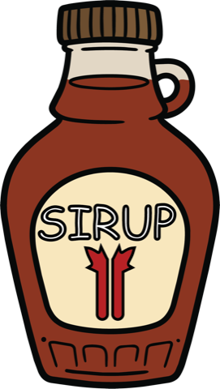

# SIRUP: Spatial Immune Receptor Utilities Package

<div markdown="1" style="background: #ffedcc; padding: 12px; margin-bottom: 24px; line-height: 24px;">
  <p style="margin: -12px -12px 12px; padding: 6px 12px; background: #d6b676; color: #ffffff; font-weight: 700;">Under construction</p>
  This site is still under construction. Be aware that some information may be missing or incorrect.
</div>


SIRUP, the Spatial Immune Receptor Utilities Package, is an R package for working with
spatial adaptive immune receptor repertoire sequencing (spAIRR-seq) data. 
It works with B cell receptor (BCR) and T cell receptor
(TCR) sequences that have a spatial barcode, together with spatial gene
expression from the same tissue section. Isn't that sweet?

SIRUP helps you:

1. **Process.** Convert demultiplexed long-read spatial immune receptor sequences 
   into high-quality consensus receptor sequences for each spatial location.
   Outputs an [AIRR rearrangement style table](https://docs.airr-community.org/en/latest/datarep/rearrangements.html).
2. **Integrate.** Combine spatially-resolved immune receptors and a Seurat spatial
   transcriptomics object into one unified SIRUP object. The SIRUP object can hold
   multiple spatial tissue sections, as well as associated non-spatial AIRR-seq data
   from bulk or single-cell experiments.
3. **Analyze and visualize.** Select regions of interest through *in silico* micro-dissection,
   measure clonal dominance and diversity within ROIs, test spatial patterns,
   build lineage trees and visualize them over tissue, and more!

<div markdown="1" style="background: #ffedcc; padding: 12px; margin-bottom: 24px; line-height: 24px;">
  <p style="margin: -12px -12px 12px; padding: 6px 12px; background: #d6b676; color: #ffffff; font-weight: 700;">Did you know?</p>
  Maple syrup has been spelled [maple sirup](https://maplesyruphistory.com/2022/09/04/the-origins-of-the-spelling-of-maple-sirup-with-an-i/) at different points of U.S. history.
</div>

## Getting started

Start with [Get started with SIRUP](vignettes/get-started.md). It takes about 15
minutes and uses example data that comes with the package. You build a SIRUP
object, plot receptors on the tissue, and measure clonal dominance in a region.

Install SIRUP from GitHub with BiocManager, which will also install dependencies:

```r
if (!requireNamespace("BiocManager", quietly = TRUE)) install.packages("BiocManager")
BiocManager::install("hoehnlab/SIRUP")
```

Use R 4.1 or later.

## Contents

**Tutorials**

* [Process demultiplexed reads](vignettes/processing.md). Turn
  demultiplexed reads into a table of consensus BCR or TCR sequences.
* [Draw tissue regions and measure clonal dominance and
  diversity](vignettes/regions.md). Compare the repertoires of regions such as
  germinal centers.
* [Call clones and build lineage trees on the
  tissue](vignettes/clones-and-trees.md). Build trees with Dowser and show them
  on the H&E image.
* [Test spatial patterns of genes, cells, and
  clones](vignettes/spatial-statistics.md). Run Moran's I, Lee's L, Ripley's
  cross K, and join counts.
* [Analyze several sections with bulk AIRR-seq and
  blood](vignettes/multisample.md). Combine sections, bulk data, and blood in
  one object.

**Guides**

* [How the SIRUP object works](vignettes/sirup-object.md). The five parts of the
  object, and the rules that SIRUP checks.
* [Choose a spatial statistic](vignettes/choose-spatial-statistic.md). Match
  your question to a function.

**For AI Assistants and/or LLMs**

AI assistants and other automated agents can read two files in the SIRUP repository:

* [llms.txt](https://github.com/hoehnlab/SIRUP/blob/main/llms.txt) is a short index of the SIRUP documentation. It links to each tutorial, guide, and function page.
* [llms-full.txt](https://github.com/hoehnlab/SIRUP/blob/main/llms-full.txt) joins the whole documentation into one file. It holds every tutorial, guide, and function page.

## Contact

If you need help or have a question, contact the [Hoehn Lab](https://sites.dartmouth.edu/hoehn/).
To report a bug or ask for a feature, open an issue on the
[issue tracker](https://github.com/hoehnlab/SIRUP/issues).

## Dependencies

**Depends:** R (>= 4.1.0)  
**Imports:** airr, airrblast, alakazam, cli, cowplot, data.table, dowser, dplyr, ggplot2, ggtree, grDevices, grid, igraph, kedd, KernSmooth, magrittr, Matrix, methods, parallel, patchwork, pbapply, RANN, rlang, scales, scoper, Seurat, SeuratObject, sf, shiny, spdep, stats, stringr, tibble, tidyr, tools, utils  
**Suggests:** ape, arrow, BiocNeighbors, knitr, nabor, pals, qpdf, rgl, rmarkdown, shazam, spatstat.explore, spatstat.geom, spatstat.random, testthat (>= 3.0.0), withr

## Authors

[Hunter J. Melton](mailto:Hunter.J.Melton@dartmouth.edu)<br>
Chinmay M. Vaidya<br>
Apekshya Panda<br>
Jessie J. Fielding<br>
Elizabeth Sergison<br>
Fred W. Kolling<br>
Kevin C. O'Connor<br>
[Kenneth B. Hoehn](mailto:Kenneth.B.Hoehn@dartmouth.edu)<br>


## Citing SIRUP

Melton HJ, Vaidya CM, Panda A, Fielding JJ, Sergison E, Kolling FW, O'Connor KC,
Hoehn KB. SIRUP, a toolkit for spatial B and T cell receptor repertoires, reveals
differences between normal and ectopic germinal centers in myasthenia gravis.
bioRxiv.

## License

MIT. See the
[LICENSE file](https://github.com/hoehnlab/SIRUP/blob/main/LICENSE).
