Get started with SIRUP
================

SIRUP (Spatial Immune Receptor Utilities Package) is an R package for
spatial adaptive immune receptor repertoire sequencing (spAIRR-seq). It
works with B cell receptor (BCR) and T cell receptor (TCR) sequences
that carry a spatial barcode, together with spatial gene expression from
the same tissue section.

SIRUP covers three stages:

1.  **Process.** Turn demultiplexed long reads into consensus receptor
    sequences in an AIRR table, with one spatial ID per sequence. See
    [Process reads into spatial AIRR tables](processing.md).
2.  **Integrate.** Put the receptor table and the spatial Seurat object
    into one SIRUP object. This vignette starts here.
3.  **Analyze and visualize.** Draw tissue regions, measure clonal
    dominance and diversity, test spatial association, and plot lineage
    trees on the tissue.

This vignette takes about 15 minutes. It shows the SIRUP object, the
main plots, and a first regional analysis. The other vignettes go
deeper:

| Vignette | Topic |
|----|----|
| [Process reads into spatial AIRR tables](processing.md) | Reads to AIRR tables with IgBLAST and pRESTO |
| [Tissue regions, clonal dominance, and diversity](regions.md) | Tissue regions, clonal dominance, and diversity |
| [Spatial statistics for genes, cells, and clones](spatial-statistics.md) | Moran’s I, Lee’s L, Ripley’s cross K, join counts |
| [Clones and lineage trees on the tissue](clones-and-trees.md) | Clones, germlines, and lineage trees on the tissue |
| [Several sections, bulk AIRR-seq, and blood](multisample.md) | Several sections, bulk AIRR-seq, and blood |

## Installation

Install SIRUP from GitHub:

``` r
if (!requireNamespace("remotes", quietly = TRUE)) install.packages("remotes")
if (!requireNamespace("SIRUP", quietly = TRUE)) remotes::install_github("hoehnlab/SIRUP")
```

SIRUP uses Seurat objects for spatial expression. SIRUP installs the
packages that most analysis functions need. These include packages from
the Immcantation framework (such as dowser, scoper, and alakazam) and
from the spatial statistics community (such as spdep). A few packages
are optional. The vignettes use them. This code installs only the
optional packages that you do not have yet:

``` r
packages <- c("spatstat.explore", "spatstat.geom", "spatstat.random", "pals")
missing <- packages[!vapply(packages, requireNamespace, logical(1), quietly = TRUE)]
if (length(missing) > 0) install.packages(missing)
```

The processing step also needs command-line tools: IgBLAST, pRESTO,
vsearch, and MUSCLE. The airrblast R package, which SIRUP installs, runs
IgBLAST. You need them only to process raw reads. The processing
vignette tells you how to set them up.

## The example data

SIRUP includes a small spAIRR-seq data set from the thymus of a patient
with myasthenia gravis (MG). The thymus in MG can contain ectopic
germinal centers (eGCs): germinal centers that form outside the lymph
nodes and tonsils. The data come from two 10x Visium sections of the
same thymus. Each 55 µm spot can hold several cells.

The files are in the package `extdata` folder:

``` r
extdata <- system.file("extdata", package = "SIRUP")
list.files(extdata)
#>  [1] "mg_thymus_bulk_blood_month0_1.tsv.gz" 
#>  [2] "mg_thymus_bulk_blood_month0_2.tsv.gz" 
#>  [3] "mg_thymus_bulk_blood_month12_1.tsv.gz"
#>  [4] "mg_thymus_bulk_blood_month12_2.tsv.gz"
#>  [5] "mg_thymus_bulk_thymus_1.tsv.gz"       
#>  [6] "mg_thymus_bulk_thymus_2.tsv.gz"       
#>  [7] "mg_thymus_cell_types.csv.gz"          
#>  [8] "mg_thymus_slice1_bcr.tsv.gz"          
#>  [9] "mg_thymus_slice1_gc_polygons.csv"     
#> [10] "mg_thymus_slice1_spatial.rds"         
#> [11] "mg_thymus_slice2_bcr.tsv.gz"          
#> [12] "mg_thymus_slice2_gc_polygons.csv"     
#> [13] "mg_thymus_slice2_reads.tsv.gz"        
#> [14] "mg_thymus_slice2_spatial.rds"         
#> [15] "mg_thymus_slice2_tcr.tsv.gz"          
#> [16] "sirup_synthetic.rds"
```

| File | Contents |
|----|----|
| `mg_thymus_slice*_spatial.rds` | Seurat object for each section: every spot, a panel of genes, and a lowres H&E image |
| `mg_thymus_slice*_bcr.tsv.gz` | IGH consensus sequences of each section, as `processSpatialSample()` wrote them |
| `mg_thymus_slice2_tcr.tsv.gz` | TRB consensus sequences of section 2 |
| `mg_thymus_bulk_*.tsv.gz` | Bulk BCR-seq of the thymus, and of blood at the thymectomy and 12 months later (a subset) |
| `mg_thymus_slice*_gc_polygons.csv` | Hand-drawn outlines of the eGCs in each section |
| `mg_thymus_cell_types.csv.gz` | cell2location cell-type proportions for each spot |
| `mg_thymus_slice2_reads.tsv.gz` | A sample of read-level IgBLAST output for the processing vignette |

The receptor files are AIRR rearrangement tables from the SIRUP paper.
To keep the package small, the Seurat objects hold a few hundred genes
and a reduced H&E image.

This vignette uses section 2 only. The multi-sample vignette uses both
sections and the bulk data.

``` r
library(SIRUP)
library(dplyr)
library(ggplot2)
```

``` r
thymus <- readRDS(file.path(extdata, "mg_thymus_slice2_spatial.rds"))
thymus
#> An object of class Seurat 
#> 506 features across 3203 samples within 2 assays 
#> Active assay: Spatial (449 features, 0 variable features)
#>  2 layers present: counts, data
#>  1 other assay present: alra
#>  1 spatial field of view present: thymus_slice2

bcrs <- airr::read_rearrangement(file.path(extdata, "mg_thymus_slice2_bcr.tsv.gz"))
bcrs %>%
  select(sequence_id, v_call, j_call, c_call, consensus_count) %>%
  head()
#> # A tibble: 6 × 5
#>   sequence_id         v_call                       j_call c_call consensus_count
#>   <chr>               <chr>                        <chr>  <chr>            <int>
#> 1 9,TGATTCCCGGTTACCT  IGHV2-5*02                   IGHJ4… IGHG1                1
#> 2 11,TGATTCCCGGTTACCT IGHV3-30*03,IGHV3-30*06      IGHJ4… IGHG1                1
#> 3 2,TGATTCCCGGTTACCT  IGHV5-51*01                  IGHJ5… IGHG2                1
#> 4 6,TGATTCCCGGTTACCT  IGHV5-51*01                  IGHJ5… IGHG2                1
#> 5 5,CCTACATTCACAGACG  IGHV3-23*01,IGHV3-23*04,IGH… IGHJ4… IGHG1                1
#> 6 3,CCTACATTCACAGACG  IGHV1-2*02,IGHV1-2*04        IGHJ4… IGHG1                1
```

Each row is one BCR sequence. The pipeline wrote the spot barcode into
`sequence_id`, after the comma. `extractSpatialIds()` copies it into its
own column, and the `suffix` argument adds `-1` so that it matches the
spot names in the Seurat object:

``` r
bcrs <- extractSpatialIds(
  bcrs,
  id = "sequence_id",
  spatial_id = "barcode_10x",
  regex = ",([ACGT]{16})$",
  suffix = "-1"
)

head(colnames(thymus))
#> [1] "AAACAAGTATCTCCCA-1" "AAACACCAATAACTGC-1" "AAACAGCTTTCAGAAG-1"
#> [4] "AAACAGGGTCTATATT-1" "AAACAGTGTTCCTGGG-1" "AAACATGGTGAGAGGA-1"
mean(bcrs$barcode_10x %in% colnames(thymus))
#> [1] 0.9373849
```

A few sequences have a barcode that is not in the Seurat object. The
spot was off the tissue or failed the expression QC. SIRUP keeps these
rows in the table, but it cannot put them on the tissue.

Keep the high-quality sequences. These are the thresholds from the SIRUP
paper (see [Process reads into spatial AIRR tables](processing.md)):

``` r
bcrs <- filterAirr(
  bcrs,
  locus_val = "IGH",
  min_v_length = 250,
  min_j_length = 30,
  min_junction_length = 10,
  productive_only = TRUE,
  min_consensus_count = NULL,
  spatial_id = "barcode_10x"
)
#> filterAirr kept 2195 of 3801 rows (dropped 1606).
bcrs <- filter(bcrs, !grepl("[^ACGT]", junction))
```

The last line removes the few sequences with an ambiguous base (such as
`N`) in the junction. scoper, which calls the clones below, needs
junctions of `A`, `C`, `G`, and `T` only.

## Create a SIRUP object

`createSIRUP()` joins the spatial data and the receptor table. You tell
it which receptor columns hold the spatial ID, the locus, and (when you
have them) the clone and a count or weight:

``` r
sirup <- createSIRUP(
  spatial = thymus,
  receptors = bcrs,
  spatial_id = "barcode_10x",
  locus = "locus",
  image_scale = "lowres",
  swap_coords = FALSE,
  metadata = list(tissue = "MG thymus", section = "slice 2")
)

sirup
#> <SIRUP object>
#> Spatial data:    Seurat, 3,203 spatial IDs, 449 genes, 1 image
#> Receptor data:   tibble, 2,105 receptor sequences x 56 columns
#> Spatial overlap: 797/868 receptor IDs in spatial data (91.8%)
#> Spatial ID field: barcode_10x
#> Analyses:        0
```

A SIRUP object is a list with five parts:

| Part        | Contents                            | Accessor         |
|-------------|-------------------------------------|------------------|
| `spatial`   | The Seurat object                   | `getSpatial()`   |
| `receptors` | The AIRR table, as a tibble         | `getReceptors()` |
| `metadata`  | Field names, image settings         | `x$metadata`     |
| `polygons`  | Tissue regions, one row per polygon | `getPolygons()`  |
| `analyses`  | Any results you choose to keep      | `getAnalysis()`  |

SIRUP records the field names once. After that, SIRUP functions find the
spatial ID, clone, and locus columns without more arguments. Your column
names do not need to match a convention.

`createSIRUP()` validates the object while building.

### Call clones

A clone is a group of B cells that descend from one ancestor cell. Many
SIRUP functions summarize receptors by clone. SIRUP does not call clones
itself. `updateReceptors()` runs a function on the receptor table and
puts the result back in the object. Here it runs
`scoper::hierarchicalClones()`, with the threshold from the SIRUP paper:

``` r
sirup <- updateReceptors(
  sirup,
  scoper::hierarchicalClones,
  threshold = 0.1,
  summarize_clones = FALSE,
  nproc = 1
)
#> Running defineClonesScoper in bulk mode and only keep heavy chains
sirup
#> <SIRUP object>
#> Spatial data:    Seurat, 3,203 spatial IDs, 449 genes, 1 image
#> Receptor data:   tibble, 2,105 receptor sequences x 57 columns
#> Spatial overlap: 797/868 receptor IDs in spatial data (91.8%)
#> Spatial ID field: barcode_10x
#> Clone ID field:  clone_id
#> Analyses:        0
```

The receptor table now has a `clone_id` column, and SIRUP records it as
the clone field. If your clone column has another name, such as
`clone_family_id`, give `clone = "clone_family_id"` to `createSIRUP()`.

### Image settings

Two settings control how SIRUP puts spots on the H&E image:

- `image_scale` tells SIRUP which scale factor to use. Use `"lowres"` or
  `"hires"` to match the image stored in the Seurat object.
  `Load10X_Spatial()` stores the lowres image by default. The example
  objects store a lowres image.
- `swap_coords` swaps the x and y coordinates. Some older Seurat objects
  store the coordinates in the opposite order to the image. If your
  spots form the right shape but sit rotated or mirrored over the H&E,
  set `swap_coords = TRUE`.

The object stores both settings. Every plot and spatial statistic reads
them from the object, so you set them once.

## Look inside the object

`summary()` gives counts for each part:

``` r
summary(sirup)
#> SIRUP summary
#>   Spatial IDs:      3,203
#>   Receptor records: 2,105
#>   Receptor IDs:     868
#>   Matched IDs:      797 (91.8%)
#>   Matched records:  1,965
#>   Image scale:      lowres
#>   Swap coords:      FALSE
#>   Stored analyses:  0
#> 
#> Per-sample summary
#> # A tibble: 1 × 7
#>   sample  n_spatial_ids n_receptor_records n_receptor_ids n_matched_ids
#>   <chr>           <int>              <int>          <int>         <int>
#> 1 spatial          3203               2105            868           797
#> # ℹ 2 more variables: n_matched_records <int>, id_match_rate <dbl>
```

The accessors return ordinary objects. You can give them to any function
from another package:

``` r
getSpatial(sirup)
#> An object of class Seurat 
#> 506 features across 3203 samples within 2 assays 
#> Active assay: Spatial (449 features, 0 variable features)
#>  2 layers present: counts, data
#>  1 other assay present: alra
#>  1 spatial field of view present: thymus_slice2

getReceptors(sirup) %>%
  count(c_call, sort = TRUE) %>%
  head()
#> # A tibble: 6 × 2
#>   c_call     n
#>   <chr>  <int>
#> 1 IGHG1   1172
#> 2 IGHG2    346
#> 3 IGHA1    215
#> 4 IGHM     193
#> 5 IGHG3    117
#> 6 <NA>      19
```

`spatialReceptorSummary()` gives a short report of a receptor table:

``` r
spatialReceptorSummary(getReceptors(sirup), spatial_id = "barcode_10x")
#> # A tibble: 1 × 4
#>   n_sequences n_spatial_ids n_loci n_productive
#>         <int>         <int>  <int>        <int>
#> 1        2105           868      1         2105
```

## Plot expression and receptors on the tissue

`spatialExpressionPlot()` draws gene expression over the H&E image. By
default it hides spots with zero expression, so the tissue stays
visible.

*AICDA* marks germinal center B cells. The example objects have two
assays: `Spatial` (counts and log-normalized data) and `alra`
(ALRA-imputed values for a panel of marker genes). Imputed values give
smoother maps. Use them for display only, not for statistics.

``` r
spatialExpressionPlot(
  sirup,
  features = "AICDA",
  assay = "alra",
  layer = "data",
  title = "AICDA",
  zero_tol = 0
) + labs(title = "Look it's a ggplot")
```

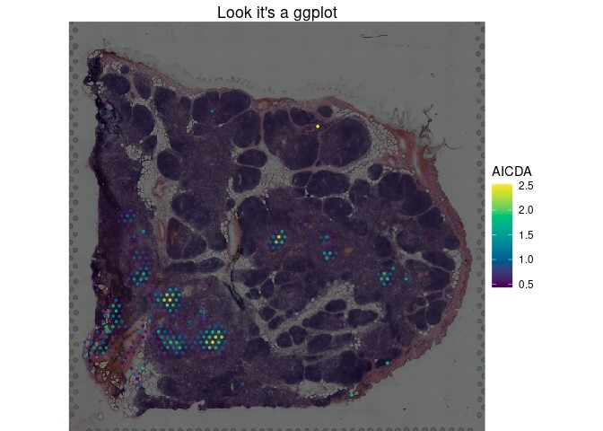

`plotReceptors()` draws receptor-positive spots. The `group` argument
names the receptor column that sets the color. Here every row has the
locus `IGH`, so all BCR-positive spots get one color:

``` r
plotReceptors(
  sirup,
  group = "locus",
  colors = "#0072B2",
  receptor_size = 1.2,
  title = "BCR-positive spots"
)
```

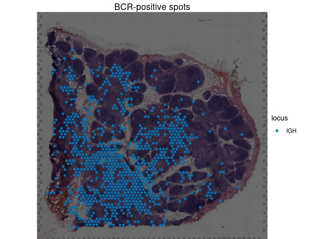

Use `group_val` to show only some values of the group column. This plot
shows the three largest clones in the section:

``` r
top_clones <- getReceptors(sirup) %>%
  count(clone_id, sort = TRUE) %>%
  slice_head(n = 3) %>%
  pull(clone_id)
top_clones
#> [1] "34"  "288" "196"

plotReceptors(
  sirup,
  group = "clone_id",
  group_val = top_clones,
  receptor_size = 1.6,
  title = "Three largest BCR clones"
)
```

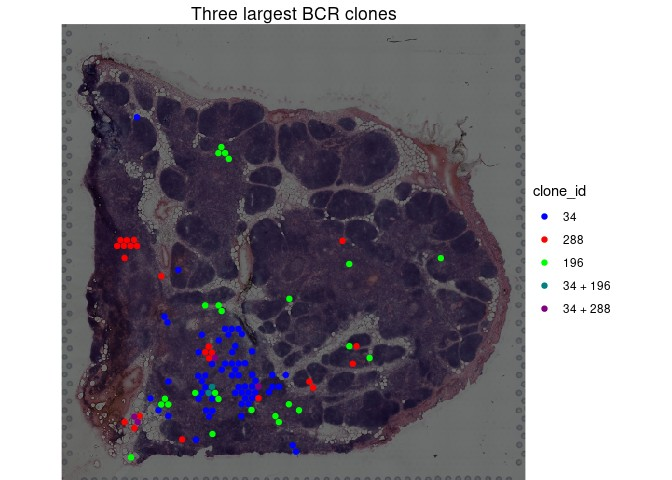

A Visium spot can hold BCRs from more than one clone. When two selected
clones share a spot, `plotReceptors()` gives the spot a combined label,
with the clone IDs joined by `+`. The `overlap` argument controls this
behavior.

`plotReceptorsExpression()` combines the two plots. Spots with
expression are filled points. Receptor-positive spots are hollow rings
on top:

``` r
plotReceptorsExpression(
  sirup,
  group = "locus",
  gene = "AICDA",
  assay = "alra",
  layer = "data",
  colors = "skyblue3",
  receptor_size = 1.2,
  feature_size = 2,
  title = "AICDA expression and BCR-positive spots"
)
```

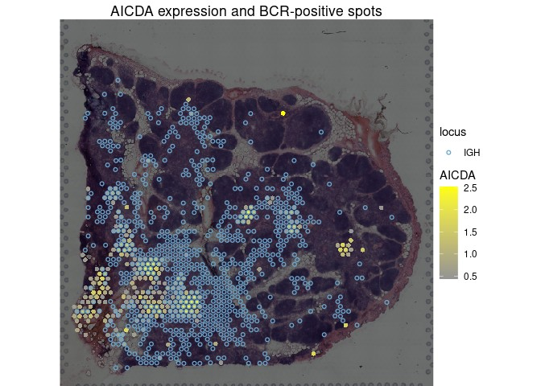

## Add tissue regions

Most spatial questions are about regions: a germinal center, a tumor
margin, a lesion. In SIRUP a region is a polygon on the tissue image.

`selectSpatialPolygons()` opens an app in which you draw polygons over
the tissue. We drew the eGCs over imputed *AICDA* expression, which
marks germinal center B cells:

``` r
gc_vertices <- selectSpatialPolygons(
  sirup,
  feature = "AICDA",
  assay = "alra",
  layer = "data",
  plot_image = TRUE,
  save_path = "mg_thymus_slice2_gc_polygons.csv"
)
```

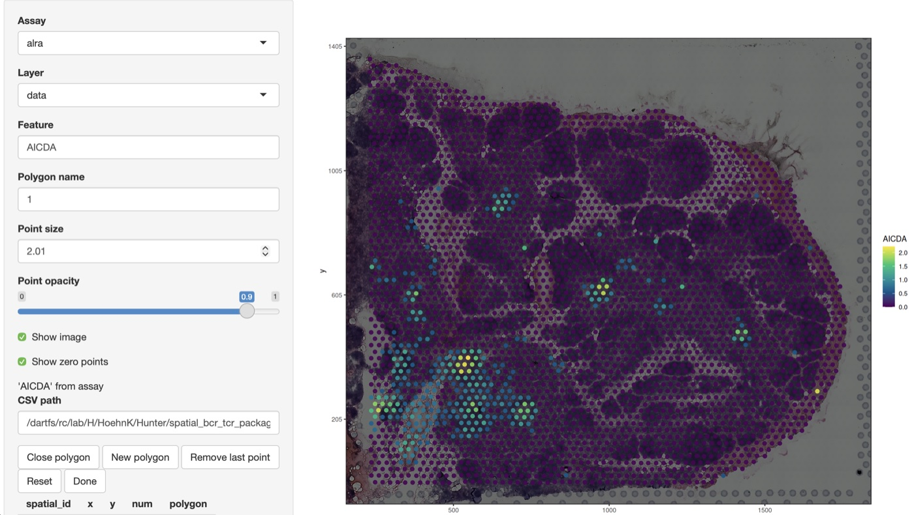

Click around the edge of a region. Each click snaps to the nearest spot,
and **Close polygon** joins the last vertex to the first:

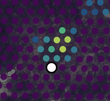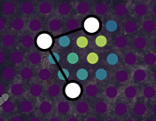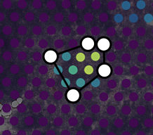

When you click **Done**, the app returns the vertices of every polygon
and writes them to the CSV file.

`addPolygons()` attaches polygons to the object. Give it the data frame
from the app (`polygons = gc_vertices`) or the CSV file
(`polygons_path`). It then annotates every spot and every receptor with
the polygon that contains it. The example data include the eGC polygons
that we drew for the SIRUP paper:

``` r
sirup <- addPolygons(
  sirup,
  polygons_path = file.path(extdata, "mg_thymus_slice2_gc_polygons.csv")
)

getPolygons(sirup)
#> # A tibble: 9 × 2
#>   polygon_id vertices        
#>   <chr>      <named list>    
#> 1 1          <tibble [7 × 5]>
#> 2 2          <tibble [4 × 5]>
#> 3 3          <tibble [4 × 5]>
#> 4 4          <tibble [4 × 5]>
#> 5 5          <tibble [6 × 5]>
#> 6 6          <tibble [7 × 5]>
#> 7 7          <tibble [7 × 5]>
#> 8 8          <tibble [4 × 5]>
#> 9 9          <tibble [4 × 5]>

plotSpatialPolygons(sirup, polygon_alpha = 0.3, 
                    label_outside = TRUE, label_offset = 0.02,
                    label_color = "white", label_leader = FALSE)
```

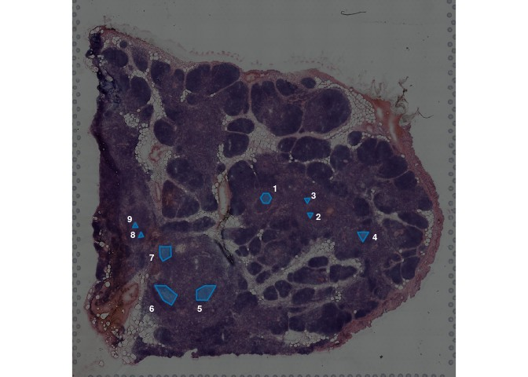

The receptor table now has a `polygon_id` column. Receptors outside
every polygon get `NA`:

``` r
getReceptors(sirup) %>%
  count(polygon_id)
#> # A tibble: 9 × 2
#>   polygon_id     n
#>   <chr>      <int>
#> 1 1             28
#> 2 2             23
#> 3 3             14
#> 4 5             47
#> 5 6              4
#> 6 7             30
#> 7 8              6
#> 8 9              4
#> 9 <NA>        1949
```

## A first regional analysis

`polygonReceptorSummary()` counts the receptors, spots, and clones in
each polygon. It stores the result in the object as an analysis:

``` r
sirup <- polygonReceptorSummary(sirup, polygon_id = "polygon_id")
getAnalysis(sirup, "polygon_receptor_summary")
#> # A tibble: 9 × 5
#>   polygon_id n_receptors n_spatial_ids n_clones top_clone_fraction
#>   <chr>            <int>         <int>    <int>              <dbl>
#> 1 1                   28             6       16              0.143
#> 2 2                   23             3       16              0.174
#> 3 3                   14             3        8              0.286
#> 4 4                    0             0        0             NA    
#> 5 5                   47            12       23              0.128
#> 6 6                    4             4        4              0.25 
#> 7 7                   30             8       12              0.167
#> 8 8                    6             3        4              0.333
#> 9 9                    4             3        4              0.25
```

Clonal dominance asks how much of each region the largest clones take
up. `spatialCloneDominance()` computes the fraction of each polygon’s
receptors that belongs to each clone. `plotSpatialPolygonPies()` draws
one pie chart per polygon next to the tissue:

``` r
dominance <- spatialCloneDominance(object = sirup)

dominance$dominance %>%
  group_by(polygon) %>%
  slice_max(proportion, n = 1, with_ties = FALSE) %>%
  select(polygon, clone_id, n_receptors, proportion)
#> # A tibble: 8 × 4
#> # Groups:   polygon [8]
#>   polygon clone_id n_receptors proportion
#>   <chr>   <chr>          <dbl>      <dbl>
#> 1 1       928                4      0.143
#> 2 2       381                4      0.174
#> 3 3       196                4      0.286
#> 4 5       810                6      0.128
#> 5 6       136                1      0.25 
#> 6 7       739                5      0.167
#> 7 8       242                2      0.333
#> 8 9       222                1      0.25

pies <- plotSpatialPolygonPies(
  dominance = dominance,
  object = sirup,
  fill = "clone_id",
  top_n = 5
)
pies$page_1
#> Warning: Removed 1 row containing missing values or values outside the scale range
#> (`geom_text()`).
```

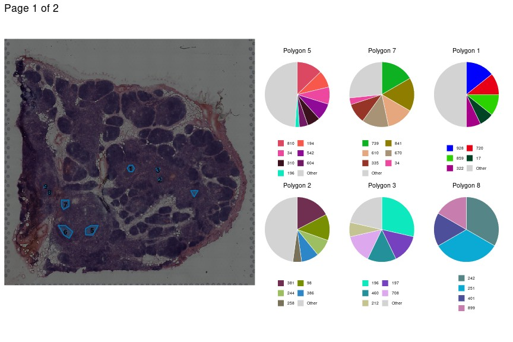

The function returns one plot per page, with six pies on each page. The
`top_n` argument sets how many clones get their own color in each pie.
The other clones go into the grey `Other` slice.

The eGCs in this section are polyclonal. In the larger eGCs, the largest
clone holds 13% to 17% of the BCRs.

## Change the data with your own functions

SIRUP does not wrap every AIRR tool. Instead, three functions let you
run any function on one part of the object and put the result back:

- `updateReceptors(x, fun, ...)` calls `fun(getReceptors(x), ...)` and
  stores the returned table.
- `updateSpatial(x, fun, ...)` calls `fun(getSpatial(x), ...)` and
  stores the returned Seurat object.
- `updateAnalysis(x, name, fun, ...)` does the same for a stored
  analysis.

Each function validates the object again before it returns. For example,
`updateReceptors()` with `dplyr::filter()` keeps only the class-switched
IgG sequences:

``` r
igg <- updateReceptors(sirup, dplyr::filter, grepl("^IGHG", c_call))
nrow(getReceptors(igg))
#> [1] 1651
```

The same pattern runs germline reconstruction
(`dowser::createGermlines()`) or mutation counting
(`shazam::observedMutations()`) inside the object. The clones vignette
shows these steps.

`updateSpatial()` works the same way for the Seurat object. This call
adds the cell2location cell-type proportions as spot metadata:

``` r
cell_types <- data.table::fread(
  file.path(extdata, "mg_thymus_cell_types.csv.gz"),
  data.table = FALSE
)
cell_types <- filter(cell_types, sample == "mg_thymus_slice2")
rownames(cell_types) <- cell_types$barcode
cell_types <- select(cell_types, -sample, -barcode)

sirup <- updateSpatial(sirup, Seurat::AddMetaData, metadata = cell_types)

spatialExpressionPlot(
  sirup,
  features = "GC B",
  zero_tol = 0.05,
  title = "GC B cell proportion (cell2location)"
)
```

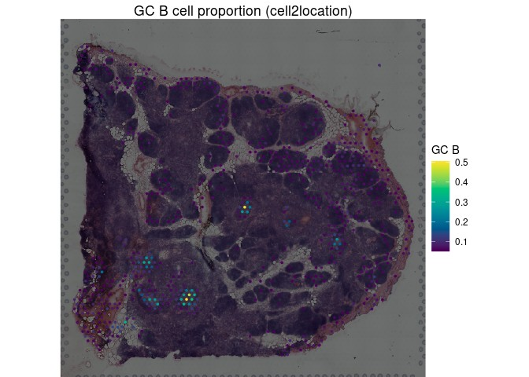

`spatialExpressionPlot()` accepts genes and numeric spot metadata
columns. `zero_tol` hides spots at or below a value. Here it hides spots
with less than 5% GC B cells.

## Keep results with the data

`setAnalysis()` stores any R object under a name. Stored results stay
with the data that produced them, so you do not need to track separate
files:

``` r
sirup <- setAnalysis(sirup, "gc_dominance", dominance)
listAnalyses(sirup)
#> [1] "polygon_receptor_summary" "gc_dominance"
```

`saveSIRUP()` writes the object to one RDS file. `readSIRUP()` reads it
back, validates it, and upgrades objects that an older SIRUP version
saved:

``` r
path <- file.path(tempdir(), "mg_thymus_slice2.sirup.rds")
saveSIRUP(sirup, path)
sirup <- readSIRUP(path)
sirup
#> <SIRUP object>
#> Spatial data:    Seurat, 3,203 spatial IDs, 449 genes, 1 image
#> Receptor data:   tibble, 2,105 receptor sequences x 67 columns
#> Spatial overlap: 797/868 receptor IDs in spatial data (91.8%)
#> Spatial ID field: barcode_10x
#> Clone ID field:  clone_id
#> Analyses:        2
#> Polygons:        9
```

## Next steps

- To process your own reads, read
  [Process reads into spatial AIRR tables](processing.md).
- To draw regions and compare their repertoires, read
  [Tissue regions, clonal dominance, and diversity](regions.md).
- To test spatial patterns, read
  [Spatial statistics for genes, cells, and clones](spatial-statistics.md).
- To build lineage trees and show them on the tissue, read
  [Clones and lineage trees on the tissue](clones-and-trees.md).
- To combine sections, bulk BCR-seq, and blood, read
  [Several sections, bulk AIRR-seq, and blood](multisample.md).
