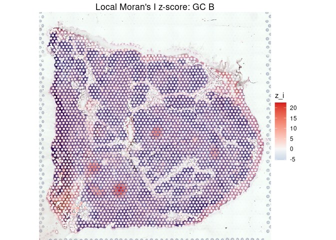
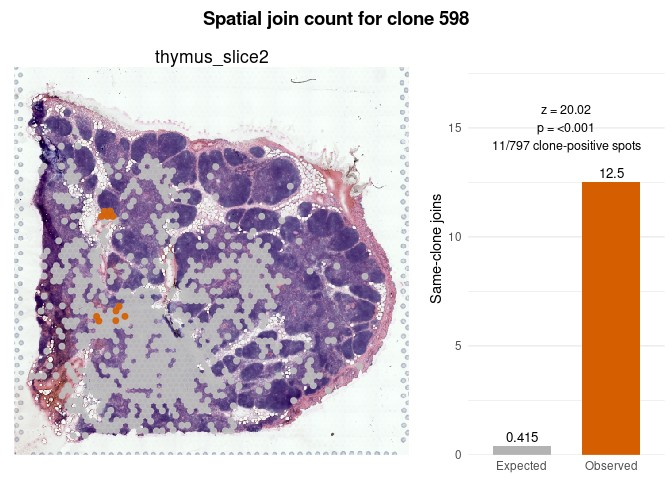
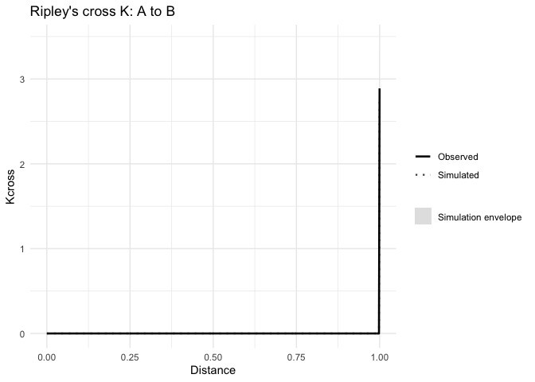

Choose the right spatial statistic for your question
================

This guide helps you choose an appropriate spatial statistic to answer
the question you want to ask. Each section below names one question. It
then gives the function, the input, and how to understand the results.

A few definitions: A *spot* is spatially-resolved location where we
capture gene expression or a BCR/TCR sequence. A *clone* is a group of
cells that are inferred to descend from a common ancestor. *Spatial
autocorrelation* is the tendency of nearby spots to have similar values,
i.e., high values by high values and low values by low values.

All tests need a SIRUP object, or a Seurat object with spatial images.
The tests read the spot coordinates from the object. Most tests compare
each spot with its “neighbors”. Generally, you can set the number of
neighbors with `k` (i.e., the `k` nearest spots will be neighbors) or
`radius` (which draws a circle with radius `radius` around the point in
question and all points inside that circle are neighbors of the point).

## Match the question to the function

| Question | Function | Input |
|----|----|----|
| Is a continuous variable spatially autocorrelated? | `spatialMoran()` | One gene or numeric metadata column |
| Where is a continuous variable spatially autocorrelated? | `spatialLocalMoran()` | One gene or numeric metadata column |
| Do two continuous variables co-vary in space? | `spatialLee()` | Two continuous variables |
| How far does a clone spread? | `spatialCloneSpread()` | Receptor table with clone IDs, pass the ID of the clone you’re interested in |
| Is a discrete variable (in this case a particular clone) spatially autocorrelated? | `spatialCloneJoinCount()` | Receptor table with clone IDs, pass the ID of the clone you’re interested in |
| Do two discrete variables co-vary in space? | `spatialRipleyCrossK()` | One metadata column with two labels |

## Load the example object

The examples use one myasthenia gravis (MG) thymus section. This code
downloads a saved SIRUP object for it, which is not part of the SIRUP
package, and reads it. The object has BCRs and TCRs, cell-type
estimates, and BCR clones. Change `dest` to a folder you want to keep.
The function skips files that are already there. To see how the object
was built, see [Get started with SIRUP](get-started.md).

``` r
extdata <- SIRUP::downloadSIRUPExample(
  dest = file.path(tempdir(), "SIRUP_example"),
  files = "mg_thymus_slice2.sirup.rds"
)
#> ℹ Downloading 'mg_thymus_slice2.sirup.rds'
```

``` r
library(SIRUP)
library(dplyr)

x <- readSIRUP(file.path(extdata, "mg_thymus_slice2.sirup.rds"))
x
#> <SIRUP object>
#> Spatial data:    Seurat, 3,203 spatial IDs, 449 genes, 1 image
#> Receptor data:   2 slots
#>   BCR: 2,105 receptor sequences x 57 columns; 797/868 receptor IDs in spatial data (91.8%)
#>   TCR: 3,610 receptor sequences x 56 columns; 1,414/1,571 receptor IDs in spatial data (90.0%)
#> Spatial ID field: barcode_10x
#> Clone ID field:  clone_id
#> Analyses:        0
```

## Is a continuous variable spatially autocorrelated?

Use `spatialMoran()` to determine if a continuous variable is spatially
autocorrelated, i.e., if neighboring spots have similar values. This
function computes [Moran’s
I](https://en.wikipedia.org/wiki/Moran%27s_I#Global_Moran's_I). Moran’s
I is near 0 when the values show no spatial pattern, it is positive when
similar values are nearby, and it is negative when dissimilar values are
nearby.

The input is a SIRUP or Seurat object. `variable_type` tells the
function what type of variable it is: a gene (`"feature"`) or a numeric
metadata column (`"metadata"`). `k` is the number of neighbors.

The estimate $I$ and the associated p value are reported. Note that a
larger section can inflate significance, so you may see a tiny p value
for a weak pattern in larger datasets.

See the code below for an example on the thymus section.

``` r
moran <- spatialMoran(
  x,
  variable = "GC B",
  variable_type = "metadata",
  k = 6
)
#> Loading required namespace: Seurat
moran$test$estimate[[1]]
#> [1] 0.6229165
moran$test$p.value
#> [1] 0
```

## **Where** is a continuous variable spatially autocorrelated?

Use `spatialLocalMoran()` to find where a continuous variable is
spatially autocorrelated, i.e., which spots sit in a cluster of similar
values. This function computes [local Moran’s
I](https://en.wikipedia.org/wiki/Moran%27s_I#Local_Moran's_I) (also
called LISA) for each spot. Local Moran’s I is positive when a spot has
neighbors with similar values and negative when a spot differs from its
neighbors.

The input is a SIRUP or Seurat object. `variable_type` tells the
function what type of variable it is: a gene (`"feature"`) or a numeric
metadata column (`"metadata"`). `k` is the number of neighbors.

The result has one row for each spot, with the local I (`local_i`), a
z-score (`z_i`), and a p value (`p_value`). Each spot has its own p
value, so we should adjust for multiple testing.
`plotSpatialLocalMoran()` draws the z-scores on the tissue.

See the code below for an example on the thymus section.

``` r
local_moran <- spatialLocalMoran(
  x,
  variable = "GC B",
  variable_type = "metadata",
  k = 6
)
head(local_moran[, c("cell", "local_i", "z_i", "p_value")])
#>                 cell    local_i       z_i     p_value
#> 1 AAACAAGTATCTCCCA-1 0.42119564 1.8775350 0.060444809
#> 2 AAACACCAATAACTGC-1 0.02554433 0.1780355 0.858695126
#> 3 AAACAGCTTTCAGAAG-1 0.67548360 2.1434191 0.032079462
#> 4 AAACAGGGTCTATATT-1 0.44557822 1.5436247 0.122679267
#> 5 AAACAGTGTTCCTGGG-1 0.10316582 0.6444111 0.519308914
#> 6 AAACATGGTGAGAGGA-1 2.05891309 3.0435870 0.002337758
plotSpatialLocalMoran(x, local_moran, point_size = 1)
```



## Do two continuous variables co-vary in space?

Use `spatialLee()` to determine if two continuous variables share a
spatial pattern, i.e., if a high value of one variable tends to sit near
high values of the other. This function computes [Lee’s
L](https://en.wikipedia.org/wiki/Lee%27s_L). Lee’s L is near 0 when the
variables show no shared pattern, it is positive when both variables are
high (or both low) in the same neighborhoods, and it is negative when
one variable is high where the other is low.

The input is a SIRUP object or a Seurat object. `x` and `y` are the
names of the two variables, and `x_type` and `y_type` tell the function
what type each variable is: a gene (`"feature"`) or a numeric metadata
column (`"metadata"`). `k` is the number of neighbors.

The estimate $L$ and the associated p value are reported. The default
test (`method = "analytical"`) builds a dense matrix with one entry for
each pair of spots, so it needs a lot of memory for large datasets. For
large data, such as Visium HD, set `method = "mc"` to use a permutation
test.

See the code below for an example on the thymus section.

``` r
lee <- spatialLee(
  x,
  x = "AICDA", x_type = "feature",
  y = "MS4A1", y_type = "feature",
  assay = "Spatial", layer = "data",
  k = 6
)
lee$L
#> [1] 0.09748529
lee$test$p.value
#> [1] 2.174023e-49
```

## How far does a clone spread?

Use `spatialCloneSpread()` to determine how far clones spread across the
tissue, i.e., how far apart their or sequences are. This function is
just descriptive. For each clone, it computes the distance between every
pair of points and reports the mean and the maximum of those distances.

The input is a SIRUP object or receptor table with clone IDs and spatial
IDs. A clone needs at least `min_spatial_ids` points (default 2). By
default, each sequence is a point, so sequences in the same spot give
distances of 0. Set `collapse_within_spot = TRUE` to count each spot
once.

The result has one row for each sample and clone, with the number of
spots (`n_spatial_ids`), the mean distance (`mean_pairwise_distance`),
and the maximum distance (`max_pairwise_distance`). Distances are in
image pixels.

See the code below for an example on the thymus section.

``` r
spread <- spatialCloneSpread(x, slot = "BCR", min_spatial_ids = 3)
spread %>%
  arrange(desc(n_spatial_ids)) %>%
  head()
#> # A tibble: 6 × 5
#>   sample  clone_id n_spatial_ids mean_pairwise_distance max_pairwise_distance
#>   <chr>   <chr>            <int>                  <dbl>                 <dbl>
#> 1 spatial 34                  86                   66.2                 397. 
#> 2 spatial 288                 42                  123.                  304. 
#> 3 spatial 196                 38                  156.                  395. 
#> 4 spatial 739                 16                   21.5                  75.1
#> 5 spatial 810                 14                   80.0                 263. 
#> 6 spatial 907                 14                   54.2                 120.
```

## Is a discrete variable (i.e., a particular clone) spatially autocorrelated?

Use `spatialCloneJoinCount()` to determine if a discrete variable is
spatially autocorrelated. This function computes the [join count
statistic](https://en.wikipedia.org/wiki/Join_count_statistic). Here,
the variable is whether a spot holds a particular clone, i.e., if the
spots of a clone sit next to each other. This function marks the spots
that hold the clone, counts the neighbor pairs in which both spots hold
the clone (the joins), and compares that count with the count expected
by chance. The observed count is higher than expected when the sequences
in the clone stay nearby each other.

The input is a SIRUP object receptor table with clone IDs and spatial
IDs. By default, the function tests every clone that occurs in at least
`min_spatial_ids` spots. Give `clone_val` to test chosen clones. If the
object has stored polygons, the function runs one test for each polygon.
Set `use_stored_polygons = FALSE` to run one test over the entire
section in this case.

The `summary` table has one row for each clone, with the observed and
expected join counts, a z-score (`statistic`), and a p value
(`p_value`). The default alternative is `"greater"`, so the test looks
for more joins than chance. The function tests many clones at once, so
be sure to adjust for multiple testing.

See the code below for an example on the thymus section.

``` r
big_clones <- getReceptors(x, slot = "BCR") %>%
  filter(!is.na(barcode_10x)) %>%
  distinct(clone_id, barcode_10x) %>%
  count(clone_id, sort = TRUE) %>%
  slice_head(n = 5) %>%
  pull(clone_id)

join_count <- spatialCloneJoinCount(
  x,
  slot = "BCR",
  clone_val = big_clones,
  use_stored_polygons = FALSE,
  k = 6,
  return_data = TRUE
)
join_count$summary[, c("clone_id", "observed_join_count", "expected_join_count", "p_value")]
#>   clone_id observed_join_count expected_join_count      p_value
#> 1      598                12.5           0.4145729 1.855757e-89
#> 2      288                30.0           2.6457286 1.118248e-74
#> 3       34                67.5          16.1683417 1.117067e-47
#> 4       64                 5.5           0.3391960 1.842208e-21
#> 5      196                15.5           2.6457286 4.997114e-18

plotSpatialCloneJoinCount(
  join_count = join_count,
  object = x,
  clone_val = join_count$summary$clone_id[[1]],
  show_neighbors = TRUE
)
```



## Do two discrete variables co-vary in space?

Use `spatialRipleyCrossK()` to determine if two discrete variables
co-vary in space, i.e., if spots of type A lie near spots of type B.
This function computes [Ripley’s cross
K](https://academicweb.nd.edu/~mhaenggi/ee87021/Dixon-K-Function.pdf?utm_campaign=redirect&utm_medium=web&utm_source=www3.nd.edu).
It counts the spots of type B within each distance of an average spot of
type A. It then compares that curve with curves from random relabeling
of the spots, which gives an envelope. Ripley’s cross K is similar to
Lee’s L, but it works with discrete data rather than continuous.

The input is a SIRUP object or a Seurat object with a column that holds
the labels (`mark_col`). Give the two levels to compare as `i` and `j`.
Set `nsim` above 0 to generate the randomly relabeled envelope for
comparison. Spots with `NA` in the column are left out.

The result holds the observed K at each distance (`plot_data`). A curve
above the envelope means that A and B sit closer than chance, i.e., they
**colocalize**. A curve below the envelope means that A and B are.
`plotRipleyCrossK()` draws the curve and the envelope. The distance is
in image pixels at the stored `image_scale`.

See the code below for an example on the thymus section.

``` r
# Label spots with mostly GC B cells or mostly T follicular helper (Tfh) cells.
x <- updateSpatial(x, function(spatial) {
  gc_b <- spatial$`GC B` > 0.10
  tfh <- spatial$Tfh > 0.10
  spatial$gc_tfh_mark <- case_when(
    gc_b & !tfh ~ "GC B",
    tfh & !gc_b ~ "Tfh",
    TRUE ~ NA_character_
  )
  spatial
})

set.seed(1)
kcross <- spatialRipleyCrossK(
  x,
  mark_col = "gc_tfh_mark",
  i = "GC B",
  j = "Tfh",
  nsim = 39,
  max_r = 40
)
plotRipleyCrossK(kcross, title = "Cross K: GC B spots to Tfh spots")
```



## Next steps

- To compare ROIs in the tissue, see
  [Annotate tissue ROIs and analyze local clonal structure](regions.md).
- To build lineage trees and visualize them on the tissue, read
  [Infer clones and lineage trees in situ](clones-and-trees.md).
