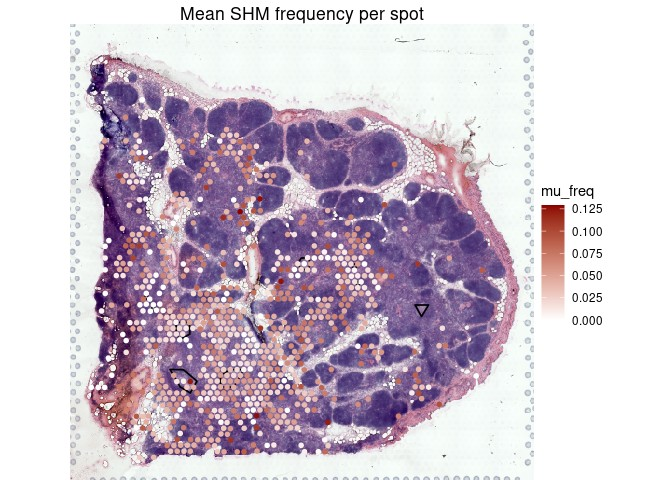
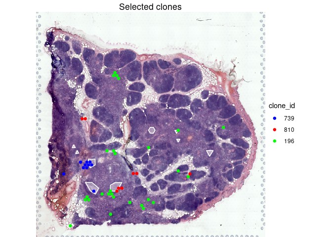

Infer clones and lineage trees in situ
================

<div markdown="1"
style="background: #F7E5BC; padding: 12px; margin-bottom: 24px; line-height: 24px;">

<p style="margin: -12px -12px 12px; padding: 6px 12px; background: #d6b676; color: #ffffff; font-weight: 700;">

<b>Note</b>
</p>

**Time:** ~15 minutes.<br> **Data:** The example SIRUP object, plus its
polygon file.<br>

</div>

Here, we will work with the clones in a SIRUP object, build lineage
trees for some of them, and pair each tree with the tissue.

A *clone* is a group of B or T cells that descend from one ancestor cell
and share its receptor rearrangement. A *lineage tree* shows how the
sequences of one clone relate to each other, where each tip is one
sequence. Pairing a tree with the tissue shows where each tip sits. At
the end, we will compare distances in the tree with distances on the
tissue.

SIRUP does not reimplement clone calling or tree building. It runs the
Immcantation tools (scoper, dowser, shazam) on the receptor table inside
the SIRUP object, then adds the spatial part: clone maps, trees paired
with tissue plots, and distances between tips in and between regions.

<div markdown="1"
style="background: #F7E5BC; padding: 12px; margin-bottom: 24px; line-height: 24px;">

<p style="margin: -12px -12px 12px; padding: 6px 12px; background: #d6b676; color: #ffffff; font-weight: 700;">

<b>Note</b>
</p>

This page starts with a saved SIRUP object, which is loaded below. To
learn how the object is built, see
[Get started with SIRUP](get-started.md). To learn about the
polygons used here, see [Annotate tissue ROIs and analyze local clonal structure](regions.md).

</div>

## Get the example data

This page uses example files that are slightly too big to be part of the
SIRUP package. This code downloads them. Change `dest` to a folder you
want to keep. The function skips files that are already there.

``` r
extdata <- SIRUP::downloadSIRUPExample(
  dest = file.path(tempdir(), "SIRUP_example"),
  files = c(
    "mg_thymus_slice2_brighter.sirup.rds",
    "mg_thymus_slice2_gc_polygons.csv"
  )
)
```

``` r
library(SIRUP)
library(dplyr)
library(ggplot2)
```

``` r
sirup <- readSIRUP(file.path(extdata, "mg_thymus_slice2_brighter.sirup.rds"))
sirup
#> <SIRUP object>
#> Spatial data:    Seurat, 3,203 spatial IDs, 449 genes, 1 image
#> Receptor data:   2 slots
#>   BCR: 2,105 receptor sequences x 57 columns; 797/868 receptor IDs in spatial data (91.8%)
#>   TCR: 3,610 receptor sequences x 56 columns; 1,414/1,571 receptor IDs in spatial data (90.0%)
#> Spatial ID field: barcode_10x
#> Clone ID field:  clone_id
#> Analyses:        0
```

The object holds two receptor slots, `"BCR"` and `"TCR"`, and the
functions that interact with the receptors in the SIRUP object read one
slot at a time. If we only need to work with one type of receptor, we
can specify the slot in the function call.

In [Annotate tissue ROIs and analyze local clonal structure](regions.md), we annotated regions of
interest (ROIs) in the tissue. We can add the polygons that outline
these ROIs to the SIRUP object so that we can include them in plots and
analyses. Add the polygons to the object with `addPolygons()`.

``` r
sirup <- addPolygons(
  sirup,
  polygons_path = file.path(extdata, "mg_thymus_slice2_gc_polygons.csv")
)
```

## Build clones

A clone, or clonal lineage, is a set of cells inferred to have descended
from a common ancestor. We can infer clones from the receptor sequences
using `scoper::hierarchicalClones()` for B cells and
`scoper::identicalClones()` for T cells. Use the `updateReceptors()`
function to run a function on the receptor table in a SIRUP object and
update the object with the result.

The example object already has BCR clones from
[Get started with SIRUP](get-started.md). To start from scratch, we
will remove the `clone_id` column and clear the clone field first.

``` r
sirup <- updateReceptors(
  sirup,
  dplyr::select,
  -clone_id,
  slot = "BCR", # specify the receptor slot
  receptor_fields = list(clone = NULL)
)
```

Then build the clones.

``` r
sirup <- updateReceptors(
  sirup,
  scoper::hierarchicalClones,
  slot = "BCR",
  threshold = 0.1,
  summarize_clones = FALSE,
  nproc = 1
)
#> Warning: package 'scoper' was built under R version 4.5.3

sirup
#> <SIRUP object>
#> Spatial data:    Seurat, 3,203 spatial IDs, 449 genes, 1 image
#> Receptor data:   2 slots
#>   BCR: 2,105 receptor sequences x 67 columns; 797/868 receptor IDs in spatial data (91.8%)
#>   TCR: 3,610 receptor sequences x 66 columns; 1,414/1,571 receptor IDs in spatial data (90.0%)
#> Spatial ID field: barcode_10x
#> Clone ID field:  clone_id
#> Analyses:        0
#> Polygons:        9
```

Because T cells do not mutate their TCRs, clones are called with
`scoper::identicalClones()`, as is below.

``` r
sirup <- updateReceptors(
  sirup,
  scoper::identicalClones,
  slot = "TCR",
  summarize_clones = FALSE,
  nproc = 1
)
```

## Reconstruct clonal germlines

Next, reconstruct the germline of the B cell clones with
`dowser::createGermlines()`. The germline is the sequence of the
unmutated common ancestor, which will root the reconstructed trees.
Building the germline requires IMGT references. Set the variable
`imgt_dir` to the folder that contains them.

<div markdown="1"
style="background: #F7E5BC; padding: 12px; margin-bottom: 24px; line-height: 24px;">

<p style="margin: -12px -12px 12px; padding: 6px 12px; background: #d6b676; color: #ffffff; font-weight: 700;">

<b>Note</b>
</p>

If you have not yet set up the IMGT references, see the
[documentation](https://github.com/hoehnlab/airrblast) for the
`airrblast` package and download and set up the IMGT references.

</div>

``` r
references <- dowser::readIMGT(imgt_dir)
#> [1] "Read in 1198 from 17 fasta files"

sirup <- updateReceptors(
  sirup,
  dowser::createGermlines,
  slot = "BCR",
  references = references,
  id = "sequence_id",
  nproc = 1
)
```

To be safe, we can also filter out potential PCR chimeras using
`shazam::slideWindowDb()`.

``` r
sirup <- updateReceptors(sirup, slot = "BCR", function(receptors) {
  chimera <- shazam::slideWindowDb(
    receptors,
    sequenceColumn = "sequence_alignment",
    germlineColumn = "germline_alignment_d_mask",
    mutThresh = 6,
    windowSize = 10
  )
  receptors[!chimera, ]
})
```

## Estimate somatic hypermutation levels

Use `shazam::observedMutations()` to count the SHM levels of each
sequence against the germline.

``` r
sirup <- updateReceptors(
  sirup,
  shazam::observedMutations,
  slot = "BCR",
  sequenceColumn = "sequence_alignment",
  germlineColumn = "germline_alignment_d_mask",
  frequency = TRUE,
  combine = TRUE
)
summary(getReceptors(sirup, slot = "BCR")$mu_freq) # SHM frequency stored in mu_freq column
#>    Min. 1st Qu.  Median    Mean 3rd Qu.    Max. 
#> 0.00000 0.01493 0.03727 0.04165 0.06377 0.13814
```

`plotReceptors()` can color spots by a numeric column in the receptor
data. Pass the column to `value`. If a spot has several receptors,
`value_combine` sets how SIRUP combines them (default is `"mean"`).

``` r
plotReceptors(
  sirup,
  slot = "BCR",
  group = "locus",
  value = "mu_freq",
  value_colors = c("white", "darkred"),
  value_combine = "mean",
  receptor_size = 1.3,
  polygons = TRUE,
  polygon_alpha = 0,
  polygon_color = "black",
  title = "Mean SHM frequency per spot"
)
```



## Infer trees

First, we need to choose a few clones to build trees for. The three
clones below are large and have sequences in the ectopic germinal
centers (the ROIs).

``` r
tree_clones <- c("739", "810", "196")

# Plot the locations of the three chosen clones
plotReceptors(
  sirup,
  slot = "BCR",
  group = "clone_id",
  group_val = tree_clones,
  receptor_size = 1.6,
  polygons = TRUE,
  polygon_alpha = 0.3,
  title = "Selected clones"
)
```



To build trees with Dowser, we need a formatted clones object.
`formatSpatialClones()` wraps `dowser::formatClones()` but allows users
to provide a SIRUP object, and it automatically places a
`formatted_clones` object in the SIRUP object’s analysis slot. Then, we
can call `getSpatialTrees()`, which wraps `dowser::getTrees()` but
allows users to provide a SIRUP object, and puts the trees in the SIRUP
object’s analysis slot.

``` r
# Filter the SIRUP object to only include the tree clones
tree_sirup <- updateReceptors(sirup, dplyr::filter, clone_id %in% tree_clones, slot = "BCR")

tree_sirup <- formatSpatialClones(
  tree_sirup,
  slot = "BCR",
  analysis_name = "formatted_clones",
  id = "sequence_id",
  germ = "germline_alignment_d_mask",
  traits = c("barcode_10x", "polygon_id") # Make sure to set the barcode column as a trait so that you don't collapse
  # sequences with the same sequence that were observed in different locations.
)

set.seed(1)
tree_sirup <- getSpatialTrees(
  tree_sirup,
  slot = "BCR",
  f_clones_analysis = "formatted_clones",
  analysis_name = "trees",
  build = "pratchet"
)

trees <- getAnalysis(tree_sirup, "trees")
trees
#> # A tibble: 3 × 5
#>   clone_id data       locus  seqs trees  
#>   <chr>    <list>     <chr> <int> <list> 
#> 1 196      <airrClon> IGH      38 <phylo>
#> 2 739      <airrClon> IGH      15 <phylo>
#> 3 810      <airrClon> IGH      13 <phylo>
```

For more information on building trees, see the [Dowser
documentation](https://dowser.readthedocs.io/en/stable/vignettes/Building-Trees-Vignette/).

``` r
sirup <- setAnalysis(sirup, "trees", trees)
```

## Pair each tree with the tissue

`plotSpatialCloneTreePairs()` plots trees on the left and H&E images and
the locations of the tip sequences on the right. `color_by` allows you
to color the tips on the tree by a column in the receptor data, but
leaving it `NULL` gives each tip its own color.

``` r
pairs <- plotSpatialCloneTreePairs(
  getAnalysis(tree_sirup, "trees"),
  object = sirup,
  slot = "BCR",
  clone_val = tree_clones,
  id = "sequence_id",
  polygons = TRUE,
  polygon_alpha = 0,
  polygon_color = "black"
)
#> Warning: Using `size` aesthetic for lines was deprecated in ggplot2 3.4.0.
#> ℹ Please use `linewidth` instead.
#> ℹ The deprecated feature was likely used in the ggtree package.
#>   Please report the issue at <https://github.com/YuLab-SMU/ggtree/issues>.
#> This warning is displayed once per session.
#> Call `lifecycle::last_lifecycle_warnings()` to see where this warning was
#> generated.
names(pairs)
#> [1] "196" "739" "810"

pairs[[1]]
```


The result is a list with one element for each clone, and each element
consists of the tree on the left and the map on the right. Each element
also holds the `tree` plot and the `spatial_clone` plot, which can be
accessed separately for a custom layout. Sequences in the same spot
share a point on the map.

### Color tips by group

A clone with many tips can be hard to read when each tip has its own
color. `clusterTreesTips()` cuts each tree into `k` connected groups of
related tips. The code below uses `k = 4` for every tree. Then
`plotSpatialCloneTreePairs()` with `color_by = "tree_cluster"` colors
the tips by their corresponding cluster for easier visualization.

``` r
clustered <- clusterTreesTips(
  trees,
  k = 4,
  id = "sequence_id",
  cluster = "tree_cluster" # What column to store the cluster assignments in
)

cluster_pairs <- plotSpatialCloneTreePairs(
  clustered,
  object = sirup,
  slot = "BCR",
  clone_val = tree_clones,
  id = "sequence_id",
  color_by = "tree_cluster",
  polygons = TRUE,
  polygon_alpha = 0,
  polygon_color = "black",
  show_spatial_legend = FALSE
)

cluster_pairs[[1]]
```


`color_by` accepts any column of the dowser clone data. For example,
`color_by = "polygon_id"` colors each tip by which polygon it belongs
to.

<div markdown="1"
style="background: #F7E5BC; padding: 12px; margin-bottom: 24px; line-height: 24px;">

<p style="margin: -12px -12px 12px; padding: 6px 12px; background: #d6b676; color: #ffffff; font-weight: 700;">

<b>Tip</b>
</p>

`spatialCloneTreePairsToPDF(cluster_pairs, "tree_pairs.pdf")` plots one
page per clone and saves the results to a PDF file.

</div>

## Next steps

- To process your own reads, read
  [Process demultiplexed reads](processing.md).
- To compare ROIs in the tissue, see
  [Annotate tissue ROIs and analyze local clonal structure](regions.md).
- To add more sections or bulk AIRR-seq, see
  [Analyze multiple spatial sections and bulk BCR-seq](multisample.md).
- To test spatial patterns, read
  [Choose the right spatial statistic for your question](choose-spatial-statistic.md).
