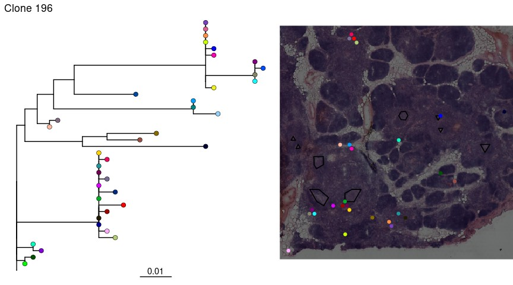

Call clones and build lineage trees on the tissue
================

> **Time:** about 20 minutes. **Data:** MG thymus section 2, bundled
> with SIRUP. **Needs:** SIRUP, scoper, dowser, shazam, and the IMGT
> reference sequences for the germline and tree steps.

A clone is a group of B or T cells that descend from one ancestor cell
and share its receptor rearrangement. In this page, you call clones in a
SIRUP object and build a lineage tree for some of them. A lineage tree
shows how the sequences of one clone relate to each other. Each tip of
the tree is one sequence. You then pair each tree with the tissue, so
you can see where each tip sits. At the end, you compare distances in
the tree with distances on the tissue.

SIRUP does not reimplement clone calling or tree building. It runs the
Immcantation tools (scoper, dowser, shazam) on the receptor table inside
the SIRUP object. It then adds the spatial part: clone maps, trees
paired with tissue plots, and distances between tips in and between
regions.

## Load the data

This page uses MG thymus section 2 and its polygons. Each polygon
outlines one ectopic germinal center (eGC). An eGC is a site in the
thymus where B cells proliferate and mutate their receptors. The data
are bundled with SIRUP.

``` r
library(SIRUP)
library(dplyr)
library(ggplot2)
```

``` r
extdata <- system.file("extdata", package = "SIRUP")

thymus <- readRDS(file.path(extdata, "mg_thymus_slice2_spatial.rds"))
bcrs <- airr::read_rearrangement(file.path(extdata, "mg_thymus_slice2_bcr.tsv.gz")) %>%
  extractSpatialIds(
    id = "sequence_id",
    spatial_id = "barcode_10x",
    regex = ",([ACGT]{16})$",
    suffix = "-1"
  ) %>%
  mutate(sequence_id = gsub(",", "_", sequence_id)) %>%
  filterAirr(
    locus_val = "IGH",
    min_v_length = 250,
    min_j_length = 30,
    min_junction_length = 10,
    productive_only = TRUE,
    min_consensus_count = NULL,
    spatial_id = "barcode_10x"
  ) %>%
  filter(!grepl("[^ACGT]", junction))
#> filterAirr kept 2189 of 3793 rows (dropped 1604).

sirup <- createSIRUP(
  spatial = thymus,
  receptors = bcrs,
  spatial_id = "barcode_10x",
  image_scale = "lowres",
  swap_coords = FALSE,
  polygons_path = file.path(extdata, "mg_thymus_slice2_gc_polygons.csv")
)
```

The code replaces the comma in each `sequence_id` with `_`. dowser
writes trees in Newick format, and a comma separates tips in that
format. dowser therefore renames tips that contain a comma. With the
comma gone, the tip names match the receptor table. SIRUP can then find
each tip on the tissue.

## Call clones

The object has no clones yet. To call clones, run
`scoper::hierarchicalClones()` through `updateReceptors()`.
`updateReceptors()` gives the receptor table to the function as its
first argument, with your other arguments. It then stores the returned
table and validates the object.

``` r
sirup <- updateReceptors(
  sirup,
  scoper::hierarchicalClones,
  threshold = 0.1,
  summarize_clones = FALSE,
  nproc = 1
)
#> Warning: package 'scoper' was built under R version 4.5.3

sirup
#> <SIRUP object>
#> Spatial data:    Seurat, 3,203 spatial IDs, 449 genes, 1 image
#> Receptor data:   tibble, 2,105 receptor sequences x 67 columns
#> Spatial overlap: 797/868 receptor IDs in spatial data (91.8%)
#> Spatial ID field: barcode_10x
#> Clone ID field:  clone_id
#> Analyses:        0
#> Polygons:        9
dplyr::n_distinct(getReceptors(sirup)$clone_id)
#> [1] 953
```

`hierarchicalClones()` groups sequences with the same V gene, J gene,
and junction length. It joins sequences whose junctions differ by less
than `threshold`. The SIRUP paper used `threshold = 0.1` for BCRs. TCRs
do not mutate, so call TCR clones with `scoper::identicalClones()`.

The function writes a `clone_id` column. `updateReceptors()` records it
as the clone field. If a function writes a different column, record it
with `receptor_fields = list(clone = "my_clone_column")`.

## Reconstruct germlines

The germline of a clone is the sequence of its unmutated ancestor. A
lineage tree starts at this sequence. `dowser::createGermlines()`
reconstructs one germline for each clone from the IMGT reference
sequences. IMGT is the international database of immune receptor genes.
The SIRUP paper made the germlines in the object and removed likely PCR
chimeras.

SIRUP does not include the IMGT references. Download them, for example
with the Immcantation script `fetch_imgtdb.sh`. Then set the environment
variable `SIRUP_IMGT_DIR` to the folder that holds the human V, D, and J
FASTA files, such as `~/share/germlines/imgt/human/vdj`. The germline
and tree chunks on this page run only when that folder exists.

``` r
references <- dowser::readIMGT(imgt_dir)
#> [1] "Read in 1198 from 17 fasta files"

sirup <- updateReceptors(
  sirup,
  dowser::createGermlines,
  references = references,
  id = "sequence_id",
  nproc = 1
)

sirup <- updateReceptors(sirup, function(receptors) {
  chimera <- shazam::slideWindowDb(
    receptors,
    sequenceColumn = "sequence_alignment",
    germlineColumn = "germline_alignment_d_mask",
    mutThresh = 6,
    windowSize = 10
  )
  receptors[!chimera, ]
})
```

## Measure somatic hypermutation

Somatic hypermutation (SHM) is the process that introduces point
mutations into B cell receptor genes. `shazam::observedMutations()`
counts the mutations of each sequence against a germline. With clonal
germlines, use `germline_alignment_d_mask`. The chunk below uses
`germline_alignment`, the germline that IgBLAST wrote for each sequence.
This choice lets the chunk run without the IMGT references. The result
goes in `mu_freq`, the fraction of mutated positions.

``` r
sirup <- updateReceptors(
  sirup,
  shazam::observedMutations,
  sequenceColumn = "sequence_alignment",
  germlineColumn = "germline_alignment",
  frequency = TRUE,
  combine = TRUE
)
summary(getReceptors(sirup)$mu_freq)
#>    Min. 1st Qu.  Median    Mean 3rd Qu.    Max. 
#> 0.00000 0.01462 0.03750 0.04184 0.06377 0.13467
```

`plotReceptors()` can color spots by a numeric receptor column. Give the
column to `value`. If a spot has several receptors, `value_combine` sets
how SIRUP combines them. The default is the mean.

``` r
plotReceptors(
  sirup,
  group = "locus",
  value = "mu_freq",
  value_colors = c("white", "darkred"),
  receptor_size = 1.3,
  polygons = TRUE,
  polygon_alpha = 0,
  polygon_color = "black",
  title = "Mean SHM frequency per spot"
)
```


## Choose clones

Trees are most useful for expanded clones. The code below keeps clones
that have 10 to 60 sequences and at least one sequence in an eGC. It
sorts them by the number of sequences in eGCs.

``` r
clone_sizes <- getReceptors(sirup) %>%
  group_by(clone_id) %>%
  summarise(
    n_sequences = n(),
    n_in_gc = sum(!is.na(polygon_id)),
    n_gcs = n_distinct(na.omit(polygon_id)),
    gcs = paste(sort(unique(na.omit(polygon_id))), collapse = ", ")
  ) %>%
  filter(n_sequences >= 10, n_sequences <= 60, n_in_gc > 0) %>%
  arrange(desc(n_in_gc))

head(clone_sizes)
#> # A tibble: 6 × 5
#>   clone_id n_sequences n_in_gc n_gcs gcs  
#>   <chr>          <int>   <int> <int> <chr>
#> 1 739               15       6     2 6, 7 
#> 2 810               13       6     1 5    
#> 3 196               40       5     2 3, 5 
#> 4 604               12       3     2 5, 6 
#> 5 428               11       2     1 5    
#> 6 598               13       1     1 7
tree_clones <- head(clone_sizes$clone_id, 3)
```

Plot the spots of the three chosen clones. A spot is one capture area of
the Visium slide.

``` r
plotReceptors(
  sirup,
  group = "clone_id",
  group_val = tree_clones,
  receptor_size = 1.6,
  polygons = TRUE,
  polygon_alpha = 0,
  polygon_color = "black",
  zoom = TRUE,
  title = "Selected clones"
)
```


## Build trees

Two functions run dowser on the object. `formatSpatialClones()` runs
`dowser::formatClones()` and stores the result as an analysis.
`getSpatialTrees()` runs `dowser::getTrees()` on a stored
formatted-clone analysis and stores the trees as another analysis. Both
functions take the dowser arguments.

Tree building takes time for large clones. First make a smaller object
with only the clones that you want. `updateReceptors()` with
`dplyr::filter()` does this.

``` r
tree_sirup <- updateReceptors(sirup, dplyr::filter, clone_id %in% tree_clones)

tree_sirup <- formatSpatialClones(
  tree_sirup,
  analysis_name = "formatted_clones",
  id = "sequence_id",
  germ = "germline_alignment_d_mask",
  traits = c("barcode_10x", "polygon_id")
)

set.seed(1)
tree_sirup <- getSpatialTrees(
  tree_sirup,
  f_clones_analysis = "formatted_clones",
  analysis_name = "trees",
  build = "pratchet"
)

trees <- getAnalysis(tree_sirup, "trees")
trees
#> # A tibble: 3 × 5
#>   clone_id data       locus  seqs trees  
#>   <chr>    <list>     <chr> <int> <list> 
#> 1 196      <airrClon> IGH      38 <phylo>
#> 2 739      <airrClon> IGH      15 <phylo>
#> 3 810      <airrClon> IGH      13 <phylo>
```

`traits` keeps the columns that the tree plots need. Keep the spatial
ID, so SIRUP can put each tip on the tissue. Add any column that you
want to color by.

`build = "pratchet"` builds maximum parsimony trees, which is fast. The
SIRUP paper used maximum likelihood (`build = "pml"`). For B cell
models, use IgPhyML (`build = "igphyml"` with the `igphyml` path).

> **Note.** By default, `formatClones()` merges identical sequences into
> one tip. A tip can then stand for several sequences.

Store the trees in the main object.

``` r
sirup <- setAnalysis(sirup, "trees", trees)
```

## Pair each tree with the tissue

`plotSpatialCloneTreePairs()` makes two plots for each clone: the
lineage tree and a tissue map. Each tip has one color in both plots. You
can find a tip of the tree on the tissue.

``` r
pairs <- plotSpatialCloneTreePairs(
  trees,
  object = sirup,
  clone_val = tree_clones,
  id = "sequence_id",
  zoom = TRUE,
  polygons = TRUE,
  polygon_alpha = 0,
  polygon_color = "black"
)
#> Warning: Using `size` aesthetic for lines was deprecated in ggplot2 3.4.0.
#> ℹ Please use `linewidth` instead.
#> ℹ The deprecated feature was likely used in the ggtree package.
#>   Please report the issue at <https://github.com/YuLab-SMU/ggtree/issues>.
#> This warning is displayed once per session.
#> Call `lifecycle::last_lifecycle_warnings()` to see where this warning was
#> generated.
names(pairs)
#> [1] "196" "739" "810"

cowplot::plot_grid(
  pairs[[1]]$tree,
  pairs[[1]]$spatial_clone,
  rel_widths = c(1.2, 1)
)
```



The result is a list with one element for each clone. Each element holds
a `tree` plot and a `spatial_clone` plot. Tips with a spot in this
section are circles. Tips without a spot, such as bulk sequences, are
squares and appear in the tree only. Sequences in the same spot share a
point on the map.

### Color tips by group

A clone with many tips is hard to read when each tip has its own color.
`clusterTreesTips()` cuts each tree into `k` connected groups of related
tips. The code below uses `k = 4` for every tree.

``` r
clustered <- clusterTreesTips(
  trees,
  k = 4,
  id = "sequence_id",
  cluster = "tree_cluster"
)

cluster_pairs <- plotSpatialCloneTreePairs(
  clustered,
  object = sirup,
  clone_val = tree_clones,
  id = "sequence_id",
  color_by = "tree_cluster",
  zoom = TRUE,
  polygons = TRUE,
  polygon_alpha = 0,
  polygon_color = "black",
  show_spatial_legend = TRUE
)

cowplot::plot_grid(
  cowplot::plot_grid(
    cluster_pairs[[1]]$tree,
    cluster_pairs[[1]]$spatial_clone,
    rel_widths = c(1.2, 1)
  ),
  cluster_pairs[[1]]$legend,
  ncol = 1,
  rel_heights = c(1, cluster_pairs[[1]]$legend_rel_height)
)
```


With `k = "auto"`, the function chooses `k` for each tree from
`k_range`. It stops when one more cut reduces the mean within-group
patristic distance by less than `improvement_threshold`. The default is
10%. A tree with little structure can get `k = 1`, which gives all its
tips one color.

`color_by` accepts any column of the dowser clone data. For example,
`color_by = "polygon_id"` colors each tip by its eGC, because the code
kept `polygon_id` in `traits`.

> **Tip.**
> `spatialCloneTreePairsToPDF(cluster_pairs, "tree_pairs.pdf", width = 12, height = 6)`
> writes one page for each clone.

## Compare tree distance with physical distance

Do sequences in the same eGC have shorter tree distances than sequences
in different eGCs? The patristic distance between two tips is the sum of
the branch lengths between them. `tipPatristicMatrix()` gives these
distances for a set of tips.

The code below takes the selected clone that spans the most eGCs. It
compares the tip pairs in the same eGC with the tip pairs in different
eGCs.

``` r
multi_gc_clone <- clone_sizes %>%
  filter(clone_id %in% tree_clones) %>%
  slice_max(n_gcs, n = 1, with_ties = FALSE) %>%
  pull(clone_id)
multi_gc_clone
#> [1] "739"

index <- which(trees$clone_id == multi_gc_clone)
clone_data <- trees$data[[index]]@data
tree <- trees$trees[[index]]

gc_tips <- clone_data %>%
  filter(!is.na(polygon_id), sequence_id %in% tree$tip.label) %>%
  select(sequence_id, polygon_id)

distances <- tipPatristicMatrix(tree, gc_tips$sequence_id)

pairs_table <- as.data.frame(as.table(distances)) %>%
  rename(tip_a = Var1, tip_b = Var2, distance = Freq) %>%
  filter(as.character(tip_a) < as.character(tip_b)) %>%
  mutate(
    gc_a = gc_tips$polygon_id[match(tip_a, gc_tips$sequence_id)],
    gc_b = gc_tips$polygon_id[match(tip_b, gc_tips$sequence_id)],
    pair = if_else(gc_a == gc_b, "same eGC", "different eGCs")
  )

pairs_table %>%
  group_by(pair) %>%
  summarise(n_pairs = n(), median_distance = median(distance))
#> # A tibble: 2 × 3
#>   pair           n_pairs median_distance
#>   <chr>            <int>           <dbl>
#> 1 different eGCs       5          0.0273
#> 2 same eGC            10          0.0150
```

Read the two medians in the table. One clone cannot support a
conclusion, because tip pairs share branches. The SIRUP paper ran this
comparison over all eGC clones. It used a mixed model with a random
effect for each clone.

## Next steps

- Draw tissue regions and measure clonal dominance:
  [Draw tissue regions and measure clonal dominance and diversity](regions.md).
- Test spatial patterns of genes, cells, and clones:
  [Test spatial patterns of genes, cells, and clones](spatial-statistics.md).
- Add more sections, bulk AIRR-seq, and blood tips to a tree:
  [Analyze several sections with bulk AIRR-seq and blood](multisample.md).
- Learn how SIRUP stores trees and other results:
  [How the SIRUP object works](sirup-object.md).
