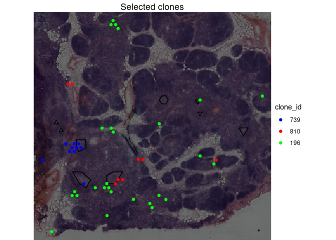
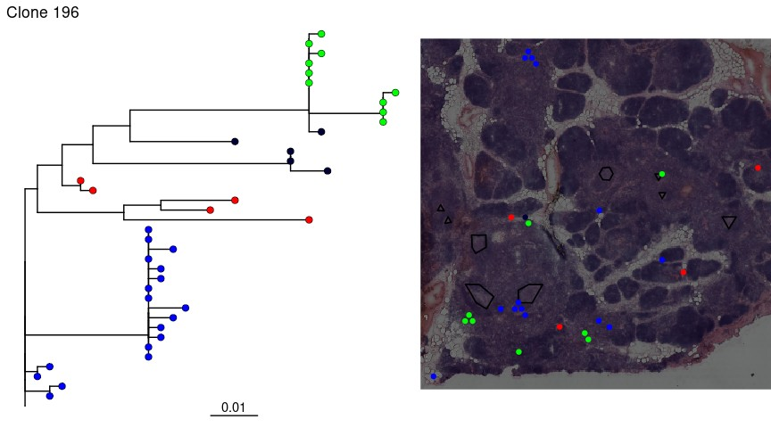

Clones and lineage trees on the tissue
================

A clone is a group of B or T cells that descend from one ancestor cell
and share its receptor rearrangement. In germinal centers, B cell clones
gain somatic hypermutations. A lineage tree of a B cell clone shows how
its sequences relate to each other. Spatial AIRR-seq lets you put each
tip of that tree on the tissue.

SIRUP does not reimplement clone calling or tree building. It runs the
Immcantation tools (scoper, dowser, shazam) on the receptor table inside
the SIRUP object. It then adds the spatial part: clone maps, trees
paired with tissue plots, and distances between tips in and between
regions.

This vignette uses MG thymus section 2 and its eGC polygons. SIRUP
installs the Immcantation packages that it needs, such as scoper,
dowser, and alakazam.

## Set up

``` r
library(SIRUP)
library(dplyr)
library(ggplot2)
```

``` r
extdata <- system.file("extdata", package = "SIRUP")

thymus <- readRDS(file.path(extdata, "mg_thymus_slice2_spatial.rds"))
bcrs <- airr::read_rearrangement(file.path(extdata, "mg_thymus_slice2_bcr.tsv.gz")) %>%
  extractSpatialIds(
    id = "sequence_id",
    spatial_id = "barcode_10x",
    regex = ",([ACGT]{16})$",
    suffix = "-1"
  ) %>%
  mutate(sequence_id = gsub(",", "_", sequence_id)) %>%
  filterAirr(
    locus_val = "IGH",
    min_v_length = 250,
    min_j_length = 30,
    min_junction_length = 10,
    productive_only = TRUE,
    min_consensus_count = NULL,
    spatial_id = "barcode_10x"
  ) %>%
  filter(!grepl("[^ACGT]", junction))
#> filterAirr kept 2195 of 3801 rows (dropped 1606).

sirup <- createSIRUP(
  spatial = thymus,
  receptors = bcrs,
  spatial_id = "barcode_10x",
  image_scale = "lowres",
  swap_coords = FALSE,
  polygons_path = file.path(extdata, "mg_thymus_slice2_gc_polygons.csv")
)
```

The setup also replaces the comma in each `sequence_id` with `_`. dowser
writes trees in Newick format, where a comma separates tips, so it
renames tips that contain one. With the comma gone, the tip names match
the receptor table, and SIRUP can find each tip on the tissue.

## Call clones inside the object

The setup made a SIRUP object without clones. To call clones, run
`scoper::hierarchicalClones()` through `updateReceptors()`.
`updateReceptors()` gives the receptor table to the function as its
first argument, with your other arguments. It then stores the returned
table and validates the object:

``` r
sirup <- updateReceptors(
  sirup,
  scoper::hierarchicalClones,
  threshold = 0.1,
  summarize_clones = FALSE,
  nproc = 1
)
#> Warning: package 'scoper' was built under R version 4.5.3

sirup
#> <SIRUP object>
#> Spatial data:    Seurat, 3,203 spatial IDs, 449 genes, 1 image
#> Receptor data:   tibble, 2,105 receptor sequences x 67 columns
#> Spatial overlap: 797/868 receptor IDs in spatial data (91.8%)
#> Spatial ID field: barcode_10x
#> Clone ID field:  clone_id
#> Analyses:        0
#> Polygons:        9
dplyr::n_distinct(getReceptors(sirup)$clone_id)
#> [1] 953
```

`hierarchicalClones()` groups sequences with the same V gene, J gene,
and junction length whose junctions differ by less than `threshold`. The
SIRUP paper used `threshold = 0.1` for BCRs. TCRs do not mutate, so call
TCR clones with `scoper::identicalClones()`.

The function writes a `clone_id` column, and `updateReceptors()` records
it as the clone field. If a function writes a different column, record
it yourself with `receptor_fields = list(clone = "my_clone_column")`.

## Germlines

A lineage tree starts at the germline sequence of its clone.
`dowser::createGermlines()` reconstructs one germline per clone from the
IMGT reference sequences. The SIRUP paper made the germlines and removed
likely PCR chimeras in the object.

SIRUP does not include the IMGT references. Download them (for example
with the Immcantation script `fetch_imgtdb.sh`) and set `SIRUP_IMGT_DIR`
to the folder that holds the human V, D, and J FASTA files, such as
`~/share/germlines/imgt/human/vdj`. The germline and tree chunks below
run only when that folder exists.

``` r
references <- dowser::readIMGT(imgt_dir)
#> [1] "Read in 1198 from 17 fasta files"

sirup <- updateReceptors(
  sirup,
  dowser::createGermlines,
  references = references,
  id = "sequence_id",
  nproc = 1
)

sirup <- updateReceptors(sirup, function(receptors) {
  chimera <- shazam::slideWindowDb(
    receptors,
    sequenceColumn = "sequence_alignment",
    germlineColumn = "germline_alignment_d_mask",
    mutThresh = 6,
    windowSize = 10
  )
  receptors[!chimera, ]
})
```

## Somatic hypermutation

`shazam::observedMutations()` counts the mutations of each sequence
against a germline. With clonal germlines, use
`germline_alignment_d_mask`. Here we use `germline_alignment`, the
germline of each sequence that IgBLAST wrote, so the chunk runs without
the IMGT references. The result goes in `mu_freq`, the fraction of
mutated positions:

``` r
sirup <- updateReceptors(
  sirup,
  shazam::observedMutations,
  sequenceColumn = "sequence_alignment",
  germlineColumn = "germline_alignment",
  frequency = TRUE,
  combine = TRUE
)
summary(getReceptors(sirup)$mu_freq)
#>    Min. 1st Qu.  Median    Mean 3rd Qu.    Max. 
#> 0.00000 0.01462 0.03750 0.04184 0.06377 0.13467
```

`plotReceptors()` can color spots by a numeric receptor column in place
of groups. Give the column to `value`. When a spot has several
receptors, `value_combine` sets how SIRUP combines them (the mean, by
default):

``` r
plotReceptors(
  sirup,
  group = "locus",
  value = "mu_freq",
  value_colors = c("white", "darkred"),
  receptor_size = 1.3,
  polygons = TRUE,
  polygon_alpha = 0,
  polygon_color = "black",
  title = "Mean SHM frequency per spot"
)
```


## Choose clones

Trees are most useful for expanded clones. Here we choose clones in the
eGCs of this section that have between 10 and 60 sequences:

``` r
clone_sizes <- getReceptors(sirup) %>%
  group_by(clone_id) %>%
  summarise(
    n_sequences = n(),
    n_in_gc = sum(!is.na(polygon_id)),
    n_gcs = n_distinct(na.omit(polygon_id)),
    gcs = paste(sort(unique(na.omit(polygon_id))), collapse = ", ")
  ) %>%
  filter(n_sequences >= 10, n_sequences <= 60, n_in_gc > 0) %>%
  arrange(desc(n_in_gc))

head(clone_sizes)
#> # A tibble: 6 × 5
#>   clone_id n_sequences n_in_gc n_gcs gcs  
#>   <chr>          <int>   <int> <int> <chr>
#> 1 739               15       6     2 6, 7 
#> 2 810               13       6     1 5    
#> 3 196               40       5     2 3, 5 
#> 4 604               12       3     2 5, 6 
#> 5 428               11       2     1 5    
#> 6 598               13       1     1 7
tree_clones <- head(clone_sizes$clone_id, 3)
```

Show their spots on the tissue:

``` r
plotReceptors(
  sirup,
  group = "clone_id",
  group_val = tree_clones,
  receptor_size = 1.6,
  polygons = TRUE,
  polygon_alpha = 0,
  polygon_color = "black",
  zoom = TRUE,
  title = "Selected clones"
)
```



## Build trees

Two functions run dowser on the object:

- `formatSpatialClones()` runs `dowser::formatClones()` and stores the
  result as an analysis.
- `getSpatialTrees()` runs `dowser::getTrees()` on a stored
  formatted-clone analysis and stores the trees as another analysis.

Both take the dowser arguments. Tree building takes time for large
clones, so first make a smaller object with only the clones you want.
`updateReceptors()` with `dplyr::filter()` does this:

``` r
tree_sirup <- updateReceptors(sirup, dplyr::filter, clone_id %in% tree_clones)

tree_sirup <- formatSpatialClones(
  tree_sirup,
  analysis_name = "formatted_clones",
  id = "sequence_id",
  germ = "germline_alignment_d_mask",
  traits = c("barcode_10x", "polygon_id")
)

tree_sirup <- getSpatialTrees(
  tree_sirup,
  f_clones_analysis = "formatted_clones",
  analysis_name = "trees",
  build = "pratchet"
)

trees <- getAnalysis(tree_sirup, "trees")
trees
#> # A tibble: 3 × 5
#>   clone_id data       locus  seqs trees  
#>   <chr>    <list>     <chr> <int> <list> 
#> 1 196      <airrClon> IGH      38 <phylo>
#> 2 739      <airrClon> IGH      15 <phylo>
#> 3 810      <airrClon> IGH      13 <phylo>
```

`traits` keeps the columns that the tree plots need. Keep the spatial
ID, so SIRUP can put each tip on the tissue, and any column that you
want to color by.

`build = "pratchet"` builds maximum parsimony trees, which is fast. For
the paper we used maximum likelihood (`build = "pml"`). For B cell
specific models, use IgPhyML (`build = "igphyml"` with the `igphyml`
path).

Store the trees in the main object:

``` r
sirup <- setAnalysis(sirup, "trees", trees)
```

## Pair each tree with the tissue

`plotSpatialCloneTreePairs()` makes two plots for each clone: the
lineage tree and a tissue map. Each tip gets one color in both plots, so
you can find a tip of the tree on the tissue:

``` r
pairs <- plotSpatialCloneTreePairs(
  trees,
  object = sirup,
  clone_val = tree_clones,
  id = "sequence_id",
  zoom = TRUE,
  polygons = TRUE,
  polygon_alpha = 0,
  polygon_color = "black"
)
#> Warning: Using `size` aesthetic for lines was deprecated in ggplot2 3.4.0.
#> ℹ Please use `linewidth` instead.
#> ℹ The deprecated feature was likely used in the ggtree package.
#>   Please report the issue at <https://github.com/YuLab-SMU/ggtree/issues>.
#> This warning is displayed once per session.
#> Call `lifecycle::last_lifecycle_warnings()` to see where this warning was
#> generated.
names(pairs)
#> [1] "196" "739" "810"

cowplot::plot_grid(
  pairs[[1]]$tree,
  pairs[[1]]$spatial_clone,
  rel_widths = c(1.2, 1)
)
```


The result is a list with one element per clone. Each element holds a
`tree` plot and a `spatial_clone` plot. Tips with a spot in this section
are circles. Tips without one, such as bulk sequences, are squares and
appear in the tree only. Sequences in the same spot share a point on the
map.

### Color tips by group

When a clone has many tips, one color per tip is hard to read.
`clusterTreesTips()` cuts each tree into `k` connected groups of related
tips. Here `k = 4` for every tree:

``` r
clustered <- clusterTreesTips(
  trees,
  k = 4,
  id = "sequence_id",
  cluster = "tree_cluster"
)

cluster_pairs <- plotSpatialCloneTreePairs(
  clustered,
  object = sirup,
  clone_val = tree_clones,
  id = "sequence_id",
  color_by = "tree_cluster",
  zoom = TRUE,
  polygons = TRUE,
  polygon_alpha = 0,
  polygon_color = "black",
  show_spatial_legend = TRUE
)

cowplot::plot_grid(
  cluster_pairs[[1]]$tree,
  cluster_pairs[[1]]$spatial_clone,
  rel_widths = c(1.2, 1)
)
```



With `k = "auto"`, the function chooses `k` for each tree from
`k_range`. It stops when one more cut reduces the mean within-group
patristic distance by less than `improvement_threshold` (10% by
default). A tree with little structure can get `k = 1`, which gives all
its tips one color.

`color_by` accepts any column of the dowser clone data. For example,
`color_by = "polygon_id"` colors each tip by its eGC, because we kept
`polygon_id` in `traits`.

### Save every pair

`spatialCloneTreePairsToPDF()` writes one page per clone:

``` r
spatialCloneTreePairsToPDF(cluster_pairs, "tree_pairs.pdf", width = 12, height = 6)
```

## Tree distance and physical distance

Do sequences in the same eGC have shorter tree distances than sequences
in different eGCs? The patristic distance between two tips is the sum of
the branch lengths between them. `tipPatristicMatrix()` gives these
distances for a set of tips. Here we take the selected clone in the most
eGCs, and compare its tip pairs in the same eGC with its pairs in
different eGCs:

``` r
multi_gc_clone <- clone_sizes %>%
  filter(clone_id %in% tree_clones) %>%
  slice_max(n_gcs, n = 1, with_ties = FALSE) %>%
  pull(clone_id)
multi_gc_clone
#> [1] "739"

index <- which(trees$clone_id == multi_gc_clone)
clone_data <- trees$data[[index]]@data
tree <- trees$trees[[index]]

gc_tips <- clone_data %>%
  filter(!is.na(polygon_id), sequence_id %in% tree$tip.label) %>%
  select(sequence_id, polygon_id)

distances <- tipPatristicMatrix(tree, gc_tips$sequence_id)

pairs_table <- as.data.frame(as.table(distances)) %>%
  rename(tip_a = Var1, tip_b = Var2, distance = Freq) %>%
  filter(as.character(tip_a) < as.character(tip_b)) %>%
  mutate(
    gc_a = gc_tips$polygon_id[match(tip_a, gc_tips$sequence_id)],
    gc_b = gc_tips$polygon_id[match(tip_b, gc_tips$sequence_id)],
    pair = if_else(gc_a == gc_b, "same eGC", "different eGCs")
  )

pairs_table %>%
  group_by(pair) %>%
  summarise(n_pairs = n(), median_distance = median(distance))
#> # A tibble: 2 × 3
#>   pair           n_pairs median_distance
#>   <chr>            <int>           <dbl>
#> 1 different eGCs       5          0.0273
#> 2 same eGC            10          0.0123
```

In this clone, tips in the same eGC are closer in the tree than tips in
different eGCs. One clone is not enough for a conclusion, because tip
pairs share branches. In the SIRUP paper we ran this comparison over all
GC clones, with a mixed model and a random effect for each clone.

With `collapse = TRUE` (the default), `formatClones()` merges identical
sequences into one tip, so not every sequence keeps its own tip.

## Session information

``` r
sessionInfo()
#> R version 4.5.1 (2025-06-13)
#> Platform: x86_64-pc-linux-gnu
#> Running under: Red Hat Enterprise Linux 8.10 (Ootpa)
#> 
#> Matrix products: default
#> BLAS/LAPACK: /usr/lib64/libopenblasp-r0.3.15.so;  LAPACK version 3.9.0
#> 
#> locale:
#>  [1] LC_CTYPE=en_US.UTF-8       LC_NUMERIC=C              
#>  [3] LC_TIME=en_US.UTF-8        LC_COLLATE=en_US.UTF-8    
#>  [5] LC_MONETARY=en_US.UTF-8    LC_MESSAGES=en_US.UTF-8   
#>  [7] LC_PAPER=en_US.UTF-8       LC_NAME=C                 
#>  [9] LC_ADDRESS=C               LC_TELEPHONE=C            
#> [11] LC_MEASUREMENT=en_US.UTF-8 LC_IDENTIFICATION=C       
#> 
#> time zone: America/New_York
#> tzcode source: system (glibc)
#> 
#> attached base packages:
#> [1] stats     graphics  grDevices utils     datasets  methods   base     
#> 
#> other attached packages:
#> [1] scoper_1.5.0     ggplot2_4.0.3    dplyr_1.2.1      SIRUP_0.0.0.9001
#> [5] testthat_3.3.2  
#> 
#> loaded via a namespace (and not attached):
#>   [1] fs_2.1.0                    matrixStats_1.5.0          
#>   [3] spatstat.sparse_3.2-0       bitops_1.1-0               
#>   [5] sf_1.1-2                    devtools_2.5.2             
#>   [7] httr_1.4.8                  RColorBrewer_1.1-3         
#>   [9] doParallel_1.0.17           tools_4.5.1                
#>  [11] sctransform_0.4.3           utf8_1.2.6                 
#>  [13] R6_2.6.1                    lazyeval_0.2.3             
#>  [15] uwot_0.2.5                  withr_3.0.3                
#>  [17] sp_2.2-3                    prettyunits_1.2.0          
#>  [19] gridExtra_2.3.1             progressr_1.0.0            
#>  [21] cli_3.6.6                   Biobase_2.70.0             
#>  [23] phylotate_1.3               spatstat.explore_3.8-1     
#>  [25] fastDummies_1.7.6           labeling_0.4.3             
#>  [27] diptest_0.77-2              Seurat_5.5.1               
#>  [29] S7_0.2.2                    spatstat.data_3.1-9        
#>  [31] readr_2.2.0                 proxy_0.4-29               
#>  [33] ggridges_0.5.7              pbapply_1.7-4              
#>  [35] Rsamtools_2.26.0            systemfonts_1.3.2          
#>  [37] yulab.utils_0.2.5           dichromat_2.0-1            
#>  [39] kedd_1.0.4                  parallelly_1.48.0          
#>  [41] sessioninfo_1.2.4           maps_3.4.3                 
#>  [43] pals_1.10                   rstudioapi_0.19.0          
#>  [45] generics_0.1.4              gridGraphics_0.5-1         
#>  [47] vroom_1.7.1                 ica_1.0-3                  
#>  [49] spatstat.random_3.5-0       spdep_1.4-2                
#>  [51] Matrix_1.7-3                S4Vectors_0.48.1           
#>  [53] abind_1.4-8                 lifecycle_1.0.5            
#>  [55] yaml_2.3.12                 SummarizedExperiment_1.40.0
#>  [57] SparseArray_1.8.0           Rtsne_0.17                 
#>  [59] grid_4.5.1                  alakazam_1.4.3             
#>  [61] promises_1.5.0              crayon_1.5.3               
#>  [63] pwalign_1.6.0               miniUI_0.1.2               
#>  [65] lattice_0.22-7              cowplot_1.2.0              
#>  [67] cigarillo_1.0.0             mapproj_1.2.12             
#>  [69] pillar_1.11.1               knitr_1.51                 
#>  [71] airrblast_0.0.1             GenomicRanges_1.62.1       
#>  [73] boot_1.3-31                 future.apply_1.20.2        
#>  [75] codetools_0.2-20            fastmatch_1.1-8            
#>  [77] wk_0.9.5                    glue_1.8.1                 
#>  [79] ggiraph_0.9.6               ggfun_0.2.1                
#>  [81] spatstat.univar_3.2-0       fontLiberation_0.1.0       
#>  [83] data.table_1.18.4           vctrs_0.7.3                
#>  [85] png_0.1-9                   treeio_1.34.0              
#>  [87] spam_2.11-4                 gtable_0.3.6               
#>  [89] cachem_1.1.0                xfun_0.60                  
#>  [91] S4Arrays_1.10.1             mime_0.13                  
#>  [93] Seqinfo_1.0.0               coda_0.19-4.1              
#>  [95] survival_3.8-9              iterators_1.0.14           
#>  [97] units_0.8-5                 ellipsis_0.3.3             
#>  [99] fitdistrplus_1.2-6          ROCR_1.0-12                
#> [101] nlme_3.1-168                ggtree_4.0.5               
#> [103] usethis_3.2.1               bit64_4.8.2                
#> [105] fontquiver_0.2.1            progress_1.2.3             
#> [107] RcppAnnoy_0.0.23            rprojroot_2.1.1            
#> [109] irlba_2.3.7                 airr_2.0.0                 
#> [111] KernSmooth_2.23-26          otel_0.2.0                 
#> [113] colorspace_2.1-3            spData_2.3.5               
#> [115] BiocGenerics_0.56.0         DBI_1.3.0                  
#> [117] ade4_1.7-24                 phangorn_2.12.1            
#> [119] tidyselect_1.2.1            bit_4.6.0                  
#> [121] compiler_4.5.1              desc_1.4.3                 
#> [123] fontBitstreamVera_0.1.1     DelayedArray_0.36.1        
#> [125] plotly_4.12.1               scales_1.4.0               
#> [127] classInt_0.4-11             lmtest_0.9-40              
#> [129] quadprog_1.5-8              rappdirs_0.3.4             
#> [131] stringr_1.6.0               digest_0.6.39              
#> [133] goftest_1.2-3               spatstat.utils_3.2-4       
#> [135] dowser_2.5.1.999            rmarkdown_2.31             
#> [137] XVector_0.50.0              htmltools_0.5.9            
#> [139] pkgconfig_2.0.3             MatrixGenerics_1.22.0      
#> [141] fastmap_1.2.0               rlang_1.3.0                
#> [143] htmlwidgets_1.6.4           shiny_1.14.0               
#> [145] farver_2.1.2                zoo_1.9-0                  
#> [147] jsonlite_2.0.0              BiocParallel_1.38.0        
#> [149] magrittr_2.0.5              ggplotify_0.1.3            
#> [151] s2_1.1.11                   dotCall64_1.2              
#> [153] patchwork_1.3.2             Rcpp_1.1.2                 
#> [155] ape_5.8-1                   gdtools_0.5.1              
#> [157] reticulate_1.46.0           stringi_1.8.9              
#> [159] brio_1.1.5                  MASS_7.3-65                
#> [161] plyr_1.8.9                  pkgbuild_1.4.8             
#> [163] parallel_4.5.1              listenv_1.0.0              
#> [165] ggrepel_0.9.8               deldir_2.0-4               
#> [167] Biostrings_2.78.0           shazam_1.3.2               
#> [169] splines_4.5.1               tensor_1.5.1               
#> [171] hms_1.1.4                   igraph_2.3.3               
#> [173] fastcluster_1.3.0           spatstat.geom_3.8-1        
#> [175] seqinr_4.2-44               markdown_2.0               
#> [177] RcppHNSW_0.7.0              reshape2_1.4.5             
#> [179] stats4_4.5.1                pkgload_1.5.3              
#> [181] evaluate_1.0.5              SeuratObject_5.4.0         
#> [183] tzdb_0.5.0                  foreach_1.5.2              
#> [185] httpuv_1.6.17               RANN_2.6.3                 
#> [187] tidyr_1.3.2                 purrr_1.2.2                
#> [189] polyclip_1.10-7             future_1.75.0              
#> [191] scattermore_1.2             xtable_1.8-8               
#> [193] e1071_1.7-17                RSpectra_0.16-2            
#> [195] tidytree_0.4.8              later_1.4.8                
#> [197] class_7.3-23                viridisLite_0.4.3          
#> [199] tibble_3.3.1                aplot_0.3.1                
#> [201] memoise_2.0.1               GenomicAlignments_1.46.0   
#> [203] IRanges_2.44.0              cluster_2.1.8.3            
#> [205] globals_0.19.1
```
