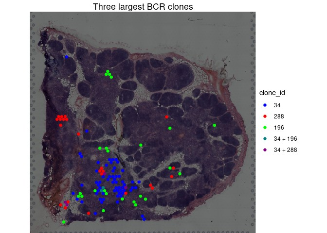
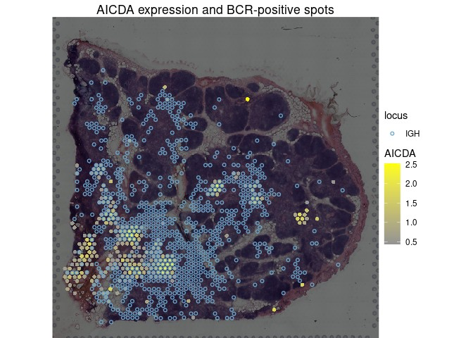

Get started with SIRUP
================

> **Time:** about 15 minutes. **Data:** the thymus example data in
> SIRUP. **Needs:** SIRUP, dplyr, ggplot2, and scoper.

SIRUP (Spatial Immune Receptor Utilities Package) is an R package for
spatial adaptive immune receptor repertoire sequencing (spAIRR-seq). In
this method, a tissue section carries a spatial barcode. The barcode
lets you read B cell receptor (BCR) or T cell receptor (TCR) sequences
and gene expression from the same spots. SIRUP joins the two data types,
so you can ask where in the tissue each clone sits.

In this page you build a SIRUP object from example data and run a first
analysis. You will do these steps:

1.  Load a Seurat object and a table of BCR sequences.
2.  Match each sequence to a spot, and filter the sequences.
3.  Create a SIRUP object and call clones.
4.  Plot expression and receptors on the tissue.
5.  Draw a tissue region, and measure clonal dominance in it.
6.  Save the object.

> **Note.** This page starts after read processing. If you have raw
> reads, read [Process reads into spatial AIRR tables](processing.md) first.

## Install SIRUP

Install SIRUP from GitHub with BiocManager. BiocManager also installs
the Bioconductor packages that SIRUP needs, such as ggtree:

``` r
if (!requireNamespace("BiocManager", quietly = TRUE)) install.packages("BiocManager")
BiocManager::install("hoehnlab/SIRUP")
```

SIRUP installs the packages that most functions need. These include
Immcantation packages (dowser, scoper, and alakazam) and the spatial
statistics package spdep. The tutorials also use a few optional
packages. This code installs the ones that you do not have:

``` r
packages <- c("spatstat.explore", "spatstat.geom", "spatstat.random", "pals")
missing <- packages[!vapply(packages, requireNamespace, logical(1), quietly = TRUE)]
if (length(missing) > 0) install.packages(missing)
```

You need command-line tools only to process raw reads. These tools are
IgBLAST, pRESTO, vsearch, and MUSCLE.
[Process reads into spatial AIRR tables](processing.md) shows how to set them up.

## Look at the example data

SIRUP includes a small spAIRR-seq data set from the thymus of a patient
with myasthenia gravis (MG). The thymus in MG can contain ectopic
germinal centers (eGCs). These are germinal centers that form outside
lymph nodes and tonsils. The data come from two 10x Visium sections of
the same thymus. Each spot is 55 µm wide and can hold several cells.

The files are in the `extdata` folder of the package:

``` r
extdata <- system.file("extdata", package = "SIRUP")
list.files(extdata)
#>  [1] "mg_thymus_bulk_blood_month0_1.tsv.gz" 
#>  [2] "mg_thymus_bulk_blood_month0_2.tsv.gz" 
#>  [3] "mg_thymus_bulk_blood_month12_1.tsv.gz"
#>  [4] "mg_thymus_bulk_blood_month12_2.tsv.gz"
#>  [5] "mg_thymus_bulk_thymus_1.tsv.gz"       
#>  [6] "mg_thymus_bulk_thymus_2.tsv.gz"       
#>  [7] "mg_thymus_cell_types.csv.gz"          
#>  [8] "mg_thymus_slice1_bcr.tsv.gz"          
#>  [9] "mg_thymus_slice1_gc_polygons.csv"     
#> [10] "mg_thymus_slice1_spatial.rds"         
#> [11] "mg_thymus_slice2_bcr.tsv.gz"          
#> [12] "mg_thymus_slice2_gc_polygons.csv"     
#> [13] "mg_thymus_slice2_reads.tsv.gz"        
#> [14] "mg_thymus_slice2_spatial.rds"         
#> [15] "mg_thymus_slice2_tcr.tsv.gz"          
#> [16] "sirup_synthetic.rds"
```

This page uses these files:

| File | Contents |
|----|----|
| `mg_thymus_slice2_spatial.rds` | A Seurat object for section 2: all spots, a panel of genes, and a low-resolution H&E image |
| `mg_thymus_slice2_bcr.tsv.gz` | The IGH consensus sequences of section 2, in an AIRR rearrangement table |
| `mg_thymus_slice2_gc_polygons.csv` | Outlines of the eGCs in section 2 |
| `mg_thymus_cell_types.csv.gz` | The cell-type proportions of each spot, from cell2location |

The SIRUP paper describes how the authors made these files. To keep the
package small, each Seurat object holds a few hundred genes and a
reduced image.

``` r
library(SIRUP)
library(dplyr)
library(ggplot2)
```

## Load the spatial data and the receptors

Read the Seurat object and the AIRR table:

``` r
thymus <- readRDS(file.path(extdata, "mg_thymus_slice2_spatial.rds"))
thymus
#> An object of class Seurat 
#> 506 features across 3203 samples within 2 assays 
#> Active assay: Spatial (449 features, 0 variable features)
#>  2 layers present: counts, data
#>  1 other assay present: alra
#>  1 spatial field of view present: thymus_slice2

bcrs <- airr::read_rearrangement(file.path(extdata, "mg_thymus_slice2_bcr.tsv.gz"))
bcrs %>%
  select(sequence_id, v_call, j_call, c_call, consensus_count) %>%
  head()
#> # A tibble: 6 × 5
#>   sequence_id         v_call                       j_call c_call consensus_count
#>   <chr>               <chr>                        <chr>  <chr>            <int>
#> 1 9,TGATTCCCGGTTACCT  IGHV2-5*02                   IGHJ4… IGHG1                1
#> 2 11,TGATTCCCGGTTACCT IGHV3-30*03,IGHV3-30*06      IGHJ4… IGHG1                1
#> 3 2,TGATTCCCGGTTACCT  IGHV5-51*01                  IGHJ5… IGHG2                1
#> 4 6,TGATTCCCGGTTACCT  IGHV5-51*01                  IGHJ5… IGHG2                1
#> 5 5,CCTACATTCACAGACG  IGHV3-23*01,IGHV3-23*04,IGH… IGHJ4… IGHG1                1
#> 6 3,CCTACATTCACAGACG  IGHV1-2*02,IGHV1-2*04        IGHJ4… IGHG1                1
```

Each row is one BCR consensus sequence. The pipeline wrote the spot
barcode at the end of `sequence_id`, after a comma.

## Match each sequence to a spot

`extractSpatialIds()` copies the barcode into its own column. The
`regex` argument finds the barcode. The `suffix` argument adds `-1`, so
that each barcode matches a spot name in the Seurat object:

``` r
bcrs <- extractSpatialIds(
  bcrs,
  id = "sequence_id",
  spatial_id = "barcode_10x",
  regex = ",([ACGT]{16})$",
  suffix = "-1"
)

head(colnames(thymus))
#> [1] "AAACAAGTATCTCCCA-1" "AAACACCAATAACTGC-1" "AAACAGCTTTCAGAAG-1"
#> [4] "AAACAGGGTCTATATT-1" "AAACAGTGTTCCTGGG-1" "AAACATGGTGAGAGGA-1"
mean(bcrs$barcode_10x %in% colnames(thymus))
#> [1] 0.9373849
```

A few sequences have a barcode that is not in the Seurat object. The
spot was off the tissue or failed the expression quality control. SIRUP
keeps these rows in the table, but it cannot put them on the tissue.

## Filter the sequences

Keep the high-quality sequences. The thresholds below come from the
SIRUP paper. [Process reads into spatial AIRR tables](processing.md) explains each
one:

``` r
bcrs <- filterAirr(
  bcrs,
  locus_val = "IGH",
  min_v_length = 250,
  min_j_length = 30,
  min_junction_length = 10,
  productive_only = TRUE,
  min_consensus_count = NULL,
  spatial_id = "barcode_10x"
)
#> filterAirr kept 2195 of 3801 rows (dropped 1606).
bcrs <- filter(bcrs, !grepl("[^ACGT]", junction))
```

The last line removes sequences with an ambiguous base, such as `N`, in
the junction. The clone caller in the next section needs junctions that
contain only `A`, `C`, `G`, and `T`.

## Create a SIRUP object

`createSIRUP()` joins the Seurat object and the receptor table. Tell it
which receptor column holds the spatial ID and which holds the locus:

``` r
sirup <- createSIRUP(
  spatial = thymus,
  receptors = bcrs,
  spatial_id = "barcode_10x",
  locus = "locus",
  image_scale = "lowres",
  swap_coords = FALSE,
  metadata = list(tissue = "MG thymus", section = "slice 2")
)

sirup
#> <SIRUP object>
#> Spatial data:    Seurat, 3,203 spatial IDs, 449 genes, 1 image
#> Receptor data:   tibble, 2,105 receptor sequences x 56 columns
#> Spatial overlap: 797/868 receptor IDs in spatial data (91.8%)
#> Spatial ID field: barcode_10x
#> Analyses:        0
```

SIRUP stores these column names once. Later functions find the spatial
ID, clone, and locus columns without more arguments. Your columns can
have any names.

Two settings control how SIRUP puts spots on the H&E image:

- `image_scale` is `"lowres"` or `"hires"`. Use the image that your
  Seurat object stores. `Load10X_Spatial()` stores the low-resolution
  image by default.
- `swap_coords` swaps the x and y coordinates. Set it to `TRUE` if your
  spots have the right shape but sit rotated or mirrored over the image.

SIRUP stores both settings in the object. Every plot and spatial
statistic reads them from there.

> **Tip.** [How the SIRUP object works](sirup-object.md) explains the
> five parts of the object and the rules that SIRUP checks.

## Call clones

A clone is a group of B cells that descend from one ancestor cell. Many
SIRUP functions summarize receptors by clone. SIRUP does not call clones
itself. `updateReceptors()` runs any function on the receptor table and
puts the result back in the object. This call runs
`scoper::hierarchicalClones()` with the threshold from the SIRUP paper:

``` r
sirup <- updateReceptors(
  sirup,
  scoper::hierarchicalClones,
  threshold = 0.1,
  summarize_clones = FALSE,
  nproc = 1
)
#> Running defineClonesScoper in bulk mode and only keep heavy chains
sirup
#> <SIRUP object>
#> Spatial data:    Seurat, 3,203 spatial IDs, 449 genes, 1 image
#> Receptor data:   tibble, 2,105 receptor sequences x 57 columns
#> Spatial overlap: 797/868 receptor IDs in spatial data (91.8%)
#> Spatial ID field: barcode_10x
#> Clone ID field:  clone_id
#> Analyses:        0
```

The receptor table now has a `clone_id` column, and SIRUP records it as
the clone field. If your clone column has another name, such as
`clone_family_id`, pass `clone = "clone_family_id"` to `createSIRUP()`.

## Look inside the object

`summary()` gives counts for each part of the object. The accessors
return ordinary R objects, so you can pass them to any function from
another package:

``` r
summary(sirup)
#> SIRUP summary
#>   Spatial IDs:      3,203
#>   Receptor records: 2,105
#>   Receptor IDs:     868
#>   Matched IDs:      797 (91.8%)
#>   Matched records:  1,965
#>   Image scale:      lowres
#>   Swap coords:      FALSE
#>   Stored analyses:  0
#> 
#> Per-sample summary
#> # A tibble: 1 × 7
#>   sample  n_spatial_ids n_receptor_records n_receptor_ids n_matched_ids
#>   <chr>           <int>              <int>          <int>         <int>
#> 1 spatial          3203               2105            868           797
#> # ℹ 2 more variables: n_matched_records <int>, id_match_rate <dbl>

getReceptors(sirup) %>%
  count(c_call, sort = TRUE) %>%
  head()
#> # A tibble: 6 × 2
#>   c_call     n
#>   <chr>  <int>
#> 1 IGHG1   1172
#> 2 IGHG2    346
#> 3 IGHA1    215
#> 4 IGHM     193
#> 5 IGHG3    117
#> 6 <NA>      19
```

## Plot expression and receptors on the tissue

`spatialExpressionPlot()` draws gene expression over the H&E image. By
default it hides spots with zero expression, so the tissue stays
visible.

*AICDA* marks germinal center B cells. The example object has two
assays: `Spatial` (counts and log-normalized data) and `alra`
(ALRA-imputed values for a panel of marker genes). Imputed values give
smoother maps. Use them to display data, not to compute statistics.

``` r
spatialExpressionPlot(
  sirup,
  features = "AICDA",
  assay = "alra",
  layer = "data",
  title = "AICDA",
  zero_tol = 0
)
```


`plotReceptors()` draws the spots that have a receptor. The `group`
argument names the receptor column that sets the color. In this table
every row has the locus `IGH`, so all BCR-positive spots get one color:

``` r
plotReceptors(
  sirup,
  group = "locus",
  colors = "#0072B2",
  receptor_size = 1.2,
  title = "BCR-positive spots"
)
```


Use `group_val` to show some values of the group column. This plot shows
the three largest clones of the section:

``` r
top_clones <- getReceptors(sirup) %>%
  count(clone_id, sort = TRUE) %>%
  slice_head(n = 3) %>%
  pull(clone_id)
top_clones
#> [1] "34"  "288" "196"

plotReceptors(
  sirup,
  group = "clone_id",
  group_val = top_clones,
  receptor_size = 1.6,
  title = "Three largest BCR clones"
)
```



A Visium spot can hold BCRs from more than one clone. If two selected
clones share a spot, `plotReceptors()` gives the spot a combined label.
The label joins the clone IDs with `+`. The `overlap` argument controls
this behavior.

`plotReceptorsExpression()` combines the two plots. Spots with
expression are filled points. Spots with a receptor are hollow rings on
top:

``` r
plotReceptorsExpression(
  sirup,
  group = "locus",
  gene = "AICDA",
  assay = "alra",
  layer = "data",
  colors = "skyblue3",
  receptor_size = 1.2,
  feature_size = 2,
  title = "AICDA expression and BCR-positive spots"
)
```



## Draw a tissue region

Many spatial questions concern a region, such as a germinal center, a
tumor margin, or a lesion. In SIRUP, a region is a polygon on the tissue
image.

`selectSpatialPolygons()` opens an app in which you draw polygons over
the tissue. For the SIRUP paper, the authors drew the eGCs over imputed
*AICDA* expression:

``` r
gc_vertices <- selectSpatialPolygons(
  sirup,
  feature = "AICDA",
  assay = "alra",
  layer = "data",
  plot_image = TRUE,
  save_path = "mg_thymus_slice2_gc_polygons.csv"
)
```


Click around the edge of a region. Each click snaps to the nearest spot.
**Close polygon** joins the last vertex to the first:


After you click **Done**, the app returns the vertices of every polygon.
It also writes them to the CSV file.

`addPolygons()` attaches polygons to the object. Give it the data frame
from the app (`polygons = gc_vertices`) or the CSV file
(`polygons_path`). SIRUP then marks the polygon that contains each spot
and each receptor. The example data include the eGC polygons from the
SIRUP paper:

``` r
sirup <- addPolygons(
  sirup,
  polygons_path = file.path(extdata, "mg_thymus_slice2_gc_polygons.csv")
)

getPolygons(sirup)
#> # A tibble: 9 × 2
#>   polygon_id vertices        
#>   <chr>      <named list>    
#> 1 1          <tibble [7 × 5]>
#> 2 2          <tibble [4 × 5]>
#> 3 3          <tibble [4 × 5]>
#> 4 4          <tibble [4 × 5]>
#> 5 5          <tibble [6 × 5]>
#> 6 6          <tibble [7 × 5]>
#> 7 7          <tibble [7 × 5]>
#> 8 8          <tibble [4 × 5]>
#> 9 9          <tibble [4 × 5]>

plotSpatialPolygons(
  sirup,
  polygon_alpha = 0.3,
  label_outside = TRUE,
  label_offset = 0.02,
  label_color = "white",
  label_leader = FALSE
)
```


The receptor table now has a `polygon_id` column. Receptors outside
every polygon get `NA`:

``` r
getReceptors(sirup) %>%
  count(polygon_id)
#> # A tibble: 9 × 2
#>   polygon_id     n
#>   <chr>      <int>
#> 1 1             28
#> 2 2             23
#> 3 3             14
#> 4 5             47
#> 5 6              4
#> 6 7             30
#> 7 8              6
#> 8 9              4
#> 9 <NA>        1949
```

## Measure clonal dominance

`polygonReceptorSummary()` counts the receptors, spots, and clones in
each polygon. It stores the result in the object as an analysis:

``` r
sirup <- polygonReceptorSummary(sirup, polygon_id = "polygon_id")
getAnalysis(sirup, "polygon_receptor_summary")
#> # A tibble: 9 × 5
#>   polygon_id n_receptors n_spatial_ids n_clones top_clone_fraction
#>   <chr>            <int>         <int>    <int>              <dbl>
#> 1 1                   28             6       16              0.143
#> 2 2                   23             3       16              0.174
#> 3 3                   14             3        8              0.286
#> 4 4                    0             0        0             NA    
#> 5 5                   47            12       23              0.128
#> 6 6                    4             4        4              0.25 
#> 7 7                   30             8       12              0.167
#> 8 8                    6             3        4              0.333
#> 9 9                    4             3        4              0.25
```

Clonal dominance measures how much of a region the largest clones fill.
`spatialCloneDominance()` computes the fraction of the receptors in each
polygon that belongs to each clone. `plotSpatialPolygonPies()` draws one
pie chart for each polygon next to the tissue:

``` r
dominance <- spatialCloneDominance(object = sirup)

dominance$dominance %>%
  group_by(polygon) %>%
  slice_max(proportion, n = 1, with_ties = FALSE) %>%
  select(polygon, clone_id, n_receptors, proportion)
#> # A tibble: 8 × 4
#> # Groups:   polygon [8]
#>   polygon clone_id n_receptors proportion
#>   <chr>   <chr>          <dbl>      <dbl>
#> 1 1       928                4      0.143
#> 2 2       381                4      0.174
#> 3 3       196                4      0.286
#> 4 5       810                6      0.128
#> 5 6       136                1      0.25 
#> 6 7       739                5      0.167
#> 7 8       242                2      0.333
#> 8 9       222                1      0.25

pies <- plotSpatialPolygonPies(
  dominance = dominance,
  object = sirup,
  fill = "clone_id",
  top_n = 5
)
pies$page_1
#> Warning: Removed 1 row containing missing values or values outside the scale range
#> (`geom_text()`).
```


The function returns one plot for each page, with six pies on a page.
The `top_n` argument sets how many clones get their own color in each
pie. The grey `Other` slice holds the remaining clones.

[Draw tissue regions and measure clonal dominance and diversity](regions.md) covers regions in depth:
overlapping regions, clonal diversity, gene expression, and distances
between regions.

## Save the object

`setAnalysis()` stores any R object under a name. Stored results stay
with the data that made them:

``` r
sirup <- setAnalysis(sirup, "gc_dominance", dominance)
listAnalyses(sirup)
#> [1] "polygon_receptor_summary" "gc_dominance"
```

`saveSIRUP()` writes the object to one RDS file. `readSIRUP()` reads it
back, validates it, and upgrades an object that an older version of
SIRUP saved:

``` r
path <- file.path(tempdir(), "mg_thymus_slice2.sirup.rds")
saveSIRUP(sirup, path)
sirup <- readSIRUP(path)
sirup
#> <SIRUP object>
#> Spatial data:    Seurat, 3,203 spatial IDs, 449 genes, 1 image
#> Receptor data:   tibble, 2,105 receptor sequences x 67 columns
#> Spatial overlap: 797/868 receptor IDs in spatial data (91.8%)
#> Spatial ID field: barcode_10x
#> Clone ID field:  clone_id
#> Analyses:        2
#> Polygons:        9
```

## Next steps

- To understand the parts of the object, read
  [How the SIRUP object works](sirup-object.md).
- To compare tissue regions, read
  [Draw tissue regions and measure clonal dominance and diversity](regions.md).
- To build lineage trees and show them on the tissue, read
  [Call clones and build lineage trees on the tissue](clones-and-trees.md).
- To test spatial patterns, read
  [Test spatial patterns of genes, cells, and clones](spatial-statistics.md).
- To process your own reads, read
  [Process reads into spatial AIRR tables](processing.md).
