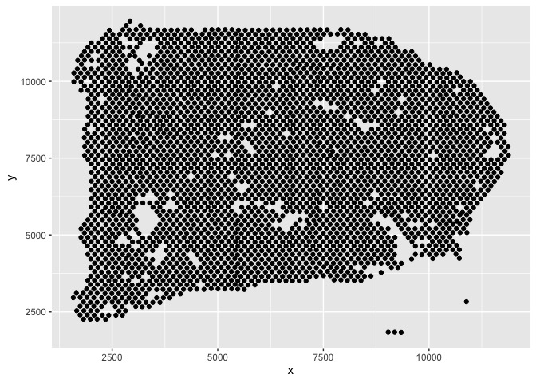
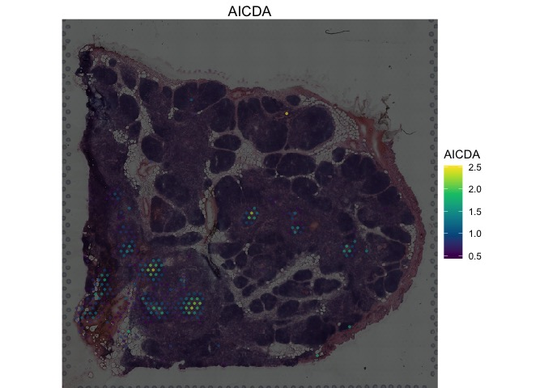
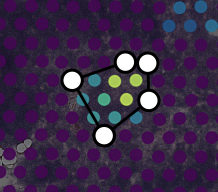
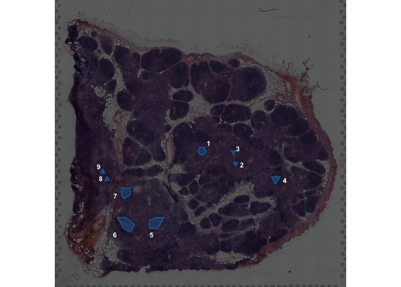
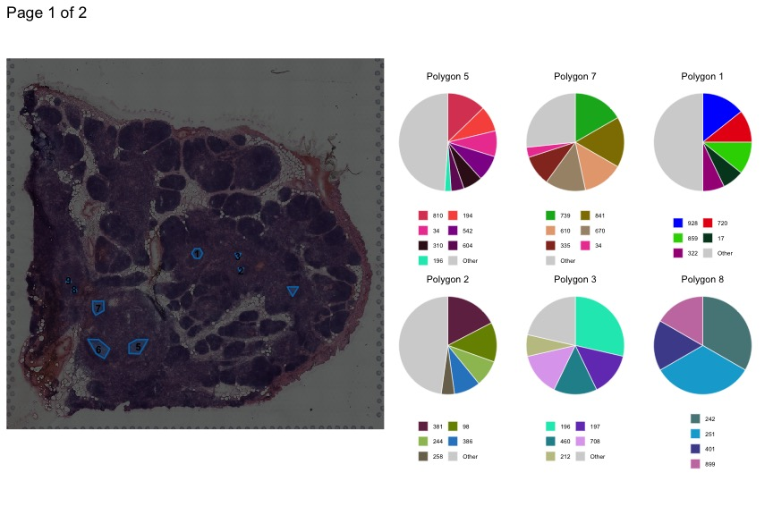

Get started with SIRUP
================

<div markdown="1"
style="background: #F7E5BC; padding: 12px; margin-bottom: 24px; line-height: 24px;">

<p style="margin: -12px -12px 12px; padding: 6px 12px; background: #d6b676; color: #ffffff; font-weight: 700;">

<b>Note</b>
</p>

**Time:** ~15 minutes.<br> **Data:** example MG thymus data in SIRUP.

</div>

Here, we will build a SIRUP object from example data and run a few
simple analyses.

<div markdown="1"
style="background: #F7E5BC; padding: 12px; margin-bottom: 24px; line-height: 24px;">

<p style="margin: -12px -12px 12px; padding: 6px 12px; background: #d6b676; color: #ffffff; font-weight: 700;">

<b>Note</b>
</p>

This page starts after read processing. If you have raw or demultiplexed
reads, see [Process demultiplexed reads](processing.md) first.

</div>

## Get the example data

This page uses example files that are not part of the SIRUP package.
This code downloads them. Change `dest` to a folder you want to keep.
The default folder is temporary. The function skips files that are
already there.

``` r
extdata <- SIRUP::downloadSIRUPExample(
  dest = file.path(tempdir(), "SIRUP_example"),
  files = c(
  "mg_thymus_slice2_spatial.rds",
  "mg_thymus_slice2_bcr.tsv.gz",
  "mg_thymus_slice2_gc_polygons.csv",
  "mg_thymus_cell_types.csv.gz"
  )
)
#> ℹ 'mg_thymus_slice2_spatial.rds' is already in '/var/folders/5l/x6nq60_10t53vqby5_sjxj9r0000gr/T//RtmpqlRSLG/SIRUP_example'.
#> ℹ 'mg_thymus_slice2_bcr.tsv.gz' is already in '/var/folders/5l/x6nq60_10t53vqby5_sjxj9r0000gr/T//RtmpqlRSLG/SIRUP_example'.
#> ℹ 'mg_thymus_slice2_gc_polygons.csv' is already in '/var/folders/5l/x6nq60_10t53vqby5_sjxj9r0000gr/T//RtmpqlRSLG/SIRUP_example'.
#> ℹ Downloading 'mg_thymus_cell_types.csv.gz'
```

## Install SIRUP

Install SIRUP and its dependencies from GitHub with BiocManager:

``` r
if (!requireNamespace("BiocManager", quietly = TRUE)) install.packages("BiocManager")
BiocManager::install("hoehnlab/SIRUP")
```

This vignette uses a few of SIRUP’s suggested packages as well. Run the
code below to install any that are missing:

``` r
packages <- c("spatstat.explore", "spatstat.geom", "spatstat.random", "pals")
missing <- packages[!vapply(packages, requireNamespace, logical(1), quietly = TRUE)]
if (length(missing) > 0) install.packages(missing)
```

## Look at the example data

SIRUP includes an example spAIRR-seq data set from the thymus of a
patient with myasthenia gravis (MG). The thymus in MG can contain
ectopic germinal centers (eGCs) where B cells undergo affinity
maturation. The data were generated with 10x Visium for spatial
transcriptomics and barcodes, then RAGE-seq + long-read Oxford Nanopore
sequencing to amplify BCRs/TCRs and sequence them.

This vignette uses these files:

| File | Contents |
|----|----|
| `mg_thymus_slice2_spatial.rds` | A spatial Seurat object for MG thymus |
| `mg_thymus_slice2_bcr.tsv.gz` | AIRR rearrangement table of IGH sequences with spatial IDs |
| `mg_thymus_slice2_gc_polygons.csv` | Annotated polygons of the eGCs |
| `mg_thymus_cell_types.csv.gz` | Cell-type proportions for each spot |

The code above downloaded these files with `downloadSIRUPExample()`.

The SIRUP paper describes how the authors made these files. To reduce
file sizes, each Seurat object holds a few hundred genes and a reduced
image.

``` r
library(SIRUP)
library(dplyr)
library(ggplot2)
```

## Load the spatial GEX data and the receptors

Read the Seurat object and the AIRR table:

``` r
thymus <- readRDS(file.path(extdata, "mg_thymus_slice2_spatial.rds"))
thymus
#> An object of class Seurat 
#> 506 features across 3203 samples within 2 assays 
#> Active assay: Spatial (449 features, 0 variable features)
#>  2 layers present: counts, data
#>  1 other assay present: alra
#>  1 spatial field of view present: thymus_slice2

bcrs <- airr::read_rearrangement(file.path(extdata, "mg_thymus_slice2_bcr.tsv.gz"))
bcrs %>%
  select(sequence_id, v_call, j_call, c_call, sequence_alignment) %>%
  head()
#> # A tibble: 6 × 5
#>   sequence_id         v_call                    j_call c_call sequence_alignment
#>   <chr>               <chr>                     <chr>  <chr>  <chr>             
#> 1 9,TGATTCCCGGTTACCT  IGHV2-5*02                IGHJ4… IGHG1  ...ATCACCTTGAAGGA…
#> 2 11,TGATTCCCGGTTACCT IGHV3-30*03,IGHV3-30*06   IGHJ4… IGHG1  .................…
#> 3 2,TGATTCCCGGTTACCT  IGHV5-51*01               IGHJ5… IGHG2  GAGGTGCCGCTGGTGCA…
#> 4 6,TGATTCCCGGTTACCT  IGHV5-51*01               IGHJ5… IGHG2  GAGGTGCCGCTGGTGCA…
#> 5 5,CCTACATTCACAGACG  IGHV3-23*01,IGHV3-23*04,… IGHJ4… IGHG1  .................…
#> 6 3,CCTACATTCACAGACG  IGHV1-2*02,IGHV1-2*04     IGHJ4… IGHG1  CAGGTGCATCTGGTGCA…
```

Each row is one BCR sequence. The processing pipeline wrote the spatial
ID at the end of `sequence_id`, after a comma.

## Match each sequence to a spot

`extractSpatialIds()` is a convenience function to extract the spatial
ID and put it into its own column. The `regex` argument finds the
spatial ID. The `suffix` argument adds `-1`, so that each spatial ID
matches a spot name in the Seurat object.

``` r
bcrs <- extractSpatialIds(
  bcrs,
  id = "sequence_id",
  spatial_id = "barcode_10x",
  regex = ",([ACGT]{16})$",
  suffix = "-1"
)

head(colnames(thymus))
#> [1] "AAACAAGTATCTCCCA-1" "AAACACCAATAACTGC-1" "AAACAGCTTTCAGAAG-1"
#> [4] "AAACAGGGTCTATATT-1" "AAACAGTGTTCCTGGG-1" "AAACATGGTGAGAGGA-1"
mean(bcrs$barcode_10x %in% colnames(thymus))
#> [1] 0.9372528
```

A few sequences have a spatial ID that is not in the Seurat object. The
spot was likely off the tissue or failed the expression quality control.
SIRUP will maintain these receptor sequences in the integrated SIRUP
object, but it will not be able to place them in spatial plots.

## Filter the sequences

Keep only the high-quality sequences. The thresholds used are discussed
in [Process demultiplexed reads](processing.md).

``` r
bcrs <- filterAirr(
  bcrs,
  locus_val = "IGH",
  min_v_length = 250,
  min_j_length = 30,
  min_junction_length = 10,
  productive_only = TRUE,
  min_consensus_count = NULL,
  spatial_id = "barcode_10x"
)
#> filterAirr kept 2189 of 3793 rows (dropped 1604).
```

## Create a SIRUP object

`createSIRUP()` joins the Seurat object and the receptor table. Tell it
which receptor column holds the spatial ID and which holds the locus.
You can also specify the image scale and coordinate settings when
constructing the object, which are discussed further below.

``` r
sirup <- createSIRUP(
  spatial = thymus,
  receptors = bcrs,
  spatial_id = "barcode_10x",
  locus = "locus",
  image_scale = "lowres",
  swap_coords = FALSE,
  metadata = list(tissue = "MG thymus", section = "slice 2")
)

sirup
#> <SIRUP object>
#> Spatial data:    Seurat, 3,203 spatial IDs, 449 genes, 1 image
#> Receptor data:   tibble, 2,189 receptor sequences x 56 columns
#> Spatial overlap: 817/888 receptor IDs in spatial data (92.0%)
#> Spatial ID field: barcode_10x
#> Analyses:        0

summary(sirup)
#> SIRUP summary
#>   Spatial IDs:      3,203
#>   Receptor records: 2,189
#>   Receptor IDs:     888
#>   Matched IDs:      817 (92.0%)
#>   Matched records:  2,047
#>   Image scale:      lowres
#>   Swap coords:      FALSE
#>   Stored analyses:  0
#> 
#> Per-sample summary
#> # A tibble: 1 × 7
#>   sample  n_spatial_ids n_receptor_records n_receptor_ids n_matched_ids
#>   <chr>           <int>              <int>          <int>         <int>
#> 1 spatial          3203               2189            888           817
#> # ℹ 2 more variables: n_matched_records <int>, id_match_rate <dbl>
```

If a `spatial_id`, `locus`, and/or `clone` column are specified when
constructing the SIRUP object, later functions can find these columns
without including them as arguments.

Two settings control how SIRUP constructs plots over the H&E image:

- `image_scale` is `"lowres"` or `"hires"`. Use the image that tge
  Seurat object stores. `Load10X_Spatial()` stores the low-resolution
  image by default, though it can use the high-resolution image if
  specified in the `image.name` argument.
- `swap_coords` swaps the x and y coordinates. Set it to `TRUE` if the
  spots have the right shape but sit rotated or mirrored over the image.
  This is easiest to determine by plotting the spots as shown below.

``` r
coords <- SeuratObject::GetTissueCoordinates(thymus)
ggplot(coords, aes(x, y)) + geom_point() 
```



If both arguments are included when constructing the SIRUP object, they
will be stored in the object, and plotting functions will automatically
use them. If they are not specified when constructing the SIRUP object,
both settings should be passed to any plotting functions.

<div markdown="1"
style="background: #F7E5BC; padding: 12px; margin-bottom: 24px; line-height: 24px;">

<p style="margin: -12px -12px 12px; padding: 6px 12px; background: #d6b676; color: #ffffff; font-weight: 700;">

<b>Note</b>
</p>

[How the SIRUP object works](sirup-object.md) discusses the SIRUP object
in more detail.

</div>

## Building clones in the SIRUP object

A clone is a group of cells that descend from a common ancestor. Many
SIRUP functions work with clone-level data, but SIRUP does not itself
build clones. The `updateReceptors()` function is a method that can runs
any function on the receptor table and updates the receptor table in the
object with the result. This call runs `hierarchicalClones()` from the
`scoper` package.

``` r
sirup <- updateReceptors(
  sirup,
  scoper::hierarchicalClones,
  threshold = 0.1,
  summarize_clones = FALSE,
  nproc = 1
)
#> Warning in prepare_db(db = db, junction = junction, v_call = v_call, j_call =
#> j_call, : Removed 84 sequences with non-ATCG characters in the junction.
#> Running defineClonesScoper in bulk mode and only keep heavy chains
sirup
#> <SIRUP object>
#> Spatial data:    Seurat, 3,203 spatial IDs, 449 genes, 1 image
#> Receptor data:   tibble, 2,105 receptor sequences x 57 columns
#> Spatial overlap: 797/868 receptor IDs in spatial data (91.8%)
#> Spatial ID field: barcode_10x
#> Clone ID field:  clone_id
#> Analyses:        0
```

The receptor table now has a `clone_id` column, and SIRUP records it as
the clone field in the object automatically.

## Plot gene expression and receptors on the tissue

`spatialExpressionPlot()` plots gene expression over the H&E image. By
default, it hides spots with zero expression to help the tissue stay
visible, though this can be turned off by setting `zero_tol = -Inf`.

The example object has two assays: `Spatial` (counts and log-normalized
data) and `alra` (ALRA-imputed values), which can help improve
visualization. *AICDA* is a marker for germinal center B cells, and it
is plotted below.

``` r
spatialExpressionPlot(
  sirup,
  features = "AICDA",
  assay = "alra",
  layer = "data",
  title = "AICDA",
  zero_tol = 0,
  point_alpha = 0.5
)
```



`plotReceptors()` plots all spots that have a receptor. The `group`
argument is the receptor column that determines the color. All BCRs here
are IGH, so they all are colored the same.

``` r
plotReceptors(
  sirup,
  group = "locus",
  colors = "#0072B2",
  receptor_size = 1.2,
  title = "BCR-positive spots"
)
```


To restrict a receptors plot to a set with only a particular value of
the `group` column, use the `group_val` argument. This plot includes
only the three largest IGH clones.

``` r
top_clones <- getReceptors(sirup) %>%
  count(clone_id, sort = TRUE) %>%
  slice_head(n = 3) %>%
  pull(clone_id)
top_clones
#> [1] "34"  "288" "196"

plotReceptors(
  sirup,
  group = "clone_id",
  group_val = top_clones,
  overlap = "average",
  receptor_size = 1.6,
  title = "Three largest clones"
)
```


Because this data was generated with 10X Visium spatial sequencing, each
spot likely contains multiple cells. Resultingly, sequences from
distinct groups may share a spot. By default, `plotReceptors()` gives
the spot a combined label and averages the colors of the two groups. The
`overlap` argument controls this behavior.

`plotReceptorsExpression()` combines the two plots. Spots with gene
expression are filled points. Spots with a receptor have a hollow ring
on top:

``` r
plotReceptorsExpression(
  sirup,
  group = "locus",
  gene = "AICDA",
  assay = "alra",
  layer = "data",
  colors = "#0072B2",
  receptor_size = 1.3,
  feature_size = 2,
  title = "AICDA expression and BCR-positive spots"
)
```


## *In silico* micro-dissection of ROIs

Many spatial questions concern a particular region, such as a germinal
center, a tumor margin, or a lesion. `selectSpatialPolygons()` opens an
app where users can draw polygons over regions of interest using the H&E
image and gene expression (e.g., *AICDA*) or spatial object metadata.

``` r
gc_vertices <- selectSpatialPolygons(
  sirup,
  feature = "AICDA",
  assay = "alra",
  layer = "data",
  plot_image = TRUE,
  save_path = "mg_thymus_slice2_gc_polygons.csv"
)
```


Click around the edge of a region. Each click snaps to the nearest spot.
**Close polygon** joins the last vertex to the first:



After you click **Done**, the app returns the vertices of every polygon.
It writes them to the CSV file at `save_path` (which can be changed
using the CSV path in the app).

`addPolygons()` attaches polygons to the object. Give it the data frame
from the app (`polygons = gc_vertices`) or the CSV file
(`polygons_path`). SIRUP then determines which polygons, if any, contain
each spot and each receptor. The example data include the annotated eGC
polygons from the SIRUP paper.

``` r
sirup <- addPolygons(
  sirup,
  polygons_path = file.path(extdata, "mg_thymus_slice2_gc_polygons.csv")
)

getPolygons(sirup)
#> # A tibble: 9 × 2
#>   polygon_id vertices        
#>   <chr>      <named list>    
#> 1 1          <tibble [7 × 5]>
#> 2 2          <tibble [4 × 5]>
#> 3 3          <tibble [4 × 5]>
#> 4 4          <tibble [4 × 5]>
#> 5 5          <tibble [6 × 5]>
#> 6 6          <tibble [7 × 5]>
#> 7 7          <tibble [7 × 5]>
#> 8 8          <tibble [4 × 5]>
#> 9 9          <tibble [4 × 5]>

getPolygons(sirup)$vertices[[1]]
#> # A tibble: 7 × 5
#>   spatial_id             x     y image         .sirup_polygon_label
#>   <chr>              <dbl> <dbl> <chr>         <chr>               
#> 1 ATCGACCCAATACAGA-1  300.  327. thymus_slice2 1                   
#> 2 AGTTCCTATTTATGTT-1  307.  327. thymus_slice2 1                   
#> 3 CAGTCTGTATACTGGG-1  310.  320. thymus_slice2 1                   
#> 4 GCGCCGTTCCACGATA-1  307.  314. thymus_slice2 1                   
#> 5 TTATGAATGAAAGGGA-1  300.  314. thymus_slice2 1                   
#> 6 ACATCGATCGTTTACC-1  296.  320. thymus_slice2 1                   
#> 7 ATCGACCCAATACAGA-1  300.  327. thymus_slice2 1
```

Plot the polygons over the H&E image with `plotSpatialPolygons()`.

``` r
plotSpatialPolygons(
  sirup,
  polygon_alpha = 0.3,
  label_outside = TRUE,
  label_offset = 0.02,
  label_color = "white",
  label_leader = FALSE
)
```



The receptor table now has a `polygon_id` column. Receptors outside
every polygon get `NA`:

``` r
getReceptors(sirup) %>%
  count(polygon_id)
#> # A tibble: 9 × 2
#>   polygon_id     n
#>   <chr>      <int>
#> 1 1             28
#> 2 2             23
#> 3 3             14
#> 4 5             47
#> 5 6              4
#> 6 7             30
#> 7 8              6
#> 8 9              4
#> 9 <NA>        1949
```

## Determine which clones dominate the polygons

`polygonReceptorSummary()` counts the receptors, spots, and clones in
each polygon. It stores the result in the object as an analysis.

``` r
sirup <- polygonReceptorSummary(sirup, polygon_id = "polygon_id")
getAnalysis(sirup, "polygon_receptor_summary")
#> # A tibble: 9 × 5
#>   polygon_id n_receptors n_spatial_ids n_clones top_clone_fraction
#>   <chr>            <int>         <int>    <int>              <dbl>
#> 1 1                   28             6       16              0.143
#> 2 2                   23             3       16              0.174
#> 3 3                   14             3        8              0.286
#> 4 4                    0             0        0             NA    
#> 5 5                   47            12       23              0.128
#> 6 6                    4             4        4              0.25 
#> 7 7                   30             8       12              0.167
#> 8 8                    6             3        4              0.333
#> 9 9                    4             3        4              0.25
```

Clonal dominance measures how much of a region the largest clones fill.
`spatialCloneDominance()` computes the fraction of the receptors in each
polygon that belongs to each clone. `plotSpatialPolygonPies()` draws one
pie chart (or stacked bar chart) for each polygon next to the tissue.

``` r
dominance <- spatialCloneDominance(object = sirup)

dominance$dominance %>%
  group_by(polygon) %>%
  slice_max(proportion, n = 1, with_ties = FALSE) %>%
  select(polygon, clone_id, n_receptors, proportion)
#> # A tibble: 8 × 4
#> # Groups:   polygon [8]
#>   polygon clone_id n_receptors proportion
#>   <chr>   <chr>          <dbl>      <dbl>
#> 1 1       928                4      0.143
#> 2 2       381                4      0.174
#> 3 3       196                4      0.286
#> 4 5       810                6      0.128
#> 5 6       136                1      0.25 
#> 6 7       739                5      0.167
#> 7 8       242                2      0.333
#> 8 9       222                1      0.25

pies <- plotSpatialPolygonPies(
  dominance = dominance,
  object = sirup,
  fill = "clone_id",
  top_n = 5
)
pies$page_1
#> Warning: Removed 1 row containing missing values or values outside the scale range
#> (`geom_text()`).
```



The function returns one plot for each page, with six pies on a page.
The `top_n` argument sets how many clones get their own color in each
pie. The grey `Other` slice holds the remaining clones.

[Draw tissue regions and measure clonal dominance and diversity](regions.md) covers ROIs in more detail.

## Save an analysis in a SIRUP object

`setAnalysis()` stores analysis within the SIRUP object. Stored analyses
can be accessed with `getAnalysis()`.

``` r
sirup <- setAnalysis(sirup, "gc_dominance", dominance)
listAnalyses(sirup)
#> [1] "polygon_receptor_summary" "gc_dominance"

getAnalysis(sirup, "gc_dominance") %>% str(max.level = 1)
#> List of 6
#>  $ dominance         :'data.frame':  87 obs. of  11 variables:
#>  $ region_spatial_ids:'data.frame':  55 obs. of  3 variables:
#>  $ region_coordinates:'data.frame':  55 obs. of  9 variables:
#>  $ region_receptors  :'data.frame':  156 obs. of  78 variables:
#>  $ polygons          :'data.frame':  47 obs. of  4 variables:
#>  $ metadata          :List of 1
#>  - attr(*, "class")= chr [1:2] "sirup_spatial_clone_dominance" "list"
```

The stored result is a list. Its `dominance` item is the table of clone
fractions. The other items hold the spots, coordinates, receptors, and
polygon vertices of each region, and the field names that the function
used.

## Save and read a SIRUP object

`saveSIRUP()` writes the object to one RDS file. `readSIRUP()` reads it
back and validates it.

``` r
path <- file.path(tempdir(), "mg_thymus_slice2.sirup.rds")
saveSIRUP(sirup, path)
sirup <- readSIRUP(path)
sirup
#> <SIRUP object>
#> Spatial data:    Seurat, 3,203 spatial IDs, 449 genes, 1 image
#> Receptor data:   tibble, 2,105 receptor sequences x 67 columns
#> Spatial overlap: 797/868 receptor IDs in spatial data (91.8%)
#> Spatial ID field: barcode_10x
#> Clone ID field:  clone_id
#> Analyses:        2
#> Polygons:        9
```

## Next steps

- To learn more about the structure of the SIRUP object see
  [How the SIRUP object works](sirup-object.md).
- To compare ROIs in the tissue, see
  [Draw tissue regions and measure clonal dominance and diversity](regions.md).
- To build lineage trees and visualize them on the tissue, read
  [Call clones and build lineage trees on the tissue](clones-and-trees.md).
- To test spatial patterns, read
  [Test spatial patterns of genes, cells, and clones](spatial-statistics.md).
- To process your own reads, read
  [Process demultiplexed reads](processing.md).
