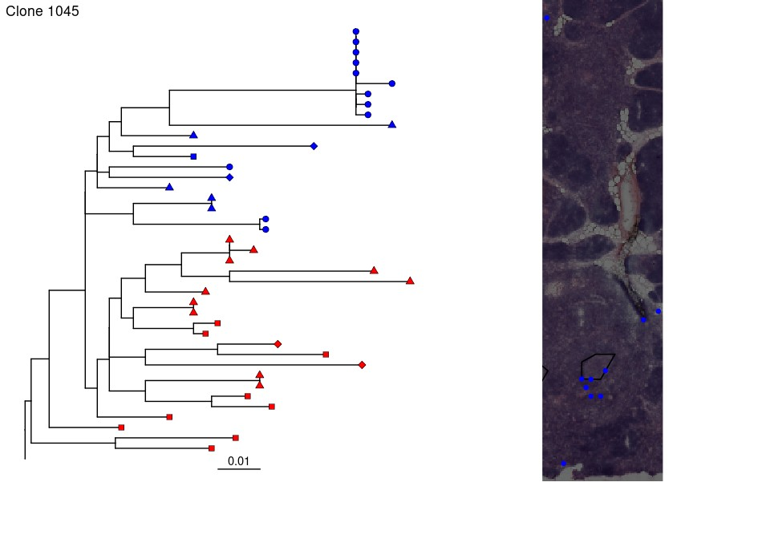

Several sections, bulk AIRR-seq, and blood
================

Most studies have more than one tissue section. You may have several
sections from one donor, bulk AIRR-seq of the same tissue, or blood from
other time points. If you call clones on all of them together, one clone
ID means the same lineage in every sample. You can then ask where a
clone was seen.

One SIRUP object can hold all of this:

- `spatial` can be a named list of Seurat objects, one per section.
- The receptor table holds the rows from every section and every bulk
  sample. A `sample` column tells SIRUP which section each row belongs
  to.
- Rows whose `sample` does not name a section stay in the table as
  nonspatial rows. SIRUP does not put them on a tissue, but clone
  calling, trees, and your own summaries can use them.

This vignette follows Figure 5 of the SIRUP paper. The MG thymus data
come from a patient who had a thymectomy. Besides the two Visium
sections, there is bulk BCR-seq of the thymus, and of blood taken at the
thymectomy and 12 months later. We ask which eGC clones also appear in
the blood.

## Set up

``` r
library(SIRUP)
library(dplyr)
library(ggplot2)
```

``` r
extdata <- system.file("extdata", package = "SIRUP")

spatial <- list(
  mg_thymus_slice1 = readRDS(file.path(extdata, "mg_thymus_slice1_spatial.rds")),
  mg_thymus_slice2 = readRDS(file.path(extdata, "mg_thymus_slice2_spatial.rds"))
)

read_bcrs <- function(file, sample, compartment) {
  airr::read_rearrangement(file.path(extdata, file)) %>%
    mutate(sample = sample, compartment = compartment)
}

sections <- bind_rows(
  read_bcrs("mg_thymus_slice1_bcr.tsv.gz", "mg_thymus_slice1", "thymus_slice1"),
  read_bcrs("mg_thymus_slice2_bcr.tsv.gz", "mg_thymus_slice2", "thymus_slice2")
) %>%
  extractSpatialIds(
    id = "sequence_id",
    spatial_id = "barcode_10x",
    regex = ",([ACGT]{16})$",
    suffix = "-1"
  )

bulk <- bind_rows(
  read_bcrs("mg_thymus_bulk_thymus_1.tsv.gz", "bulk_thymus_1", "bulk_thymus"),
  read_bcrs("mg_thymus_bulk_thymus_2.tsv.gz", "bulk_thymus_2", "bulk_thymus"),
  read_bcrs("mg_thymus_bulk_blood_month0_1.tsv.gz", "bulk_blood_month0_1", "blood_month0"),
  read_bcrs("mg_thymus_bulk_blood_month0_2.tsv.gz", "bulk_blood_month0_2", "blood_month0"),
  read_bcrs("mg_thymus_bulk_blood_month12_1.tsv.gz", "bulk_blood_month12_1", "blood_month12"),
  read_bcrs("mg_thymus_bulk_blood_month12_2.tsv.gz", "bulk_blood_month12_2", "blood_month12")
)

bcrs <- bind_rows(sections, bulk) %>%
  mutate(sequence_id = paste(sample, gsub(",", "_", sequence_id), sep = "_")) %>%
  filterAirr(
    locus_val = "IGH",
    min_v_length = 250,
    min_j_length = 30,
    min_junction_length = 10,
    productive_only = TRUE,
    min_consensus_count = NULL
  ) %>%
  filter(!grepl("[^ACGT]", junction))
#> filterAirr kept 5739 of 8857 rows (dropped 3118).

count(bcrs, compartment, sample)
#> # A tibble: 8 × 3
#>   compartment   sample                   n
#>   <chr>         <chr>                <int>
#> 1 blood_month0  bulk_blood_month0_1    182
#> 2 blood_month0  bulk_blood_month0_2    182
#> 3 blood_month12 bulk_blood_month12_1   241
#> 4 blood_month12 bulk_blood_month12_2   108
#> 5 bulk_thymus   bulk_thymus_1          176
#> 6 bulk_thymus   bulk_thymus_2          576
#> 7 thymus_slice1 mg_thymus_slice1      1967
#> 8 thymus_slice2 mg_thymus_slice2      2105
```

`read_bcrs()` reads one AIRR file and adds two columns: `sample` and
`compartment`. After the barcodes come out of the section IDs, the code
makes each `sequence_id` unique and tree-safe. It puts the sample name
in front, because IDs repeat between files, and it replaces the comma
with `_`, because dowser renames tree tips that contain a comma. The
spatial rows get a `sample` that matches the names of the `spatial`
list. The bulk and blood rows have their own sample names and no
barcode.

To keep the package small, the bulk files hold a subset of the bulk
data: the blood sequences of clones seen in a section, and up to 10 bulk
thymus sequences of each clone that reaches the blood.

## Create a multi-sample object

Give `createSIRUP()` the named list and the `sample` column:

``` r
sirup <- createSIRUP(
  spatial = spatial,
  receptors = bcrs,
  spatial_id = "barcode_10x",
  sample = "sample",
  image_scale = "lowres",
  swap_coords = FALSE
)

sirup
#> <SIRUP object>
#> Spatial data:    Seurat, 6,599 spatial IDs, 449 genes, 2 spatial samples, 2 images
#> Receptor data:   tibble, 5,537 receptor sequences x 58 columns
#> Spatial overlap: 1,567/1,640 receptor IDs in spatial data (95.5%)
#> Samples:         2
#> Spatial ID field: barcode_10x
#> Sample ID field: sample
#> Analyses:        0
spatialSamples(sirup)
#> [1] "mg_thymus_slice1" "mg_thymus_slice2"
```

Visium barcodes repeat between sections: `AAACAAGTATCTCCCA-1` exists in
both. SIRUP matches each receptor to a spot by the pair of sample and
barcode, so the two sections never mix.

If the sections need different image settings, give named values:
`image_scale = c(mg_thymus_slice1 = "hires", mg_thymus_slice2 = "lowres")`.

## Get one sample

The accessors take a `sample` argument:

``` r
getSpatial(sirup, "mg_thymus_slice1")
#> An object of class Seurat 
#> 506 features across 3396 samples within 2 assays 
#> Active assay: Spatial (449 features, 0 variable features)
#>  2 layers present: counts, data
#>  1 other assay present: alra
#>  1 spatial field of view present: thymus_slice1
nrow(getReceptors(sirup, "mg_thymus_slice1"))
#> [1] 1967
nrow(getReceptors(sirup))
#> [1] 5537
```

`filterSample()` returns a new SIRUP object with one section. It drops
the nonspatial rows:

``` r
slice1 <- filterSample(sirup, "mg_thymus_slice1")
slice1
#> <SIRUP object>
#> Spatial data:    Seurat, 3,396 spatial IDs, 449 genes, 1 image
#> Receptor data:   tibble, 1,967 receptor sequences x 58 columns
#> Spatial overlap: 770/772 receptor IDs in spatial data (99.7%)
#> Spatial ID field: barcode_10x
#> Analyses:        0
```

`subsetSIRUP()` gives finer control. It can keep a set of spots, a set
of receptor rows, and, with `keep_nonspatial_receptors = TRUE`, the bulk
rows.

To go the other way, `mergeSIRUP()` combines single-section objects into
a multi-sample object. It adds a sample column with the names you give:

``` r
slice2 <- filterSample(sirup, "mg_thymus_slice2")
merged <- mergeSIRUP(
  slice1, slice2,
  samples = c("mg_thymus_slice1", "mg_thymus_slice2"),
  sample_field = "sample"
)
merged
#> <SIRUP object>
#> Spatial data:    Seurat, 6,599 spatial IDs, 449 genes, 2 spatial samples, 2 images
#> Receptor data:   tibble, 4,072 receptor sequences x 58 columns
#> Spatial overlap: 1,567/1,640 receptor IDs in spatial data (95.5%)
#> Samples:         2
#> Spatial ID field: barcode_10x
#> Sample ID field: sample
#> Analyses:        0
```

## Add polygons for each section

Give `addPolygons()` a named vector of polygon files, one per section:

``` r
sirup <- addPolygons(sirup, polygons_path = c(
  mg_thymus_slice1 = file.path(extdata, "mg_thymus_slice1_gc_polygons.csv"),
  mg_thymus_slice2 = file.path(extdata, "mg_thymus_slice2_gc_polygons.csv")
))

getPolygons(sirup)
#> # A tibble: 19 × 3
#>    polygon_id           sample           vertices        
#>    <chr>                <chr>            <named list>    
#>  1 mg_thymus_slice1::1  mg_thymus_slice1 <tibble [6 × 6]>
#>  2 mg_thymus_slice1::10 mg_thymus_slice1 <tibble [6 × 6]>
#>  3 mg_thymus_slice1::2  mg_thymus_slice1 <tibble [4 × 6]>
#>  4 mg_thymus_slice1::3  mg_thymus_slice1 <tibble [5 × 6]>
#>  5 mg_thymus_slice1::4  mg_thymus_slice1 <tibble [5 × 6]>
#>  6 mg_thymus_slice1::5  mg_thymus_slice1 <tibble [6 × 6]>
#>  7 mg_thymus_slice1::6  mg_thymus_slice1 <tibble [8 × 6]>
#>  8 mg_thymus_slice1::7  mg_thymus_slice1 <tibble [5 × 6]>
#>  9 mg_thymus_slice1::8  mg_thymus_slice1 <tibble [4 × 6]>
#> 10 mg_thymus_slice1::9  mg_thymus_slice1 <tibble [5 × 6]>
#> 11 mg_thymus_slice2::1  mg_thymus_slice2 <tibble [7 × 6]>
#> 12 mg_thymus_slice2::2  mg_thymus_slice2 <tibble [4 × 6]>
#> 13 mg_thymus_slice2::3  mg_thymus_slice2 <tibble [4 × 6]>
#> 14 mg_thymus_slice2::4  mg_thymus_slice2 <tibble [4 × 6]>
#> 15 mg_thymus_slice2::5  mg_thymus_slice2 <tibble [6 × 6]>
#> 16 mg_thymus_slice2::6  mg_thymus_slice2 <tibble [7 × 6]>
#> 17 mg_thymus_slice2::7  mg_thymus_slice2 <tibble [7 × 6]>
#> 18 mg_thymus_slice2::8  mg_thymus_slice2 <tibble [4 × 6]>
#> 19 mg_thymus_slice2::9  mg_thymus_slice2 <tibble [4 × 6]>
```

Both files number their eGCs from 1, so SIRUP adds the sample to each
polygon ID: `mg_thymus_slice1::1` and `mg_thymus_slice2::1` are
different regions.

## Plot several sections

By default, a spatial plot of a multi-sample object returns a list with
one plot per section. Set `combine_sample_plots = TRUE` to get one
combined figure, or give `sample_id` to plot one section:

``` r
plotSpatialPolygons(sirup, zoom = TRUE, combine_sample_plots = TRUE)
```


``` r
spatialExpressionPlot(
  sirup,
  features = "AICDA",
  assay = "alra",
  layer = "data",
  sample_id = "mg_thymus_slice1",
  title = "AICDA, section 1"
)
```


## Call clones across all samples

Call clones on the whole receptor table, so that one clone ID covers the
sections, the bulk thymus, and the blood:

``` r
sirup <- updateReceptors(
  sirup,
  scoper::hierarchicalClones,
  threshold = 0.1,
  summarize_clones = FALSE,
  nproc = 1
)
dplyr::n_distinct(getReceptors(sirup)$clone_id)
#> [1] 1860
```

## Where was each clone seen?

Each row has a `compartment`. For each clone, count its sequences in
each compartment, and record the eGCs that hold it:

``` r
clones <- getReceptors(sirup) %>%
  group_by(clone_id) %>%
  summarise(
    in_section = any(compartment %in% c("thymus_slice1", "thymus_slice2")),
    n_egc = sum(!is.na(polygon_id)),
    egcs = paste(sort(unique(na.omit(polygon_id))), collapse = ", "),
    n_bulk_thymus = sum(compartment == "bulk_thymus"),
    n_blood_month0 = sum(compartment == "blood_month0"),
    n_blood_month12 = sum(compartment == "blood_month12")
  ) %>%
  mutate(
    in_egc = n_egc > 0,
    in_blood = n_blood_month0 + n_blood_month12 > 0
  )

count(clones, in_egc, in_blood)
#> # A tibble: 4 × 3
#>   in_egc in_blood     n
#>   <lgl>  <lgl>    <int>
#> 1 FALSE  FALSE     1575
#> 2 FALSE  TRUE       153
#> 3 TRUE   FALSE      121
#> 4 TRUE   TRUE        11
```

Most clones stay in the thymus. A few eGC clones also appear in the
blood. The paper calls these clones exported. Fisher’s exact test
compares the eGC clones with the other clones of the sections:

``` r
section_clones <- filter(clones, in_section)
fisher.test(table(section_clones$in_egc, section_clones$in_blood))
#> 
#>  Fisher's Exact Test for Count Data
#> 
#> data:  table(section_clones$in_egc, section_clones$in_blood)
#> p-value = 0.3623
#> alternative hypothesis: true odds ratio is not equal to 1
#> 95 percent confidence interval:
#>  0.625789 2.559146
#> sample estimates:
#> odds ratio 
#>   1.326868
```

Count, for each eGC, the clones it holds and the clones that reach the
blood:

``` r
getReceptors(sirup) %>%
  filter(!is.na(polygon_id)) %>%
  distinct(polygon_id, clone_id) %>%
  left_join(select(clones, clone_id, in_blood), by = "clone_id") %>%
  group_by(polygon_id) %>%
  summarise(n_clones = n(), n_exported = sum(in_blood)) %>%
  arrange(desc(n_exported))
#> # A tibble: 17 × 3
#>    polygon_id           n_clones n_exported
#>    <chr>                   <int>      <int>
#>  1 mg_thymus_slice2::5        23          5
#>  2 mg_thymus_slice2::1        16          3
#>  3 mg_thymus_slice1::10       15          1
#>  4 mg_thymus_slice1::2         2          1
#>  5 mg_thymus_slice2::2        16          1
#>  6 mg_thymus_slice2::3         7          1
#>  7 mg_thymus_slice2::6         4          1
#>  8 mg_thymus_slice1::1         6          0
#>  9 mg_thymus_slice1::3         2          0
#> 10 mg_thymus_slice1::4         1          0
#> 11 mg_thymus_slice1::5        10          0
#> 12 mg_thymus_slice1::6        18          0
#> 13 mg_thymus_slice1::7         2          0
#> 14 mg_thymus_slice1::9         5          0
#> 15 mg_thymus_slice2::7        12          0
#> 16 mg_thymus_slice2::8         4          0
#> 17 mg_thymus_slice2::9         4          0
```

The example data hold a subset of the bulk data, and the clones come
from that subset. For the full analysis, see Figure 5 of the SIRUP
paper.

## Clonal dominance in every section

Regional functions work on all sections at once. The dominance table has
a `sample` column and the full `polygon_id`:

``` r
dominance <- spatialCloneDominance(object = sirup, locus_val = "IGH")

dominance$dominance %>%
  group_by(polygon_id) %>%
  slice_max(proportion, n = 1, with_ties = FALSE) %>%
  ungroup() %>%
  select(sample, polygon_id, clone_id, n_receptors, proportion) %>%
  head()
#> # A tibble: 6 × 5
#>   sample           polygon_id           clone_id n_receptors proportion
#>   <chr>            <chr>                <chr>          <dbl>      <dbl>
#> 1 mg_thymus_slice1 mg_thymus_slice1::1  1270               2      0.222
#> 2 mg_thymus_slice1 mg_thymus_slice1::10 1148               4      0.16 
#> 3 mg_thymus_slice1 mg_thymus_slice1::2  1661               1      0.5  
#> 4 mg_thymus_slice1 mg_thymus_slice1::3  1267               2      0.5  
#> 5 mg_thymus_slice1 mg_thymus_slice1::4  1399               1      1    
#> 6 mg_thymus_slice1 mg_thymus_slice1::5  1385               3      0.231
```

Most plotting functions return a named list with one plot per section:

``` r
region_plots <- plotSpatialRegionReceptors(
  dominance = dominance,
  object = sirup,
  top_n = 8,
  point_size = 1.5,
  zoom = TRUE
)
names(region_plots)
#> [1] "mg_thymus_slice1" "mg_thymus_slice2"
region_plots$mg_thymus_slice1
```


`plotSpatialPolygonPies()` also works on all sections at once. Give
`sample_id` to draw the pies of one section next to its map:

``` r
pies <- plotSpatialPolygonPies(
  dominance = dominance,
  object = sirup,
  fill = "clone_id",
  top_n = 5,
  sample_id = "mg_thymus_slice1"
)
pies$page_1
#> Warning: Removed 10 rows containing missing values or values outside the scale range
#> (`geom_text()`).
```


## A tree with blood tips

A lineage tree can mix spatial and bulk sequences. Pick an exported eGC
clone with blood sequences from both time points:

``` r
exported <- clones %>%
  filter(in_egc, n_blood_month0 > 0, n_blood_month12 > 0) %>%
  mutate(n_total = n_egc + n_bulk_thymus + n_blood_month0 + n_blood_month12) %>%
  filter(n_total <= 100) %>%
  arrange(desc(n_blood_month0 + n_blood_month12))
exported
#> # A tibble: 4 × 10
#>   clone_id in_section n_egc egcs    n_bulk_thymus n_blood_month0 n_blood_month12
#>   <chr>    <lgl>      <int> <chr>           <int>          <int>           <int>
#> 1 1045     TRUE           2 mg_thy…            10             15               4
#> 2 1673     TRUE           3 mg_thy…             0              2               1
#> 3 868      TRUE           1 mg_thy…             0              1               2
#> 4 85       TRUE           1 mg_thy…            10              1               1
#> # ℹ 3 more variables: in_egc <lgl>, in_blood <lgl>, n_total <int>

tree_clone <- exported$clone_id[[1]]
tree_section <- sub("::.*$", "", exported$egcs[[1]])
tree_section
#> [1] "mg_thymus_slice2"
```

Make its germline with `dowser::createGermlines()`, then build its tree.
As in [Clones and lineage trees on the tissue](clones-and-trees.md), the germline
step needs the IMGT references in the folder that `SIRUP_IMGT_DIR`
names, and the tree chunks run only when that folder exists. Keep
`compartment` in `traits`, so we can set the tip shapes by compartment:

``` r
tree_sirup <- updateReceptors(sirup, dplyr::filter, clone_id == tree_clone)
tree_sirup <- updateReceptors(
  tree_sirup,
  dowser::createGermlines,
  references = dowser::readIMGT(imgt_dir),
  id = "sequence_id"
)
#> Warning in fun(sirup_data, ...): 107 sequence lengths longer than predicted
#> germlines, consider setting trim_lengths=TRUE if germlines fail
#> [1] "Read in 1198 from 17 fasta files"
tree_sirup <- formatSpatialClones(
  tree_sirup,
  id = "sequence_id",
  traits = c("barcode_10x", "sample", "compartment", "polygon_id")
)
tree_sirup <- getSpatialTrees(tree_sirup)
trees <- getAnalysis(tree_sirup, "trees")
```

`plotSpatialCloneTreePairs()` puts the spatial tips on their sections.
Bulk and blood tips appear in the tree only. Here `shape_by` sets one
shape per compartment and `color_by` colors the tips by tree cluster:

``` r
trees <- clusterTreesTips(trees, k = "auto", id = "sequence_id", k_range = 1:6)

pair <- plotSpatialCloneTreePairs(
  trees,
  object = sirup,
  id = "sequence_id",
  color_by = "tree_cluster",
  shape_by = "compartment",
  shape_values = c(
    thymus_slice1 = 21, thymus_slice2 = 21, bulk_thymus = 22,
    blood_month0 = 24, blood_month12 = 23
  ),
  zoom = TRUE,
  polygons = TRUE,
  polygon_alpha = 0,
  polygon_color = "black"
)

names(pair)
#> [1] "1045"
```

The list has one element per clone. When the tips of a clone fall in
more than one section, it has one element per clone and section instead,
named `<clone>::<sample>`, and each one pairs the full tree with the map
of one section. Each element also holds a `legend` for the tip shapes
and colors. Show the section that holds the eGC tips:

``` r
key <- paste0(tree_clone, "::", tree_section)
if (!key %in% names(pair)) key <- tree_clone
section_pair <- pair[[key]]

cowplot::plot_grid(
  cowplot::plot_grid(section_pair$tree, section_pair$spatial_clone, rel_widths = c(1.3, 1)),
  section_pair$legend,
  ncol = 1,
  rel_heights = c(1, section_pair$legend_rel_height)
)
```



Circles are tips from a section, squares are bulk thymus, triangles are
blood at the thymectomy, and diamonds are blood 12 months later.

## Save the object

``` r
path <- file.path(tempdir(), "mg_thymus.sirup.rds")
saveSIRUP(sirup, path)
readSIRUP(path)
#> <SIRUP object>
#> Spatial data:    Seurat, 6,599 spatial IDs, 449 genes, 2 spatial samples, 2 images
#> Receptor data:   tibble, 5,537 receptor sequences x 79 columns
#> Spatial overlap: 1,567/1,640 receptor IDs in spatial data (95.5%)
#> Samples:         2
#> Spatial ID field: barcode_10x
#> Sample ID field: sample
#> Clone ID field:  clone_id
#> Analyses:        0
#> Polygons:        19
```
