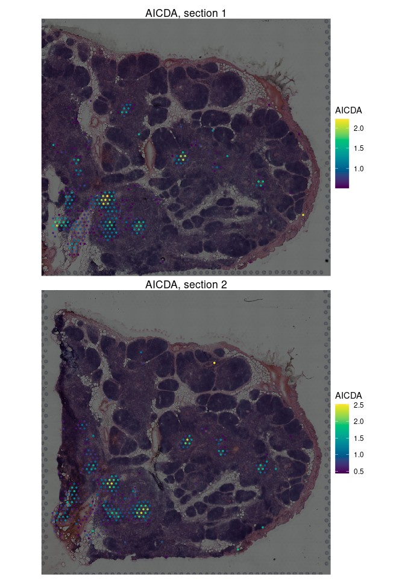

Analyze multiple spatial sections and bulk BCR-seq
================

<div markdown="1"
style="background: #F7E5BC; padding: 12px; margin-bottom: 24px; line-height: 24px;">

<p style="margin: -12px -12px 12px; padding: 6px 12px; background: #d6b676; color: #ffffff; font-weight: 700;">

<b>Note</b>
</p>

**Time:** ~15 minutes.<br> **Data:** example spatial MG thymus sections,
bulk thymus BCR-seq, and bulk blood BCR-seq.<br>

</div>

Many studies have multiple spatial samples of the same tissue sections,
or multi-modal AIRR-seq from the same patient. Here, we will build and
analyze a single SIRUP object that contains two spatial sections, bulk
thymus BCR-seq, and bulk blood BCR-seq.

The SIRUP object contains \* `spatial`, a named list of spatial Seurat
objects, one for each section. \* `receptors`, a named list of receptor
tables, have one for each type of receptor. One table can hold all BCRs,
including both spatial and bulk data. A `sample` column tells SIRUP
which sample each row belongs to. \* Rows whose `sample` does not name a
section stay in the table as non-spatial rows. SIRUP does not put them
on a tissue, but clone calling, trees, and custom summaries can use
them.

This page follows Figure 5 of the SIRUP paper. The MG thymus data come
from a patient who had a thymectomy. Besides the two Visium sections,
there is bulk BCR-seq of the thymus and bulk BCR-seq of blood, taken at
the thymectomy and 12 months later. The question is which clones in
ectopic germinal centers (eGCs) also appear in the blood. An eGC is a
site in the thymus where B cells proliferate and mutate their receptors.

<div markdown="1"
style="background: #F7E5BC; padding: 12px; margin-bottom: 24px; line-height: 24px;">

<p style="margin: -12px -12px 12px; padding: 6px 12px; background: #d6b676; color: #ffffff; font-weight: 700;">

<b>Note</b>
</p>

This page assumes a basic knowledge of the SIRUP object. To learn how an
object is built, see [Get started with SIRUP](get-started.md). To
learn how the object works, see
[How the SIRUP object works](sirup-object.md).

</div>

## Get the example data

This page uses example files that are slightly too big to be part of the
SIRUP package. This code downloads them. Change `dest` to a folder you
want to keep. The function skips files that are already there.

``` r
extdata <- SIRUP::downloadSIRUPExample(
  dest = file.path(tempdir(), "SIRUP_example"),
  files = c(
    "mg_thymus_slice1_spatial.rds",
    "mg_thymus_slice2_spatial.rds",
    "mg_thymus_slice1_bcr.tsv.gz",
    "mg_thymus_slice2_bcr.tsv.gz",
    "mg_thymus_slice2_tcr.tsv.gz",
    "mg_thymus_slice1_gc_polygons.csv",
    "mg_thymus_slice2_gc_polygons.csv",
    "mg_thymus_bulk_thymus_1.tsv.gz",
    "mg_thymus_bulk_thymus_2.tsv.gz",
    "mg_thymus_bulk_blood_month0_1.tsv.gz",
    "mg_thymus_bulk_blood_month0_2.tsv.gz",
    "mg_thymus_bulk_blood_month12_1.tsv.gz",
    "mg_thymus_bulk_blood_month12_2.tsv.gz"
  )
)
#> ℹ Downloading 'mg_thymus_slice1_spatial.rds'
#> ℹ 'mg_thymus_slice2_spatial.rds' is already in '/scratch/f007p0j/RtmpmcRWCi/SIRUP_example'.
#> ℹ Downloading 'mg_thymus_slice1_bcr.tsv.gz'
#> ℹ 'mg_thymus_slice2_bcr.tsv.gz' is already in '/scratch/f007p0j/RtmpmcRWCi/SIRUP_example'.
#> ℹ 'mg_thymus_slice2_tcr.tsv.gz' is already in '/scratch/f007p0j/RtmpmcRWCi/SIRUP_example'.
#> ℹ Downloading 'mg_thymus_slice1_gc_polygons.csv'
#> ℹ 'mg_thymus_slice2_gc_polygons.csv' is already in '/scratch/f007p0j/RtmpmcRWCi/SIRUP_example'.
#> ℹ Downloading 'mg_thymus_bulk_thymus_1.tsv.gz'
#> ℹ Downloading 'mg_thymus_bulk_thymus_2.tsv.gz'
#> ℹ Downloading 'mg_thymus_bulk_blood_month0_1.tsv.gz'
#> ℹ Downloading 'mg_thymus_bulk_blood_month0_2.tsv.gz'
#> ℹ Downloading 'mg_thymus_bulk_blood_month12_1.tsv.gz'
#> ℹ Downloading 'mg_thymus_bulk_blood_month12_2.tsv.gz'
```

## Load the samples

``` r
library(SIRUP)
library(dplyr)
library(ggplot2)
```

Load the two spatial Seurat objects and all of the BCR data.

``` r
spatial <- list(
  mg_thymus_slice1 = readRDS(file.path(extdata, "mg_thymus_slice1_spatial.rds")),
  mg_thymus_slice2 = readRDS(file.path(extdata, "mg_thymus_slice2_spatial.rds"))
)

# One AIRR file for each sample, with the compartment that the sample came from
bcr_files <- c(
  mg_thymus_slice1 = "mg_thymus_slice1_bcr.tsv.gz",
  mg_thymus_slice2 = "mg_thymus_slice2_bcr.tsv.gz",
  bulk_thymus_1 = "mg_thymus_bulk_thymus_1.tsv.gz",
  bulk_thymus_2 = "mg_thymus_bulk_thymus_2.tsv.gz",
  bulk_blood_month0_1 = "mg_thymus_bulk_blood_month0_1.tsv.gz",
  bulk_blood_month0_2 = "mg_thymus_bulk_blood_month0_2.tsv.gz",
  bulk_blood_month12_1 = "mg_thymus_bulk_blood_month12_1.tsv.gz",
  bulk_blood_month12_2 = "mg_thymus_bulk_blood_month12_2.tsv.gz"
)
compartments <- c(
  mg_thymus_slice1 = "thymus_slice1",
  mg_thymus_slice2 = "thymus_slice2",
  bulk_thymus_1 = "bulk_thymus",
  bulk_thymus_2 = "bulk_thymus",
  bulk_blood_month0_1 = "blood_month0",
  bulk_blood_month0_2 = "blood_month0",
  bulk_blood_month12_1 = "blood_month12",
  bulk_blood_month12_2 = "blood_month12"
)

bcr_list <- lapply(file.path(extdata, bcr_files), airr::read_rearrangement)
names(bcr_list) <- names(bcr_files)

# Put all BCRs together
all_bcrs <- bind_rows(bcr_list, .id = "sample") %>%
  mutate(compartment = unname(compartments[sample]))
```

Then add the spatial IDs to the spatial BCRs and filter the BCRs to only
include sequences that are productive and have reasonable looking Vs,
Js, and junctions.

``` r
# Add a spatial id to the spatial data
spatial_bcrs <- all_bcrs %>%
  filter(compartment %in% c("thymus_slice1", "thymus_slice2")) %>%
  extractSpatialIds(
    id = "sequence_id",
    spatial_id = "barcode_10x",
    regex = ",([ACGT]{16})$",
    suffix = "-1"
  )
bulk <- all_bcrs %>%
  filter(!compartment %in% c("thymus_slice1", "thymus_slice2"))

bcrs <- bind_rows(spatial_bcrs, bulk) %>%
  mutate(sequence_id = paste(sample, gsub(",", "_", sequence_id), sep = "_")) %>%
  filterAirr(
    locus_val = "IGH",
    min_v_length = 250,
    min_j_length = 30,
    min_junction_length = 10,
    productive_only = TRUE,
    min_consensus_count = NULL
  ) %>%
  filter(!grepl("[^ACGT]", junction))
#> filterAirr kept 5733 of 8849 rows (dropped 3116).

count(bcrs, compartment, sample)
#> # A tibble: 8 × 3
#>   compartment   sample                   n
#>   <chr>         <chr>                <int>
#> 1 blood_month0  bulk_blood_month0_1    182
#> 2 blood_month0  bulk_blood_month0_2    182
#> 3 blood_month12 bulk_blood_month12_1   241
#> 4 blood_month12 bulk_blood_month12_2   108
#> 5 bulk_thymus   bulk_thymus_1          176
#> 6 bulk_thymus   bulk_thymus_2          576
#> 7 thymus_slice1 mg_thymus_slice1      1967
#> 8 thymus_slice2 mg_thymus_slice2      2105
```

Load in and filter TCRs.

``` r
tcrs <- airr::read_rearrangement(file.path(extdata, "mg_thymus_slice2_tcr.tsv.gz")) %>%
  mutate(sample = "mg_thymus_slice2", compartment = "thymus_slice2") %>%
  extractSpatialIds(
    id = "sequence_id",
    spatial_id = "barcode_10x",
    regex = ",([ACGT]{16})$",
    suffix = "-1"
  ) %>%
  mutate(sequence_id = paste(sample, gsub(",", "_", sequence_id), sep = "_")) %>%
  filterAirr(
    locus_val = "TRB",
    min_v_length = 250,
    min_j_length = 30,
    min_junction_length = 10,
    productive_only = TRUE,
    min_consensus_count = NULL
  ) %>%
  filter(!grepl("[^ACGT]", junction))
#> filterAirr kept 3718 of 7915 rows (dropped 4197).
```

We add columns `sample` and `compartment` to each AIRR table. We extract
the barcodes from the spatial sequences and then filter., Make sure the
`sequence_id`s are unique. The code adds the sample name in front of the
`sequence_id`, because IDs may repeat between datasets, and it replaces
the comma with `_`, because dowser renames tree tips that contain a
comma.

The section rows get a `sample` that matches the names of the `spatial`
list. The bulk and blood rows have their own sample names and no
barcode.

<div markdown="1"
style="background: #9e584a; padding: 12px; margin-bottom: 24px; line-height: 24px;">

<p style="margin: -12px -12px 12px; padding: 6px 12px; background: #8b3620; color: #ffffff; font-weight: 700;">

<b>WARNING</b>
</p>

Make sure that the `sample` column of the receptor tables matches the
names of the `spatial` list for the spatial receptor sequences. Also
make sure that the `sequence_id` column is (1) unique across all
samples, and (2) does not contain commas to avoid problems with Dowser.

</div>

## Create a multi-sample SIRUP object

Pass `createSIRUP()` the named list of Seurat objects, and pass
`receptors` a named list of receptor tables. The tables are the slots
`"BCR"` and `"TCR"`, and only the spatial section has TCRs. Pass the
name of the `sample` column to `sample_id`. All slots use this column.

``` r
sirup <- createSIRUP(
  spatial = spatial,
  receptors = list(BCR = bcrs, TCR = tcrs),
  spatial_id = "barcode_10x",
  sample_id = "sample",
  image_scale = "lowres",
  swap_coords = FALSE
)

sirup
#> <SIRUP object>
#> Spatial data:    Seurat, 6,599 spatial IDs, 449 genes, 2 spatial samples, 2 images
#> Receptor data:   2 slots
#>   BCR: 5,537 receptor sequences x 58 columns; 1,567/1,640 receptor IDs in spatial data (95.5%)
#>   TCR: 3,610 receptor sequences x 58 columns; 1,414/1,571 receptor IDs in spatial data (90.0%)
#> Samples:         2
#> Spatial ID field: barcode_10x
#> Sample ID field: sample
#> Analyses:        0
spatialSamples(sirup) # Get the names of the spatial samples
#> [1] "mg_thymus_slice1" "mg_thymus_slice2"
```

Visium barcodes repeat between sections, e.g., `AAACAAGTATCTCCCA-1`
exists in both. SIRUP matches each receptor to a spot by sample and
barcode, so the two sections stay separate.

If the sections need different image settings, give named values:
`image_scale = c(mg_thymus_slice1 = "hires", mg_thymus_slice2 = "lowres")`.

## Get one sample

The accessors (`getReceptors` and `getSpatial`) take a `sample_id`
argument, and the receptor accessors also take a `slot` argument.

``` r
getSpatial(sirup, "mg_thymus_slice1")
#> An object of class Seurat 
#> 506 features across 3396 samples within 2 assays 
#> Active assay: Spatial (449 features, 0 variable features)
#>  2 layers present: counts, data
#>  1 other assay present: alra
#>  1 spatial field of view present: thymus_slice1
nrow(getReceptors(sirup, "mg_thymus_slice1", slot = "BCR"))
#> [1] 1967
nrow(getReceptors(sirup, slot = "BCR"))
#> [1] 5537
```

`subsetSIRUP()` returns a new SIRUP object with only data that matches
the named sample, which here is `mg_thymus_slice1`. The new object has
only the spatial GEX data from the entry in the `spatial` list named
`mg_thymus_slice1`, and only the BCRs that have
`sample == "mg_thymus_slice1"`.

``` r
slice1 <- subsetSIRUP(sirup, sample_id = "mg_thymus_slice1")
slice1
#> <SIRUP object>
#> Spatial data:    Seurat, 3,396 spatial IDs, 449 genes, 1 image
#> Receptor data:   2 slots
#>   BCR: 1,967 receptor sequences x 58 columns; 770/772 receptor IDs in spatial data (99.7%)
#>   TCR: 0 receptor sequences x 58 columns; 0/0 receptor IDs in spatial data (NaN%)
#> Spatial ID field: barcode_10x
#> Analyses:        0
```

`mergeSIRUP()` goes the other way. It combines single-section objects
into a multi-sample object, and it adds a sample column with the names
that are given.

``` r
slice2 <- subsetSIRUP(sirup, sample_id = "mg_thymus_slice2")
merged <- mergeSIRUP(
  slice1, slice2,
  samples = c("mg_thymus_slice1", "mg_thymus_slice2"),
  sample_field = "sample"
)
merged
#> <SIRUP object>
#> Spatial data:    Seurat, 6,599 spatial IDs, 449 genes, 2 spatial samples, 2 images
#> Receptor data:   2 slots
#>   BCR: 4,072 receptor sequences x 58 columns; 1,567/1,640 receptor IDs in spatial data (95.5%)
#>   TCR: 3,610 receptor sequences x 58 columns; 1,414/1,571 receptor IDs in spatial data (90.0%)
#> Samples:         2
#> Spatial ID field: barcode_10x
#> Sample ID field: sample
#> Analyses:        0
```

## Add ROI polygons for each section

As discussed in [Annotate tissue ROIs and analyze local clonal structure](regions.md), we can add ROI
polygons to the SIRUP object with `addPolygons()`. Since we have
multiple spatial samples, we pass a named (with the section names)
vector of polygon files.

``` r
sirup <- addPolygons(sirup, polygons_path = c(
  mg_thymus_slice1 = file.path(extdata, "mg_thymus_slice1_gc_polygons.csv"),
  mg_thymus_slice2 = file.path(extdata, "mg_thymus_slice2_gc_polygons.csv")
))

getPolygons(sirup)
#> # A tibble: 19 × 3
#>    polygon_id           sample           vertices        
#>    <chr>                <chr>            <named list>    
#>  1 mg_thymus_slice1::1  mg_thymus_slice1 <tibble [6 × 6]>
#>  2 mg_thymus_slice1::10 mg_thymus_slice1 <tibble [6 × 6]>
#>  3 mg_thymus_slice1::2  mg_thymus_slice1 <tibble [4 × 6]>
#>  4 mg_thymus_slice1::3  mg_thymus_slice1 <tibble [5 × 6]>
#>  5 mg_thymus_slice1::4  mg_thymus_slice1 <tibble [5 × 6]>
#>  6 mg_thymus_slice1::5  mg_thymus_slice1 <tibble [6 × 6]>
#>  7 mg_thymus_slice1::6  mg_thymus_slice1 <tibble [8 × 6]>
#>  8 mg_thymus_slice1::7  mg_thymus_slice1 <tibble [5 × 6]>
#>  9 mg_thymus_slice1::8  mg_thymus_slice1 <tibble [4 × 6]>
#> 10 mg_thymus_slice1::9  mg_thymus_slice1 <tibble [5 × 6]>
#> 11 mg_thymus_slice2::1  mg_thymus_slice2 <tibble [7 × 6]>
#> 12 mg_thymus_slice2::2  mg_thymus_slice2 <tibble [4 × 6]>
#> 13 mg_thymus_slice2::3  mg_thymus_slice2 <tibble [4 × 6]>
#> 14 mg_thymus_slice2::4  mg_thymus_slice2 <tibble [4 × 6]>
#> 15 mg_thymus_slice2::5  mg_thymus_slice2 <tibble [6 × 6]>
#> 16 mg_thymus_slice2::6  mg_thymus_slice2 <tibble [7 × 6]>
#> 17 mg_thymus_slice2::7  mg_thymus_slice2 <tibble [7 × 6]>
#> 18 mg_thymus_slice2::8  mg_thymus_slice2 <tibble [4 × 6]>
#> 19 mg_thymus_slice2::9  mg_thymus_slice2 <tibble [4 × 6]>
```

Both files number their polygons from 1, so SIRUP adds the sample ID to
each polygon ID, i.e., `mg_thymus_slice1::1` and `mg_thymus_slice2::1`.

## Plot multiple spatial sections

Functions that create spatial plots for a multi-sample object return a
list with one plot for each section. Set `combine_sample_plots = TRUE`
to get one combined figure, or pass `sample_id` to plot one section.

``` r
spatialExpressionPlot(
  sirup,
  features = "AICDA",
  assay = "alra",
  layer = "data",
  title = c("AICDA, section 1", "AICDA, section 2"),
  combine_sample_plots = TRUE
)
```



``` r
spatialExpressionPlot(
  sirup,
  features = "AICDA",
  assay = "alra",
  layer = "data",
  sample_id = "mg_thymus_slice1",
  title = "AICDA, section 1"
)
```


## Infer clones and trees across all samples

Infer clones for the entire set of BCRs, including both spatial and bulk
datasets, using `updateReceptors()` with `scoper::hierarchicalClones()`.
Clones represent the set of B cells that are inferred to descend from a
common ancestor.

``` r
sirup <- updateReceptors(
  sirup,
  scoper::hierarchicalClones,
  slot = "BCR",
  threshold = 0.1,
  summarize_clones = FALSE,
  nproc = 1
)
```

Phylogenetic trees show the evolutionary history of a clone. Each tip in
the tree is one observed sequence. With SIRUP, trees can include tips
from all spatial and bulk samples.

This guide uses clone 1045. It has sequences in spatial section 2,
including ectopic germinal center (eGC) 5, in the bulk thymus, and in
the blood at both time points.

``` r
tree_clone <- "1045"
tree_section <- "mg_thymus_slice2"

getReceptors(sirup, slot = "BCR") %>%
  filter(clone_id == tree_clone) %>%
  count(compartment)
#> # A tibble: 4 × 2
#>   compartment       n
#>   <chr>         <int>
#> 1 blood_month0     15
#> 2 blood_month12     4
#> 3 bulk_thymus      10
#> 4 thymus_slice2    15
```

Next, make the germline of the clone with `dowser::createGermlines()`.
The germline is the sequence of the unmutated common ancestor, which
roots the tree. As in [Infer clones and lineage trees in situ](clones-and-trees.md),
building the germline requires IMGT references. Set the variable
`imgt_dir` to the folder that contains them.

<div markdown="1"
style="background: #F7E5BC; padding: 12px; margin-bottom: 24px; line-height: 24px;">

<p style="margin: -12px -12px 12px; padding: 6px 12px; background: #d6b676; color: #ffffff; font-weight: 700;">

<b>Note</b>
</p>

If you have not yet set up the IMGT references, see the
[documentation](https://github.com/hoehnlab/airrblast) for the
`airrblast` package and download and set up the IMGT references.

</div>

Keep `compartment` in `traits`, because the tree plot uses it to set the
tip shapes.

``` r
tree_sirup <- updateReceptors(sirup, dplyr::filter, clone_id == tree_clone, slot = "BCR")
tree_sirup <- updateReceptors(
  tree_sirup,
  dowser::createGermlines,
  slot = "BCR",
  references = dowser::readIMGT(imgt_dir),
  id = "sequence_id"
)
#> Warning in fun(sirup_data, ...): 107 sequence lengths longer than predicted
#> germlines, consider setting trim_lengths=TRUE if germlines fail
#> [1] "Read in 1198 from 17 fasta files"
```

To build trees with Dowser, we need a formatted clones object.
`formatSpatialClones()` wraps `dowser::formatClones()` but allows users
to provide a SIRUP object, and it automatically places a
`formatted_clones` object in the SIRUP object’s analysis slot. Then, we
can call `getSpatialTrees()`, which wraps `dowser::getTrees()` but
allows users to provide a SIRUP object, and puts the trees in the SIRUP
object’s analysis slot.

``` r
tree_sirup <- formatSpatialClones(
  tree_sirup,
  slot = "BCR",
  id = "sequence_id",
  traits = c("barcode_10x", "sample", "compartment", "polygon_id")
)

tree_sirup <- getSpatialTrees(tree_sirup, slot = "BCR")
trees <- getAnalysis(tree_sirup, "trees_BCR")
```

`plotSpatialCloneTreePairs()` plots the tree on the left and the H&E
image of the section(s) on the right. Tips in the tree are plotted in
their corresponding spots in the tissue if they are from the spatial
data. The argument `shape_by` sets the shape for each tip according to
the provided column (here `"compartment"`), and `color_by` colors the
tips by cluster. `clusterTreesTips()` clusters the tips in the tree by
genetic relationships in order to provide visual clarity for paired
plots. Here, `k = 6` splits the tree into six groups of tips.

``` r
trees <- clusterTreesTips(trees, k = 6, id = "sequence_id", method = "monophyletic_clades")

pair <- plotSpatialCloneTreePairs(
  trees,
  object = sirup,
  slot = "BCR",
  id = "sequence_id",
  color_by = "tree_cluster",
  shape_by = "compartment",
  shape_values = c(
    thymus_slice1 = 21, thymus_slice2 = 21, bulk_thymus = 22,
    blood_month0 = 24, blood_month12 = 23
  ),
  polygons = TRUE,
  polygon_alpha = 0,
  polygon_color = "black",
  show_spatial_legend = TRUE,
  legend_theme = ggplot2::theme(
    legend.text = ggplot2::element_text(size = 7),
    legend.title = ggplot2::element_text(size = 8, face = "bold"),
    legend.key.size = grid::unit(0.3, "cm")
  )
)

names(pair)
#> [1] "1045"
```

In general, the `plotSpatialCloneTreePairs()` function returns a list of
plots, one for each clone. If a clone has sequences in multiple spatial
samples, the list will have one element for each clone-sample
combination, named `<clone>::<sample>`. Each one pairs the full tree
with the map of one section. The code below shows the section that holds
the eGC tips.

``` r
key <- paste0(tree_clone, "::", tree_section)
if (!key %in% names(pair)) key <- tree_clone
section_pair <- pair[[key]]

section_pair
```


## Save and read the object

`saveSIRUP()` writes the object to a file. `readSIRUP()` reads it back
and checks its structure.

``` r
path <- file.path(tempdir(), "mg_thymus.sirup.rds")
saveSIRUP(sirup, path)
readSIRUP(path)
#> <SIRUP object>
#> Spatial data:    Seurat, 6,599 spatial IDs, 449 genes, 2 spatial samples, 2 images
#> Receptor data:   2 slots
#>   BCR: 5,537 receptor sequences x 79 columns; 1,567/1,640 receptor IDs in spatial data (95.5%)
#>   TCR: 3,610 receptor sequences x 68 columns; 1,414/1,571 receptor IDs in spatial data (90.0%)
#> Samples:         2
#> Spatial ID field: barcode_10x
#> Sample ID field: sample
#> Clone ID field:  clone_id
#> Analyses:        0
#> Polygons:        19
```

## Next steps

- To compare ROIs in the tissue, see
  [Annotate tissue ROIs and analyze local clonal structure](regions.md).
- To build lineage trees and visualize them on the tissue, read
  [Infer clones and lineage trees in situ](clones-and-trees.md).
- To learn more about the structure of the SIRUP object see
  [How the SIRUP object works](sirup-object.md).
