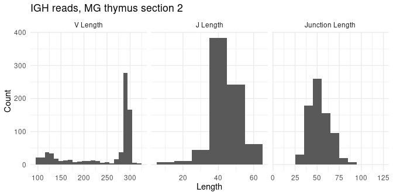

Process demultiplexed reads
================

<div markdown="1"
style="background: #F7E5BC; padding: 12px; margin-bottom: 24px; line-height: 24px;">

<p style="margin: -12px -12px 12px; padding: 6px 12px; background: #d6b676; color: #ffffff; font-weight: 700;">

<b>Note</b>
</p>

**Time:** ~30 minutes.<br> **Data:** example MG thymus read-level data
in SIRUP.

</div>

Here, we will take demultiplexed long-read sequences and process them
into an [AIRR
rearrangement](https://docs.airr-community.org/en/latest/datarep/rearrangements.html).

## Get the example data

This page uses example files that are not part of the SIRUP package.
This code downloads them. Change `dest` to a folder you want to keep.
The default folder is temporary. The function skips files that are
already there.

``` r
extdata <- SIRUP::downloadSIRUPExample(
  dest = file.path(tempdir(), "SIRUP_example"),
  files = c(
  "mg_thymus_slice2_reads.tsv.gz",
  "mg_thymus_slice2_bcr.tsv.gz",
  "mg_thymus_slice2_spatial_brighter.rds"
  )
)
```

## Demultiplexing long-read sequences

SIRUP does not demultiplex long-read sequencing data on its own. At
present, users should demultiplex their data with

1.  RAD, the read-structure agnostic demultiplexer, which can be used
    [via the command line](https://github.com/indianewok/rad) or
    [natively in R](https://github.com/indianewok/rrad). SIRUP can then
    process the demultiplexed long-reads.
2.  [LongAIRR](https://github.com/AGImkeller/LongAIRR), which
    demultiplexes and processes long-read sequencing data.

If using LongAIRR, the output is an AIRR rearrangement that can be used
directly, without further processing in SIRUP. In this case, the rest of
this vignette is not needed.

## SIRUP processing pipeline

Spatial AIRR-seq libraries are sets of long-read sequences of B and T
cell receptor transcripts. Each read carries a spatial ID (or barcode),
which is a short DNA tag that identifies the spot where the molecule
came from. Many protocols also include a UMI (unique molecular
identifier), a tag that identifies the original molecule.

Processing in SIRUP is done with the `processSpatialSample()` function.
It consists of the following steps.

|  | Step | What it does |
|----|----|----|
| 1 | IgBLAST (`airrblast::assignGenes()`) | Annotates each read with V(D)J genes |
| 2 | `filterAirr()` | Removes reads that are not receptors or are too short to use |
| 3 | `ClusterSets.py` (pRESTO) | Groups the reads of each spot by sequence identity (using vsearch) |
| 4 | `AlignSets.py` (pRESTO) | Aligns the reads in each group (using MUSCLE) |
| 5 | `BuildConsensus.py` (pRESTO) | Builds one consensus sequence per group |
| 6 | `airrblast::assignGenes()` and `airrblast::addGaps()` | Annotates the consensus sequences, adds the IMGT gaps, and writes the AIRR table |

Long-read sequencing has a high error rate. A consensus of several reads
removes most random errors. The spot barcode stays in the sequence
header through every step, so each consensus sequence keeps its spot.

## Install and set up dependencies

### IgBLAST and IMGT germline references

See more detailed instructions in the [airrblast
documentation](https://github.com/hoehnlab/airrblast/tree/main).

Briefly, download and decompress
[IgBLAST](https://ftp.ncbi.nih.gov/blast/executables/igblast/release/LATEST/).

<div markdown="1"
style="background: #9e584a; padding: 12px; margin-bottom: 24px; line-height: 24px;">

<p style="margin: -12px -12px 12px; padding: 6px 12px; background: #8b3620; color: #ffffff; font-weight: 700;">

<b>WARNING</b>
</p>

There is a patch to the latest stable release of IgBLAST. Download the
patched .aux files
[here](https://ftp.ncbi.nih.gov/blast/executables/igblast/release/patch/)
(in `optional_file`). Then swap them into your `optional_file` directory
in your IgBLAST installation.

</div>

Then download the IMGT germline references and set up the IgBLAST
database with `airrblast`. airrblast supports human, mouse, and rhesus
macaque.

``` r
library(airrblast)
library(airr)

# name/location of the uncompressed IgBLAST directory
igblast_dir <- "ncbi-igblast-1.22.0"

# Download IMGT GENE-DB into directory "imgt"
# Do this only once
downloadIMGT("imgt", organism="human", verbose=1)

# Set up search databases for IgBlast using imgt database
# Do this only once
imgtToIgblast("imgt", "igblast", igblast_dir)
```

### Other dependencies

- [**pRESTO**](https://presto.readthedocs.io/en/stable/install.html#installation).
- [**vsearch**](https://github.com/torognes/vsearch).
- [**MUSCLE**](https://www.drive5.com/muscle/downloads_v3.htm) v3.8.31.

<div markdown="1"
style="background: #F7E5BC; padding: 12px; margin-bottom: 24px; line-height: 24px;">

<p style="margin: -12px -12px 12px; padding: 6px 12px; background: #d6b676; color: #ffffff; font-weight: 700;">

<b>Note</b>
</p>

Paths such as `~/share/igblast` and `~/bin/muscle3.8.31_i86linux64` in
this page are examples. Replace them with the paths on your system.

</div>

Check that R can find the programs. This chunk shows code only:

``` r
Sys.which(c(
  "ClusterSets.py", "ParseHeaders.py", "AlignSets.py", "BuildConsensus.py",
  "vsearch"
))
file.exists(file.path("~/share/igblast", "bin", "igblastn"))
```

An empty string means R cannot find that program. Add its folder to
`PATH`, or give its full path to `processSpatialSample()`
(`muscle_exec`). SIRUP runs IgBLAST through airrblast. It uses
`<igblast_base>/bin/igblastn`.

## Process the demultiplexed reads

To go from demultiplexed reads to an AIRR table, give the FASTA file to
`processSpatialSample()`. It runs IgBLAST on each read, reads the
barcode and UMI from the header, filters the reads, builds the consensus
sequences, and writes the AIRR table. The rest of *this* section is
optional. Skip ahead to [Run the consensus
pipeline](#run-the-consensus-pipeline) if you do not want to run the
first IgBLAST pass by hand and examine the reads before building
consensus sequences.

### Run the first IgBLAST pass by hand

RAD/rRAD produces a FASTA file with a header that includes each read
holds the spatial ID and the UMI, in the form `id|BARCODE=YYY|UMI=XXX`.
`airrblast::assignGenes()` annotates every read with V(D)J genes and
writes an AIRR table. It works with plain FASTA files only, so make sure
to decompress a gzipped file before running. `parseRadSequenceIds()`
copies the barcode and the UMI from the read ID into `barcode` and `umi`
columns automatically.

This chunk shows code only. It needs IgBLAST and a full-size input:

``` r
library(airrblast)

assignGenes(
  file = "prepared/sample-igblast.fasta",
  igblast = "~/share/igblast",
  refs = "~/share/igblast_refs",
  organism = "human",
  locus = "Ig",
  outfile = "processed/reads_igblast.tsv",
  nproc = 8,
  return = FALSE
)

reads <- airr::read_rearrangement("processed/reads_igblast.tsv")
reads <- parseRadSequenceIds(reads)
```

Use `locus = "TR"` for TCRs. BCRs and TCRs need to run as separate
calls. The metadata must be in the ID, before any white space. If the
header has a different format, use `extractSpatialIds()`.

`reads` is now a read-level AIRR table. The next section examines and
filters such a table. You can also give it to `processSpatialSample()`
with `input_type = "airr"`, as shown in [Run the consensus
pipeline](#run-the-consensus-pipeline).

### Examine and filter demultiplexed reads by hand

As an example, SIRUP includes 2,000 read-level IgBLAST rows from one
section of human thymus. They have the form of the table that the first
IgBLAST pass makes.

``` r
library(dplyr)

reads <- airr::read_rearrangement(
  file.path(extdata, "mg_thymus_slice2_reads.tsv.gz")
)

dim(reads)
#> [1] 2000  130
count(reads, locus, sort = TRUE)
#> # A tibble: 4 × 2
#>   locus     n
#>   <chr> <int>
#> 1 IGH    1259
#> 2 IGL     480
#> 3 IGK     205
#> 4 <NA>     56
```

Many reads are fragments, light chains, or other transcripts.
`filterAirr()` is a function that conveniently filters out low quality
reads and keeps those potentially worth using to build a consensus. We
recommend using the thresholds given below.

``` r
reads$barcode <- reads$cell_barcode

igh_reads <- filterAirr(
  reads,
  locus_val = "IGH",
  min_v_length = 100,
  min_j_length = 10,
  min_junction_length = 1,
  productive_only = FALSE,
  min_consensus_count = NULL,
  spatial_id = "barcode"
)
#> filterAirr kept 750 of 2000 rows (dropped 1250).

spatialReceptorSummary(igh_reads, spatial_id = "barcode")
#> # A tibble: 1 × 4
#>   n_sequences n_spatial_ids n_loci n_productive
#>         <int>         <int>  <int>        <int>
#> 1         750           451      1          307
```

`plotLengthQc()` shows the V, J, and junction lengths. It can be used to
choose the thresholds rather than using the above.

``` r
plotLengthQc(igh_reads, bin_width = 10, title = "IGH reads")
```



## Run the consensus pipeline

`processSpatialSample()` runs every step from the previously shown
table. It will print each command before it runs, so that if a command
fails debugging is straightforward. This section shows code only.

You can start from three types of input. Demultiplexed reads (the first
row) are the usual start:

| `input` | `input_type` | First step that runs |
|----|----|----|
| FASTA or FASTQ from RAD/rRAD | `"auto"` or `"raw_reads"` | IgBLAST on each read |
| AIRR table (path or data frame) from a first IgBLAST pass | `"auto"` or `"airr"` | `filterAirr()` |
| FASTA that is already filtered, with the spot in the header | `"spatial_fasta"` | sequence clustering |

### From demultiplexed reads

This call takes the FASTA from RAD/rRAD all the way to a properly
formatted AIRR rearrangement. It will run the first IgBLAST pass and
filtering. Note that you should replace the paths below with your own
paths.

``` r
result <- processSpatialSample(
  input = "prepared/sample-igblast.fasta",
  output_dir = "processed/bcr",
  receptor = "ig",
  organism = "human",
  igblast_base = "~/share/igblast",
  igblast_refs = "~/share/igblast_refs",
  imgt_dir = "~/share/imgt",
  muscle_exec = "~/bin/muscle3.8.31_i86linux64",
  identity = 1.0,
  consensus_freq = 0.51,
  consensus_min_count = 2,
  nproc = 8
)

result$db_pass
```

The key arguments here are:

| `argument` | `options` | What it does |
|----|----|----|
| `receptor` | `"ig"` or `"tr"` | Assign IG (for BCRs) or TR (for TCRs) genes with IgBLAST |
| `identity` | 0-1 | How closely do sequences have to match within a spatial spot to be clustered together? |
| `consensus_freq` | 0-1 | What proportion of sequences in a cluster must have the same nucleotide at each position for the consensus sequence to not report an N? |
| `consensus_min_count` | `2` | Require at least 2 reads to support a consensus sequence |
| `nproc` | `8` | Use 8 processes for parallel execution |

### Choosing processing settings

These settings are recommended to change depending on the method used to
perform spatial sequencing. Here, this is 10X Visium data, where spatial
spots are 55$\mu$m in diameter and it is reasonable to expect ~10 cells
per spot. As such, we do not know if slight differences in BCR sequences
seen in the same spot are sequencing errors or mutated BCR sequences
from different cells, so we recommend using `identity = 1.0` to be safe.

Since TCRs do not mutate, we recommend a looser identity threshold,
`identity = 0.975` for 10X Visium data.

For other formats of data that have single-cell or near single-cell
resolution, such as Visium HD or Curio Trekker, we recommend using
`identity = 0.95`, as it is not expected that multiple cells would be
present within the same spot.

We recommend `consensus_freq = 0.51` and `consensus_min_count = 2`
regardless of data.

### Using UMI support

If your spatial sequencing data includes UMIs, which the 10X Visium data
here does, you can use UMI support to group reads from the same
molecule. We expect that differences in sequences with identical UMIs
are likely sequencing errors. By setting `umi_support = TRUE`, SIRUP
first groups the reads of each spot and UMI at a looser identity
(`umi_identity`, default 0.95). It builds one consensus per molecule
from productive reads only. Then, the same spot-level clustering step as
discussed above combines the molecules and sums their reads counts.

The point of using UMI support is to let multiple reads within the same
UMI be counted as support for consensus sequence building, rather than
as separate reads.

This call of `processSpatialSample` will process the demultiplexed data
with UMI support. `filter_args` are passed to a call of `filterAirr()`
that gets run after the first IgBLAST step to reduce downstream
computational time. If you do not pass a set of `filter_args`, the
filtering step is skipped.

``` r
result <- processSpatialSample(
  input = "prepared/sample-igblast.fasta",
  output_dir = "processed/bcr_umi",
  receptor = "ig",
  identity = 1.0,
  consensus_freq = 0.51,
  cluster_field = "barcode",
  igblast_base = "~/share/igblast",
  igblast_refs = "~/share/igblast_refs",
  imgt_dir = "~/share/imgt",
  muscle_exec = "~/bin/muscle3.8.31_i86linux64",
  nproc = 8,
  umi_support = TRUE,
  umi_field = "umi",
  umi_identity = 0.95,
  min_umi_support = 2,
  filter_args = list(
    locus_val = "IGH",
    min_v_length = 100,
    min_j_length = 10,
    productive_only = FALSE,
    complete_vdj = FALSE,
    min_consensus_count = NULL,
    spatial_id = "barcode",
    add_spatial_sequence_id = FALSE
  )
)

result$db_pass_umi
```

With `umi_support = TRUE`, the result has two AIRR tables. `db_pass`
holds every consensus sequence. `db_pass_umi` holds the sequences with
at least `min_umi_support` reads.

### Running multiple samples

`processSpatialSamples()` runs `processSpatialSample()` on each input,
with the same settings.

``` r
processSpatialSamples(
  inputs = c("prepared/slice1.fasta", "prepared/slice2.fasta"),
  output_dirs = c("processed/slice1", "processed/slice2"),
  receptor = "ig",
  igblast_base = "~/share/igblast",
  igblast_refs = "~/share/igblast_refs",
  imgt_dir = "~/share/imgt",
  nproc = 8
)
```

<div markdown="1"
style="background: #F7E5BC; padding: 12px; margin-bottom: 24px; line-height: 24px;">

<p style="margin: -12px -12px 12px; padding: 6px 12px; background: #d6b676; color: #ffffff; font-weight: 700;">

<b>Tip</b>
</p>

On a cluster, submit one job per sample. Each job calls
`processSpatialSample()` once.

</div>

## After `processSpatialSample()`

The pipeline writes the consensus `sequence_id` as
`<cluster>,<barcode>`. The example data include the AIRR rearrangement
of consensus sequences from a thymus section. Read in and examine the
data below.

``` r
consensus <- airr::read_rearrangement(
  file.path(extdata, "mg_thymus_slice2_bcr.tsv.gz")
)
head(consensus$sequence_id)
#> [1] "9,TGATTCCCGGTTACCT"  "11,TGATTCCCGGTTACCT" "2,TGATTCCCGGTTACCT" 
#> [4] "6,TGATTCCCGGTTACCT"  "5,CCTACATTCACAGACG"  "3,CCTACATTCACAGACG"
```

`extractSpatialIds()` copies the part of an ID that a regular expression
matches into a new column. The `suffix` argument adds `-1`, so the
barcode matches the spot names that Space Ranger writes to the spatial
gene expression data.

``` r
consensus <- extractSpatialIds(
  consensus,
  id = "sequence_id", # look in column
  spatial_id = "barcode_10x", # write to column
  regex = ",([ACGT]{16})$", # what to extract
  suffix = "-1" # suffix to add
)
head(consensus$barcode_10x)
#> [1] "TGATTCCCGGTTACCT-1" "TGATTCCCGGTTACCT-1" "TGATTCCCGGTTACCT-1"
#> [4] "TGATTCCCGGTTACCT-1" "CCTACATTCACAGACG-1" "CCTACATTCACAGACG-1"
```

To examine the consensus sequences that pass through
`processSpatialSample()`, we add a few quality
metrics.`addSequenceQualityMetrics()` adds three columns that help you
set thresholds for further filtering. `non_N_nucleotide_prop` (fraction
of nucleotides that are not N), `max_gap_length` ( longest gap in the
alignment), and `opening_gap_length` (length of a gap at the beginning
of the sequence).

``` r
consensus <- addSequenceQualityMetrics(
  consensus,
  sequence = "sequence",
  alignment = "sequence_alignment"
)
summary(consensus[, c("non_N_nucleotide_prop", "max_gap_length", "consensus_count")])
#>  non_N_nucleotide_prop max_gap_length   consensus_count 
#>  Min.   :0.9510        Min.   :  6.00   Min.   : 1.000  
#>  1st Qu.:1.0000        1st Qu.: 12.00   1st Qu.: 1.000  
#>  Median :1.0000        Median : 12.00   Median : 1.000  
#>  Mean   :0.9982        Mean   : 63.71   Mean   : 1.442  
#>  3rd Qu.:1.0000        3rd Qu.:131.00   3rd Qu.: 1.000  
#>  Max.   :1.0000        Max.   :220.00   Max.   :35.000
```

We then recommend filtering the processed data further to ensure
analyses are done on high quality sequences. We recommend keeping
productive sequences with V gene length at least 250 nucleotides, J gene
length at least 30 nucleotides, and junction length at least 10.
Futhermore, we filter such that sequences are not allowed to have a gap
longer than 15 nucleotides for BCRs and 24 nucleotides for TCRs.

We do not pass a minimum consensus count because the table only includes
sequences with at least two reads supporting the consensus.

``` r
bcrs <- filterAirr(
  consensus,
  locus_val = "IGH",
  min_v_length = 250,
  min_j_length = 30,
  min_junction_length = 10,
  productive_only = TRUE,
  min_consensus_count = NULL,
  max_gap_length = 15,
  spatial_id = "barcode_10x"
)
#> filterAirr kept 2073 of 3793 rows (dropped 1720).

nrow(consensus)
#> [1] 3793
nrow(bcrs)
#> [1] 2073
```

The table is now ready for `createSIRUP()`.

## Next steps

- To build a SIRUP object and run a few simple analyses, see
  [Get started with SIRUP](get-started.md).
- To compare ROIs in the tissue, see
  [Annotate tissue ROIs and analyze local clonal structure](regions.md).
- To build lineage trees and visualize them on the tissue, read
  [Infer clones and lineage trees in situ](clones-and-trees.md).
- To learn more about the structure of the SIRUP object see
  [How the SIRUP object works](sirup-object.md).
