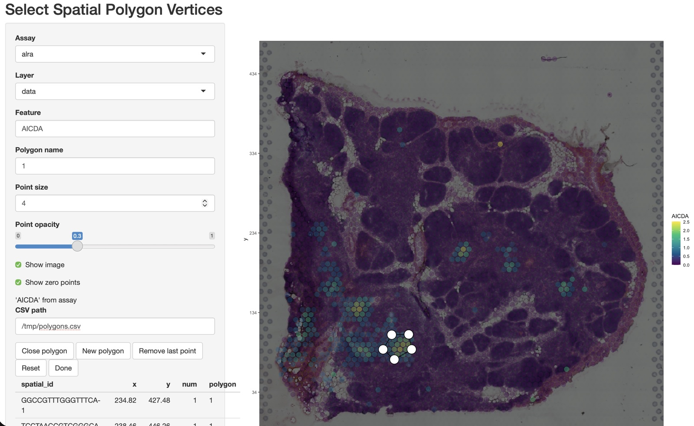
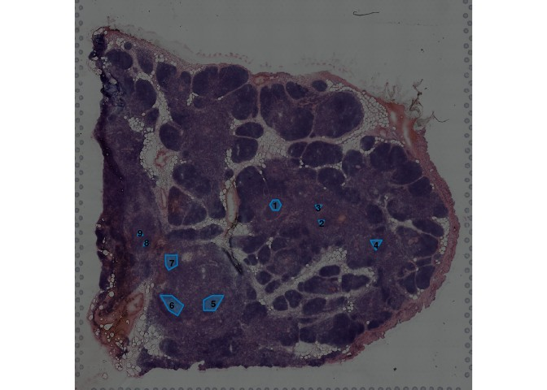
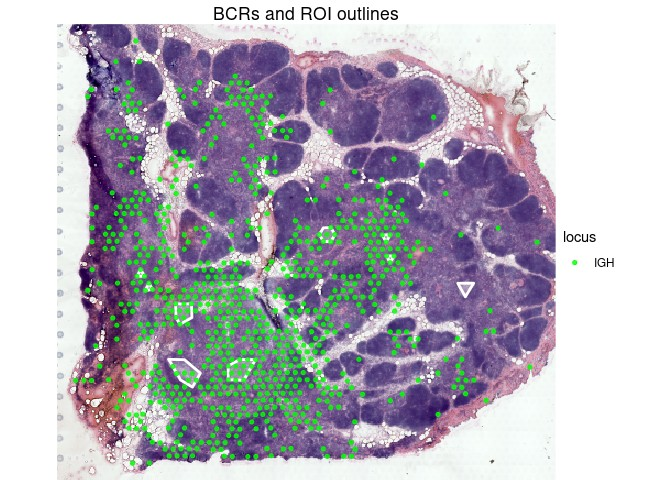
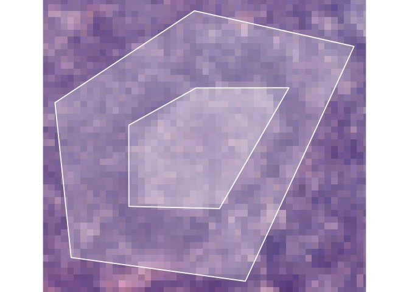
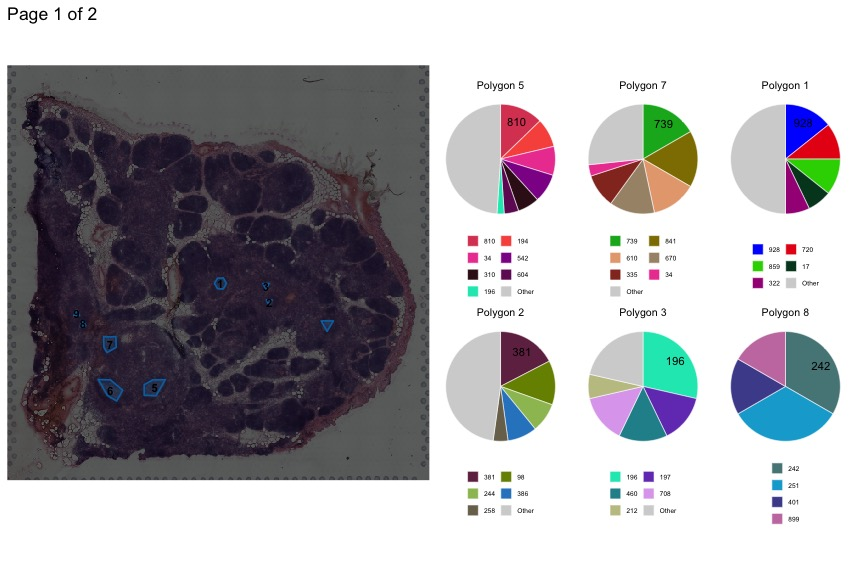
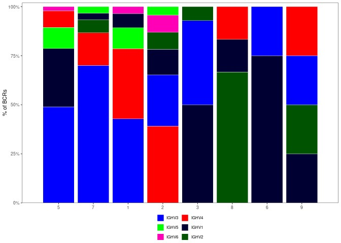
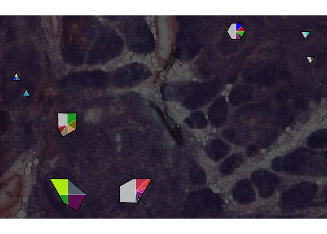
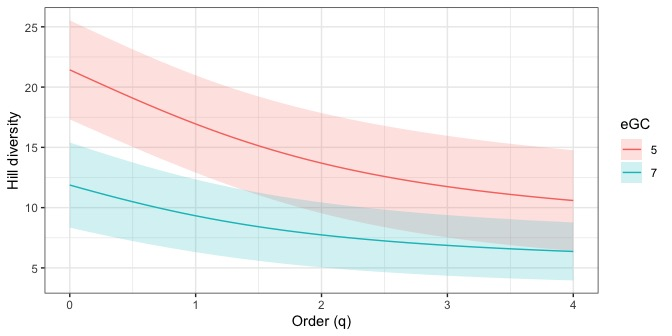
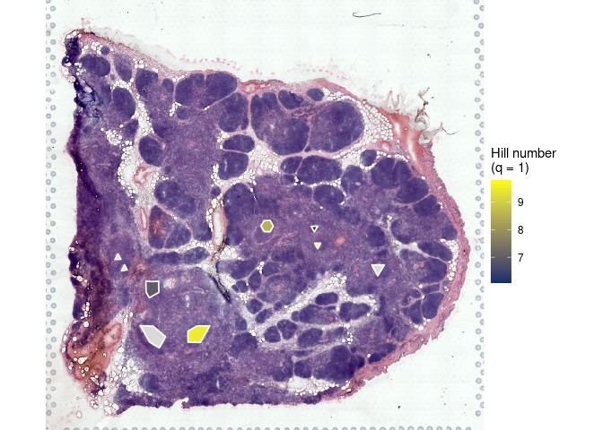

Annotate tissue ROIs and analyze local clonal structure
================

<div markdown="1"
style="background: #F7E5BC; padding: 12px; margin-bottom: 24px; line-height: 24px;">

<p style="margin: -12px -12px 12px; padding: 6px 12px; background: #d6b676; color: #ffffff; font-weight: 700;">

<b>Note</b>
</p>

**Time:** ~15 minutes.<br> **Data:** The example SIRUP object, plus its
polygon file.<br>

</div>

Here, we will select regions of interest (ROIs) on a tissue section,
attach them to a SIRUP object, and examine the BCR repertoire in each
region.

## Load the example object

This code downloads a saved SIRUP object for MG thymus section 2, which
is slightly too big to come directly with the package, and the polygon
file for the section. Change `dest` to a whatever folder you wish to
save the example data in. To see how the object was built, see
[Get started with SIRUP](get-started.md).

``` r
extdata <- SIRUP::downloadSIRUPExample(
  dest = file.path(tempdir(), "SIRUP_example"),
  files = c(
    "mg_thymus_slice2_brighter.sirup.rds",
    "mg_thymus_slice2_gc_polygons.csv"
  )
)
```

``` r
library(SIRUP)
library(dplyr)
library(ggplot2)

sirup <- readSIRUP(file.path(extdata, "mg_thymus_slice2_brighter.sirup.rds"))
sirup
#> <SIRUP object>
#> Spatial data:    Seurat, 3,203 spatial IDs, 449 genes, 1 image
#> Receptor data:   2 slots
#>   BCR: 2,105 receptor sequences x 57 columns; 797/868 receptor IDs in spatial data (91.8%)
#>   TCR: 3,610 receptor sequences x 56 columns; 1,414/1,571 receptor IDs in spatial data (90.0%)
#> Spatial ID field: barcode_10x
#> Clone ID field:  clone_id
#> Analyses:        0
```

## Draw regions

In SIRUP, select ROIs using the `selectSpatialPolygons()` function,
which opens a Shiny app in the web browser. The app shows spots over the
H&E image, colored by a gene or a metadata column in the spatial gex
data. Click to select the vertices of a region, then click **Close
polygon** to join the last vertex to the first. Click **New polygon** to
start the next region. When finished, click **Done**. The app returns a
table of the vertices, and it writes them to the CSV file at
`save_path`.



The panel on the left sets the assay, layer, and feature (from the
spatial GEX data) that color the spots, the size and opacity of the
points, and whether to show the H&E image and the spots with zero
expression. The screenshot shows one selected polygon.

``` r
gc_vertices <- selectSpatialPolygons(
  sirup,
  feature = "AICDA",
  assay = "alra",
  layer = "data",
  plot_image = TRUE,
  save_path = "mg_thymus_slice2_gc_polygons.csv"
)
```

If you’re working with very large or dense data, like Visium HD these
arguments can help the app respond faster: \* `show_zeros = FALSE` hides
spots with zero expression, which keeps 0 spots from overwhelming the
visualization. \* `downsample_n` draws fewer spots, so the app responds
faster. Each click still snaps to the full set of spots.

<div markdown="1"
style="background: #F7E5BC; padding: 12px; margin-bottom: 24px; line-height: 24px;">

<p style="margin: -12px -12px 12px; padding: 6px 12px; background: #d6b676; color: #ffffff; font-weight: 700;">

<b>Tip</b>
</p>

Give a `save_path`. The CSV file is the record of the annotation, so
other people can repeat the analysis without a second round of drawing.

</div>

### Draw regions on a remote server

If you are running R on a remote server, like an HPC cluster, the app
cannot open a browser on your computer. Instead, start the app on the
server, then connect to it from your computer through an SSH tunnel.

1.  Start R on the server. On a cluster, use an interactive session on a
    compute node (e.g., with `srun --pty`).
2.  Run `selectSpatialPolygons()` with `launch_browser = FALSE` and a
    `port`. Pick a port above 1024 that nobody else on the server uses,
    e.g., 4321.
3.  On your computer, open a second terminal and start the tunnel. The
    tunnel sends your local port to the port of the app. Leave the
    terminal open while you draw.
4.  In the browser on your computer, go to `http://127.0.0.1:4321` (or
    whatever port you chose).

The app runs on the server, but you see it on your computer. When you
finish drawing, click **Done**. The app writes the CSV file on the
server, so provide a `save_path` that is valid there. An example call to
selectSpatialPolygons() is below. The SSH command is also shown. Change
`user` and `server.example.edu` to your username and server.

``` r
# On the server
gc_vertices <- selectSpatialPolygons(
  sirup,
  feature = "AICDA",
  assay = "alra",
  layer = "data",
  plot_image = TRUE,
  save_path = "mg_thymus_slice2_gc_polygons.csv",
  launch_browser = FALSE,
  port = 4321
)
```

``` bash
# On your computer
ssh -L 4321:127.0.0.1:4321 user@server.example.edu
```

If you run R on a compute node behind a login node, the tunnel must
reach the compute node. Add `host = "0.0.0.0"` to
`selectSpatialPolygons()`, so that the login node can connect to the
app, and give the name of the compute node to the tunnel:

``` bash
# On your computer
ssh -L 4321:compute-node-name:4321 user@login.server.example.edu
```

<div markdown="1"
style="background: #F7E5BC; padding: 12px; margin-bottom: 24px; line-height: 24px;">

<p style="margin: -12px -12px 12px; padding: 6px 12px; background: #d6b676; color: #ffffff; font-weight: 700;">

<b>Note</b>
</p>

`host = "0.0.0.0"` lets other computers on the server network reach the
app while it runs. Draw the regions, click **Done**, and let the
function end, so the app does not stay open. Give a `save_path` on the
server, so that the CSV file holds the vertices after the session ends.

</div>

### Read the example polygons

The example data include the polygon file for this section. Read it in
as you would any .csv file.

``` r
vertices <- read.csv(
  file.path(extdata, "mg_thymus_slice2_gc_polygons.csv"),
  colClasses = c(polygon = "character")
)
head(vertices)
#>           spatial_id       x       y polygon         image
#> 1 ATCGACCCAATACAGA-1 300.011 326.595       1 thymus_slice2
#> 2 AGTTCCTATTTATGTT-1 306.874 326.943       1 thymus_slice2
#> 3 CAGTCTGTATACTGGG-1 310.474 320.435       1 thymus_slice2
#> 4 GCGCCGTTCCACGATA-1 306.851 313.941       1 thymus_slice2
#> 5 TTATGAATGAAAGGGA-1 299.989 314.314       1 thymus_slice2
#> 6 ACATCGATCGTTTACC-1 296.388 320.461       1 thymus_slice2
```

Each row is one vertex. `polygon` names the region, `spatial_id` is the
closest spot to where you clicked, and `x` and `y` are its coordinates.

Regions drawn by a pathologist in QuPath (or by you) can be added too,
as shown in [Use QuPath annotations to define ROIs](qupath-annotations.md).

## Attach ROIs to the SIRUP object

Use `addPolygons()` to attach the polygons to the SIRUP object. This
function also automatically annotates the spots and the receptors with
which polygons they live in.

``` r
sirup <- addPolygons(
  sirup,
  polygons_path = file.path(extdata, "mg_thymus_slice2_gc_polygons.csv")
)
sirup
#> <SIRUP object>
#> Spatial data:    Seurat, 3,203 spatial IDs, 449 genes, 1 image
#> Receptor data:   2 slots
#>   BCR: 2,105 receptor sequences x 67 columns; 797/868 receptor IDs in spatial data (91.8%)
#>   TCR: 3,610 receptor sequences x 66 columns; 1,414/1,571 receptor IDs in spatial data (90.0%)
#> Spatial ID field: barcode_10x
#> Clone ID field:  clone_id
#> Analyses:        0
#> Polygons:        9
```

The receptor table and the Seurat metadata now have a `polygon_id`
column. They also have one `TRUE`/`FALSE` column for each polygon, such
as `polygon_5`. This ensures that if you have any overlapping polygons,
you can still identify which polygon each spot or receptor belongs to.

`plotSpatialPolygons()` draws the stored polygons over the tissue.

``` r
plotSpatialPolygons(sirup, polygon_alpha = 0.3)
```



Set `zoom = TRUE` to crop the image to the polygons.

``` r
plotSpatialPolygons(sirup, zoom = TRUE)
```


Small polygons can crowd their labels, so set `label_outside = TRUE` to
move the labels outside, each joined to its polygon by a line.

Most SIRUP spatial plots accept `polygons = TRUE`, which draws the
stored polygons on top, as in the next plot of BCR-positive spots.

``` r
plotReceptors(
  sirup,
  slot = "BCR",
  group = "locus",
  colors = "green",
  receptor_size = 1.2,
  receptor_alpha = 0.8,
  polygons = TRUE,
  polygon_alpha = 0.2,
  polygon_color = "white",
  polygon_linewidth = 1,
  zoom = TRUE,
  title = "BCRs and ROI outlines"
)
```



## Overlapping ROIs

ROIs can overlap, e.g., a germinal center can be drawn inside a larger
follicle. To account for this, SIRUP records polygon membership in two
ways

- `polygon_id` holds one region for each spot. If a spot is in more than
  one polygon, it is assigned to the polygon with the smallest area.
- `polygon_<ID>` columns hold the full membership. Each polygon has one
  `TRUE`/`FALSE` column.

SIRUP analyses use `polygon_id` by default for polygon membership. To
use a different rule, build your own column from the `polygon_<ID>`
columns and pass your new column to the analysis functions.

To demonstrate, we will make another polygon around polygon 5.
`expandPolygons()` moves each vertex away from the polygon center by
`delta`, in image pixels.

``` r
expanded_5 <- vertices %>%
  filter(polygon == "5") %>%
  expandPolygons(delta = 12) %>%
  mutate(polygon = "5_expanded")

nested <- addPolygons(sirup, polygons = bind_rows(vertices, expanded_5))

getReceptors(nested, slot = "BCR") %>%
  filter(polygon_5_expanded == TRUE) %>%
  count(polygon_id, polygon_5, polygon_5_expanded)
#> # A tibble: 2 × 4
#>   polygon_id polygon_5 polygon_5_expanded     n
#>   <chr>      <lgl>     <lgl>              <int>
#> 1 5          TRUE      TRUE                  47
#> 2 5_expanded FALSE     TRUE                  65

plotSpatialPolygons(nested, polygon_val = c("5", "5_expanded"), zoom = TRUE, label = FALSE)
```



The inner polygon is polygon 5 and the outer polygon is the expanded
version. Receptors in polygon 5 keep `polygon_id = "5"`, because polygon
5 is smaller by area. Receptors in the ring around it get
`polygon_id = "5_expanded"`. The `polygon_5_expanded` column is `TRUE`
for both groups.

## Count receptors in each ROI

Use `polygonReceptorSummary()` to count the receptors in each polygon.
It gives one row for each polygon and also stores the table in the
object as an analysis.

``` r
sirup <- polygonReceptorSummary(
  sirup,
  slot = "BCR",
  polygon_id = "polygon_id",
  include_total_spots = TRUE,
  summary_columns = c("c_call", "junction_length"),
  summary_operations = c("cat", "mean")
)

getAnalysis(sirup, "polygon_receptor_summary_BCR")
#>   polygon_id n_receptors n_spatial_ids n_clones top_clone_fraction
#> 1          1          28             6       16          0.1428571
#> 2          2          23             3       16          0.1739130
#> 3          3          14             3        8          0.2857143
#> 4          4           0             0        0                 NA
#> 5          5          47            12       23          0.1276596
#> 6          6           4             4        4          0.2500000
#> 7          7          30             8       12          0.1666667
#> 8          8           6             3        4          0.3333333
#> 9          9           4             3        4          0.2500000
#>                           cat_c_call mean_junction_length n_total_spatial_ids
#> 1        IGHA1,IGHD,IGHG1,IGHG2,IGHM             52.39286                   7
#> 2                   IGHG1,IGHG2,IGHM             54.00000                   3
#> 3            IGHA1,IGHG1,IGHG2,IGHG3             60.64286                   3
#> 4                               <NA>                   NA                   4
#> 5 IGHA1,IGHG1,IGHG2,IGHG3,IGHG4,IGHM             50.29787                  12
#> 6                              IGHG1             62.25000                  11
#> 7                   IGHG1,IGHG2,IGHM             54.90000                   9
#> 8                   IGHA1,IGHG3,IGHM             55.50000                   3
#> 9                         IGHG1,IGHM             52.50000                   3
```

The default output table includes columns that count the receptors, the
spots with receptors, and the clones. The table also gives the fraction
of receptors in the largest clone. `include_total_spots = TRUE` adds the
total number of spots in the polygon.

`summary_columns` and `summary_operations` can add custom summaries.
Pass `summary_columns` a vector of column names in that you want to
summarize from the receptor table, and `summary_operations` a vector of
operations to run on each column. Allowed operations are `count`, `sum`,
`mean`, `median`, `var`, `sd`, `min`, `max`, `any`, `all`, and `cat`. In
the table above, `mean_junction_length` is the mean junction length in
each ROI.

`withPolygons()` runs any function on the receptors of each polygon. It
returns a list with one result for each polygon.

``` r
isotypes <- withPolygons(
  sirup,
  slot = "BCR",
  function(receptors) {
    receptors %>%
      mutate(isotype = substr(c_call, 1, 4)) %>%
      count(isotype)
  }
)
isotypes[["5"]]
#> # A tibble: 3 × 2
#>   isotype     n
#>   <chr>   <int>
#> 1 IGHA       11
#> 2 IGHG       33
#> 3 IGHM        3
```

With `mode = "all_polygons"`, `withPolygons()` runs the function once on
the receptors of all polygons together.

## Determine which clones dominate the ROIs

*Clonal dominance* is the fraction of the receptors in an ROI that
belong to each clone. Use `spatialCloneDominance()` to compute this for
every polygon.

``` r
dominance <- spatialCloneDominance(object = sirup, slot = "BCR", locus_val = "IGH")
names(dominance)
#> [1] "dominance"          "region_spatial_ids" "region_coordinates"
#> [4] "region_receptors"   "polygons"           "metadata"

dominance$dominance %>%
  arrange(polygon, desc(proportion)) %>%
  select(polygon, clone_id, n_receptors, proportion, v_gene_superfamily) %>%
  head(10)
#>    polygon clone_id n_receptors proportion v_gene_superfamily
#> 1        1      928           4 0.14285714              IGHV4
#> 2        1      720           3 0.10714286              IGHV3
#> 3        1      859           3 0.10714286              IGHV4
#> 4        1       17           2 0.07142857              IGHV5
#> 5        1      322           2 0.07142857              IGHV3
#> 6        1      373           2 0.07142857              IGHV3
#> 7        1      519           2 0.07142857              IGHV3
#> 8        1      904           2 0.07142857              IGHV4
#> 9        1        1           1 0.03571429              IGHV5
#> 10       1      128           1 0.03571429              IGHV1
```

The result is a list, and `dominance` is the main table, with one row
for each clone and polygon. The other items hold the spots, coordinates,
receptors, and polygon outlines that the plot functions need. Store the
result in the SIRUP object.

``` r
sirup <- setAnalysis(sirup, "gc_dominance", dominance)
```

By default, each receptor row counts once. Give a numeric column to
`count` to weight the rows, e.g., by `consensus_count`. Set
`exclude_singletons = TRUE` to drop clones with one receptor.

### Plot clonal dominance

`plotSpatialRegionReceptors()` draws the receptors in each polygon,
colored by a column. `top_n` gives a color to each of the most common
values, and the function groups the rest as `Other`.

``` r
plotSpatialRegionReceptors(
  dominance = dominance,
  object = sirup,
  color = "clone_id",
  top_n = 12,
  point_size = 2,
  zoom = TRUE
)
```


`plotSpatialPolygonPies()` shows each polygon as a pie chart. It has
four modes.

- `"side_by_side"` (default) is a numbered map with the pie charts next
  to it.
- `"spatial_clipped"` fills each pie into its own polygon on the tissue.
  This mode needs the sf package.
- `"dominance_only"` shows the pie charts without a map.
- `"stacked_bar"` shows one stacked bar for each polygon to the right of
  the numbered map.

``` r
pies <- plotSpatialPolygonPies(
  dominance = dominance,
  object = sirup,
  fill = "clone_id",
  top_n = 5,
  label_top_n = 1
)
pies$page_1
#> Warning: Removed 1 row containing missing values or values outside the scale range
#> (`geom_text()`).
```



The fill column can be any column, not only the clone.
`v_gene_superfamily` shows which IGHV families each region uses. The
`stacked_bar` mode plots a stacked bar chart summarizing the proportions
of each value in each polygon.

``` r
plotSpatialPolygonPies(
  dominance = dominance,
  object = sirup,
  fill = "v_gene_superfamily",
  mode = "stacked_bar",
  top_n = 7
)
```



The `spatial_clipped` mode draws each pie inside its polygon, which is
not recommended for small polygons as it can be tough to see.

``` r
plotSpatialPolygonPies(
  dominance = dominance,
  object = sirup,
  fill = "clone_id",
  mode = "spatial_clipped",
  top_n = 5,
  zoom = TRUE
)
```



## Measure clonal diversity in ROIs

*Clonal diversity* describes the variety and abundance of clones in the
repertoire, see for more details. We are interested in the diversity of
the clones in each ROI.

`polygonDiversity()` calls `alakazam::alphaDiversity()` with polygon as
the grouping variable. `alakazam::alphaDiversity()` resamples every
polygon to the same number of receptors (to ensure comparability, since
diversity is sensitive to sample size), the size of the smallest polygon
that has at least `min_n` receptors, and adds bootstrap confidence
intervals. The function excludes any ROIs with fewer than `min_n`
receptors (default 10). A larger `min_n` gives less noisy estimates but
keeps fewer polygons.

``` r
sirup <- polygonDiversity(sirup, slot = "BCR", polygon_id = "polygon_id", min_n = 10, nboot = 200)
diversity <- getAnalysis(sirup, "polygon_diversity_BCR")
```

The stored analysis is one `alakazam` `DiversityCurve` object, with one
curve for each polygon. Plot it with `alakazam::plotDiversityCurve()`,
which shows the 95% confidence band of each polygon.

``` r
alakazam::plotDiversityCurve(diversity, legend_title = "ROI")
```



`summarizePolygonDiversity()` picks one `q` and stores a table with one
row for each polygon. `plotSpatialPolygons()` can then fill each polygon
by a column of any stored analysis.

``` r
sirup <- summarizePolygonDiversity(sirup, slot = "BCR", q = 1, analysis_name = "shannon")

plotSpatialPolygons(
  sirup,
  fill_analysis = "shannon",
  fill_column = "d",
  analysis_fill = c("#08306B", "#FFFF00"),
  polygon_alpha = 1,
  label = FALSE
) +
  labs(fill = "Hill number\n(q = 1)")
```



`analysis_fill` sets the colors for the lowest and the highest value.
Polygons with too few receptors for the estimate are grey.

`polygonAbundance()` works the same way for clonal rank-abundance
curves. It calls `alakazam::estimateAbundance()` once on all polygons
and stores one `AbundanceCurve`. Plot it with
`alakazam::plotAbundanceCurve()`.

## Extract and compare GEX in ROIs

`seuratSubsetPolygon()` keeps the spots inside polygons and records the
polygon of each spot in the Seurat metadata under the specified column
(e.g., with `metadata = "gc"`). Use it to extract the spots in each
polygon and then make comparisons. Here, we aggregate the expression of
each gene in each polygon to make pseudobulk profiles.

``` r
gc_spots <- seuratSubsetPolygon(sirup, metadata = "gc")
gc_spots
#> An object of class Seurat 
#> 506 features across 55 samples within 2 assays 
#> Active assay: Spatial (449 features, 0 variable features)
#>  2 layers present: counts, data
#>  1 other assay present: alra
#>  1 spatial field of view present: thymus_slice2
table(gc_spots$gc)
#> 
#>  1  2  3  4  5  6  7  8  9 
#>  7  3  3  4 12 11  9  3  3

pseudobulk <- Seurat::AggregateExpression(
  gc_spots,
  assays = "Spatial",
  group.by = "gc"
)$Spatial
pseudobulk[c("AICDA", "MS4A1", "CXCL13", "CD3E"), ]
#> 4 x 9 sparse Matrix of class "dgCMatrix"
#>         g1 g2 g3 g4  g5 g6  g7 g8 g9
#> AICDA    2  .  .  1   4  5   6  .  .
#> MS4A1  107 48 12  6 141 56 258 74 29
#> CXCL13  24 16 14  6  13 12  66 36  7
#> CD3E    11  3  2  2  17 16  12  7  3
```

<div markdown="1"
style="background: #F7E5BC; padding: 12px; margin-bottom: 24px; line-height: 24px;">

<p style="margin: -12px -12px 12px; padding: 6px 12px; background: #d6b676; color: #ffffff; font-weight: 700;">

<b>Note</b>
</p>

Seurat adds a `g` to group names that start with a number. The column
for eGC 1 is `g1`.

</div>

These profiles can be given to a differential expression tool, such as
limma or DESeq2.

## Measure distances between regions

`polygonCentroids()` calculates and returns the centroid of each
polygon. `polygonPairwiseDistance()` returns the distance between every
pair of centroid, in image pixels (`distance`). It also divides each
distance by the diagonal of the section (`normalized_distance`), which
can be used to compare sections of different sizes.

``` r
polygonCentroids(sirup)
#> # A tibble: 9 × 7
#>   sample polygon_id polygon_label     x     y .sirup_y n_vertices
#>   <chr>  <chr>      <chr>         <dbl> <dbl>    <dbl>      <int>
#> 1 <NA>   1          1              303.  320.    -320.          7
#> 2 <NA>   2          2              361.  342.    -342.          4
#> 3 <NA>   3          3              357.  323.    -323.          4
#> 4 <NA>   4          4              429.  369.    -369.          4
#> 5 <NA>   5          5              224.  443.    -443.          6
#> 6 <NA>   6          6              175.  445.    -445.          7
#> 7 <NA>   7          7              173.  391.    -391.          7
#> 8 <NA>   8          8              142.  369.    -369.          4
#> 9 <NA>   9          9              134.  356.    -356.          4
polygonPairwiseDistance(sirup) %>%
  arrange(distance) %>%
  head()
#> # A tibble: 6 × 8
#>   sample  polygon_id_1 polygon_id_2 polygon_label_1 polygon_label_2 distance
#>   <chr>   <chr>        <chr>        <chr>           <chr>              <dbl>
#> 1 spatial 8            9            8               9                   14.5
#> 2 spatial 2            3            2               3                   19.4
#> 3 spatial 7            8            7               8                   38.7
#> 4 spatial 5            6            5               6                   49.5
#> 5 spatial 7            9            7               9                   52.3
#> 6 spatial 1            3            1               3                   53.6
#> # ℹ 2 more variables: normalized_distance <dbl>, section_diagonal <dbl>
```

## Next steps

- To build lineage trees and visualize them on the tissue, read
  [Infer clones and lineage trees in situ](clones-and-trees.md).
- To add more sections or bulk AIRR-seq, see
  [Analyze multiple spatial sections and bulk BCR-seq](multisample.md).
- To test spatial patterns, read
  [Choose the right spatial statistic for your question](choose-spatial-statistic.md).
- To use QuPath annotations to define ROIs, see
  [Use QuPath annotations to define ROIs](qupath-annotations.md).
