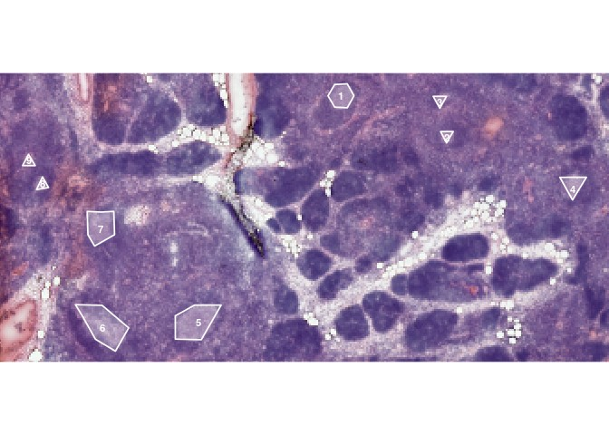
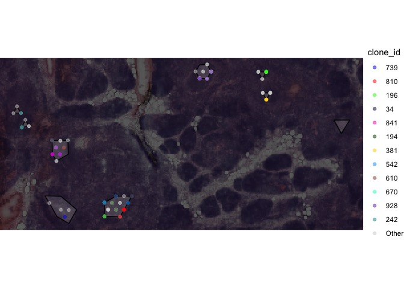

Draw tissue regions and measure clonal dominance and diversity
================

> **Time:** about 15 minutes. **Data:** consensus BCRs and spatial gene
> expression from one myasthenia gravis (MG) thymus section, bundled
> with SIRUP. **Needs:** SIRUP with its Suggests packages scoper,
> alakazam, and sf, plus rgl for the 3D plot.

In this page you mark regions on a tissue section, attach them to a
SIRUP object, and measure the B cell receptor (BCR) repertoire in each
region. A *spot* is one capture location of the spatial assay. A
*polygon* is a closed outline on the H&E image that you draw around
spots. A *clone* is a group of receptors that descend from one ancestor
cell. In the SIRUP paper, polygons mark the ectopic germinal centers
(eGCs) of the MG thymus. You compare their repertoires with the germinal
centers of the tonsil.

You finish with a table of receptors per region, clonal dominance plots,
diversity curves, and pseudobulk expression profiles. This page assumes
you know the SIRUP object. See
[How the SIRUP object works](sirup-object.md) for an introduction.

## Set up the object

Load the packages.

``` r
library(SIRUP)
library(dplyr)
library(ggplot2)
```

``` r
extdata <- system.file("extdata", package = "SIRUP")

thymus <- readRDS(file.path(extdata, "mg_thymus_slice2_spatial.rds"))
bcrs <- airr::read_rearrangement(file.path(extdata, "mg_thymus_slice2_bcr.tsv.gz")) %>%
  extractSpatialIds(
    id = "sequence_id",
    spatial_id = "barcode_10x",
    regex = ",([ACGT]{16})$",
    suffix = "-1"
  ) %>%
  filterAirr(
    locus_val = "IGH",
    min_v_length = 250,
    min_j_length = 30,
    min_junction_length = 10,
    productive_only = TRUE,
    min_consensus_count = NULL,
    spatial_id = "barcode_10x"
  ) %>%
  filter(!grepl("[^ACGT]", junction))
#> filterAirr kept 2195 of 3801 rows (dropped 1606).

sirup <- createSIRUP(
  spatial = thymus,
  receptors = bcrs,
  spatial_id = "barcode_10x",
  image_scale = "lowres",
  swap_coords = FALSE
)
sirup <- updateReceptors(
  sirup,
  scoper::hierarchicalClones,
  threshold = 0.1,
  summarize_clones = FALSE,
  nproc = 1
)
#> Running defineClonesScoper in bulk mode and only keep heavy chains
```

The setup chunk reads the consensus BCRs of section 2. It takes the spot
barcode from `sequence_id`. It keeps high-quality sequences that have an
unambiguous junction. It then calls clones with
`scoper::hierarchicalClones()`.
[Get started with SIRUP](get-started.md) explains each step.

## Draw regions

`selectSpatialPolygons()` opens a Shiny app in your web browser. The app
shows the spots over the H&E image. You color the spots by a gene or a
metadata column. You click around the edge of each region. The app
returns a table of vertices.

In the SIRUP paper, the eGCs are drawn over imputed *AICDA* expression.
*AICDA* marks germinal center B cells. This chunk does not run here,
because it needs a browser:

``` r
gc_vertices <- selectSpatialPolygons(
  sirup,
  feature = "AICDA",
  assay = "alra",
  layer = "data",
  plot_image = TRUE,
  save_path = "mg_thymus_slice2_gc_polygons.csv"
)
```

These arguments help on large sections:

- `feature` names a gene or a numeric metadata column, such as a module
  score or a cell-type proportion. You can change it in the app.
- `show_zeros = FALSE` hides spots with zero expression. This helps on
  sparse Visium HD bins.
- `downsample_n` draws fewer spots, so the app responds faster. Clicks
  still snap to the full set of spots.
- On a remote server, set `launch_browser = FALSE`, `host = "0.0.0.0"`,
  and a `port`. Then open the port through an SSH tunnel.

> **Tip.** Give a `save_path`. The CSV file is the record of your
> annotation. Other people can repeat the analysis without a second
> round of drawing.

The example data include the polygon file for this section. Read it:

``` r
vertices <- read.csv(
  file.path(extdata, "mg_thymus_slice2_gc_polygons.csv"),
  colClasses = c(polygon = "character")
)
head(vertices)
#>           spatial_id       x       y polygon         image
#> 1 ATCGACCCAATACAGA-1 300.011 326.595       1 thymus_slice2
#> 2 AGTTCCTATTTATGTT-1 306.874 326.943       1 thymus_slice2
#> 3 CAGTCTGTATACTGGG-1 310.474 320.435       1 thymus_slice2
#> 4 GCGCCGTTCCACGATA-1 306.851 313.941       1 thymus_slice2
#> 5 TTATGAATGAAAGGGA-1 299.989 314.314       1 thymus_slice2
#> 6 ACATCGATCGTTTACC-1 296.388 320.461       1 thymus_slice2
```

Each row is one vertex. `polygon` names the region. `spatial_id` is the
spot under the click. `x` and `y` are its image coordinates. You can
build this table in other ways. For example, `formatSpatialPolygons()`
turns a set of spots into a polygon outline. One such set is a Seurat
cluster.

## Attach regions to the object

`addPolygons()` stores the polygons. It also annotates the spots and the
receptors:

``` r
sirup <- addPolygons(
  sirup,
  polygons_path = file.path(extdata, "mg_thymus_slice2_gc_polygons.csv")
)
sirup
#> <SIRUP object>
#> Spatial data:    Seurat, 3,203 spatial IDs, 449 genes, 1 image
#> Receptor data:   tibble, 2,105 receptor sequences x 67 columns
#> Spatial overlap: 797/868 receptor IDs in spatial data (91.8%)
#> Spatial ID field: barcode_10x
#> Clone ID field:  clone_id
#> Analyses:        0
#> Polygons:        9
```

The receptor table and the Seurat metadata now have a `polygon_id`
column. They also have one `TRUE`/`FALSE` column for each polygon, such
as `polygon_5`. The next section explains why both exist.

`plotSpatialPolygons()` draws the stored polygons over the tissue:

``` r
plotSpatialPolygons(sirup, polygon_alpha = 0.3)
```


Set `zoom = TRUE` to crop the image to the polygons:

``` r
plotSpatialPolygons(sirup, zoom = TRUE)
```



Small polygons can crowd their labels. Set `label_outside = TRUE` to
move the labels outside, each joined to its polygon by a line. Leave
`zoom` off, so the labels have space.

Most SIRUP spatial plots accept `polygons = TRUE`. This draws the stored
polygons on top. The next plot shows BCR-positive spots with the eGC
outlines:

``` r
plotReceptors(
  sirup,
  group = "locus",
  colors = "#0072B2",
  receptor_size = 1,
  polygons = TRUE,
  polygon_alpha = 0,
  polygon_color = "black",
  zoom = TRUE,
  title = "BCRs and eGC outlines"
)
```


## Handle overlapping regions

Regions can overlap. For example, you can draw a germinal center inside
a larger follicle. SIRUP records polygon membership in two ways:

- `polygon_id` holds one region for each spot. If a spot is in more than
  one polygon, it gets the polygon with the smallest area.
- `polygon_<ID>` columns hold the full membership. Each polygon has one
  `TRUE`/`FALSE` column.

The SIRUP analysis functions use `polygon_id`. To use a different rule,
build your own column from the `polygon_<ID>` columns.

To show this, make a zone around eGC 5. `expandPolygons()` moves each
vertex away from the polygon center by `delta`, in image pixels:

``` r
zone <- vertices %>%
  filter(polygon == "5") %>%
  expandPolygons(delta = 12) %>%
  mutate(polygon = "5_zone")

nested <- addPolygons(sirup, polygons = bind_rows(vertices, zone))

getReceptors(nested) %>%
  filter(polygon_5_zone) %>%
  count(polygon_id, polygon_5, polygon_5_zone)
#> # A tibble: 2 × 4
#>   polygon_id polygon_5 polygon_5_zone     n
#>   <chr>      <lgl>     <lgl>          <int>
#> 1 5          TRUE      TRUE              47
#> 2 5_zone     FALSE     TRUE              65

plotSpatialPolygons(nested, polygon_val = c("5", "5_zone"), zoom = TRUE, label = FALSE)
```


The inner polygon is eGC 5. The outer polygon is the zone. Receptors in
eGC 5 keep `polygon_id = "5"`, because eGC 5 is the smaller polygon.
Receptors in the ring around it get `polygon_id = "5_zone"`. The
`polygon_5_zone` column is `TRUE` for both groups.

## Count receptors in each region

`polygonReceptorSummary()` gives one row for each polygon. It also
stores the table in the object as an analysis:

``` r
sirup <- polygonReceptorSummary(
  sirup,
  polygon_id = "polygon_id",
  include_total_spots = TRUE,
  summary_columns = c("c_call", "junction_length"),
  summary_operations = c("cat", "mean")
)

getAnalysis(sirup, "polygon_receptor_summary")
#>   polygon_id n_receptors n_spatial_ids n_clones top_clone_fraction
#> 1          1          28             6       16          0.1428571
#> 2          2          23             3       16          0.1739130
#> 3          3          14             3        8          0.2857143
#> 4          4           0             0        0                 NA
#> 5          5          47            12       23          0.1276596
#> 6          6           4             4        4          0.2500000
#> 7          7          30             8       12          0.1666667
#> 8          8           6             3        4          0.3333333
#> 9          9           4             3        4          0.2500000
#>                           cat_c_call mean_junction_length n_total_spatial_ids
#> 1        IGHA1,IGHD,IGHG1,IGHG2,IGHM             52.39286                   7
#> 2                   IGHG1,IGHG2,IGHM             54.00000                   3
#> 3            IGHA1,IGHG1,IGHG2,IGHG3             60.64286                   3
#> 4                               <NA>                   NA                   4
#> 5 IGHA1,IGHG1,IGHG2,IGHG3,IGHG4,IGHM             50.29787                  12
#> 6                              IGHG1             62.25000                  11
#> 7                   IGHG1,IGHG2,IGHM             54.90000                   9
#> 8                   IGHA1,IGHG3,IGHM             55.50000                   3
#> 9                         IGHG1,IGHM             52.50000                   3
```

The default columns count the receptors, the spots with receptors, and
the clones. They also give the fraction of receptors in the largest
clone. `include_total_spots = TRUE` adds the number of spots in the
polygon, with or without a receptor.

`summary_columns` and `summary_operations` add your own summaries. Each
pair gives a column named `<operation>_<column>`. The operations are
`count`, `sum`, `mean`, `median`, `var`, `sd`, `min`, `max`, `any`,
`all`, and `cat`. `cat` pastes the distinct values together. In the
table above, `mean_junction_length` is the mean junction length in each
eGC.

`withPolygons()` runs any function on the receptors of each polygon. It
returns a list with one result for each polygon:

``` r
isotypes <- withPolygons(
  sirup,
  function(receptors) {
    receptors %>%
      mutate(isotype = substr(c_call, 1, 4)) %>%
      count(isotype)
  }
)
isotypes[["5"]]
#> # A tibble: 3 × 2
#>   isotype     n
#>   <chr>   <int>
#> 1 IGHA       11
#> 2 IGHG       33
#> 3 IGHM        3
```

With `mode = "all_polygons"`, `withPolygons()` runs the function once on
the receptors of all polygons together.

## Measure clonal dominance

*Clonal dominance* is the fraction of the receptors in a region that
belong to each clone. One clone dominates a region when the region has
few, large clones. A polyclonal region has many small clones.

`spatialCloneDominance()` computes this for every polygon:

``` r
dominance <- spatialCloneDominance(object = sirup, locus_val = "IGH")
names(dominance)
#> [1] "dominance"          "region_spatial_ids" "region_coordinates"
#> [4] "region_receptors"   "polygons"           "metadata"

dominance$dominance %>%
  arrange(polygon, desc(proportion)) %>%
  select(polygon, clone_id, n_receptors, proportion, v_gene_superfamily) %>%
  head(10)
#>    polygon clone_id n_receptors proportion v_gene_superfamily
#> 1        1      928           4 0.14285714              IGHV4
#> 2        1      720           3 0.10714286              IGHV3
#> 3        1      859           3 0.10714286              IGHV4
#> 4        1       17           2 0.07142857              IGHV5
#> 5        1      322           2 0.07142857              IGHV3
#> 6        1      373           2 0.07142857              IGHV3
#> 7        1      519           2 0.07142857              IGHV3
#> 8        1      904           2 0.07142857              IGHV4
#> 9        1        1           1 0.03571429              IGHV5
#> 10       1      128           1 0.03571429              IGHV1
```

The result is a list. `dominance` is the main table, with one row for
each clone and polygon. The other items hold the spots, coordinates,
receptors, and polygon outlines that the plot functions need. Store the
result in the object to keep it:

``` r
sirup <- setAnalysis(sirup, "gc_dominance", dominance)
```

By default, each receptor row counts once. Give a numeric column to
`count` to weight the rows, for example by `consensus_count`. Set
`exclude_singletons = TRUE` to drop clones with one receptor.

### Plot dominance

`plotSpatialRegionReceptors()` draws the receptors in each polygon,
colored by a column. `top_n` gives a color to each of the most common
values. The function groups the rest as `Other`:

``` r
plotSpatialRegionReceptors(
  dominance = dominance,
  object = sirup,
  color = "clone_id",
  top_n = 12,
  point_size = 1.5,
  zoom = TRUE
)
```



`plotSpatialPolygonPies()` shows each polygon as a pie chart. It has
four modes:

- `"side_by_side"` (default): a numbered map with the pies next to it.
- `"spatial_clipped"`: each pie fills its own polygon on the tissue.
  This mode needs the sf package.
- `"dominance_only"`: the pies without a map.
- `"stacked_bar"`: one stacked bar for each polygon, in one panel.

``` r
pies <- plotSpatialPolygonPies(
  dominance = dominance,
  object = sirup,
  fill = "clone_id",
  top_n = 5,
  label_top_n = 1
)
pies$page_1
#> Warning: Removed 1 row containing missing values or values outside the scale range
#> (`geom_text()`).
```


The fill column can be any column, not only the clone.
`v_gene_superfamily` shows which IGHV families each region uses. The
`stacked_bar` mode puts every polygon in one panel:

``` r
plotSpatialPolygonPies(
  dominance = dominance,
  object = sirup,
  fill = "v_gene_superfamily",
  mode = "stacked_bar",
  top_n = 7
)
```


The `spatial_clipped` mode draws each pie inside its polygon:

``` r
plotSpatialPolygonPies(
  dominance = dominance,
  object = sirup,
  fill = "clone_id",
  mode = "spatial_clipped",
  top_n = 5,
  zoom = TRUE
)
#> Warning: package 'sf' was built under R version 4.5.3
#> Linking to GEOS 3.7.2, GDAL 3.0.4, PROJ 6.3.2; sf_use_s2() is TRUE
```


### Plot clone density in 3D

`plotSpatialCloneDensity3D()` draws the H&E image as a floor. It adds a
smoothed density surface for each of the largest clones in a polygon. In
the HTML version of this page, you can rotate and zoom the plot with the
mouse. The plot needs the rgl package. The Markdown version of this page
shows the code only.

``` r
options(rgl.useNULL = TRUE)
plotSpatialCloneDensity3D(
  dominance = dominance,
  object = sirup,
  polygon_val = "5",
  top_n = 5,
  zoom = TRUE
)
```

Use `plot_type = "histogram"` for 3D bars in place of smooth surfaces.
Set `return_data = TRUE` to get the computed surfaces as tables.

## Measure clonal diversity

*Clonal diversity* describes how the receptors in a region spread across
clones. A Hill number gives a diversity value for each order `q`. At
`q = 0`, the Hill number is the number of clones (richness). As `q`
rises, large clones get more weight. `q = 1` gives the exponential of
Shannon entropy. `q = 2` gives the inverse Simpson index.

Small regions have few receptors, and a diversity estimate depends on
sample size. `polygonDiversity()` calls `alakazam::alphaDiversity()`.
This function rarefies every polygon to the same number of receptors. It
also adds bootstrap confidence intervals. The function leaves out
polygons with fewer than `min_n` receptors:

``` r
sirup <- polygonDiversity(sirup, polygon_id = "polygon_id", min_n = 30, nboot = 200)
diversity <- getAnalysis(sirup, "polygon_diversity")
names(diversity)
#> [1] "1" "2" "3" "4" "5" "6" "7" "8" "9"
```

The stored analysis is a list with one `alakazam` result for each
polygon. Collect the curves and plot them:

``` r
curves <- bind_rows(
  lapply(names(diversity), function(id) {
    if (is.null(diversity[[id]])) return(NULL)
    mutate(diversity[[id]]@diversity, polygon = id)
  })
)

ggplot(curves, aes(q, d, color = polygon, fill = polygon)) +
  geom_ribbon(aes(ymin = d_lower, ymax = d_upper), alpha = 0.2, color = NA) +
  geom_line() +
  labs(x = "Order (q)", y = "Hill diversity", color = "eGC", fill = "eGC") +
  theme_bw()
```


`summarizePolygonDiversity()` picks one `q`. It stores a table with one
row for each polygon. `plotSpatialPolygons()` can then fill each polygon
by a column of any stored analysis:

``` r
sirup <- summarizePolygonDiversity(sirup, q = 1, analysis_name = "shannon")

plotSpatialPolygons(
  sirup,
  fill_analysis = "shannon",
  fill_column = "d",
  analysis_fill = c("#08306B", "#FFFF00"),
  polygon_alpha = 1,
  zoom = TRUE
) +
  labs(fill = "Hill number\n(q = 1)")
```


`analysis_fill` sets the colors for the lowest and the highest value.
Polygons with too few receptors for the estimate are grey.
`polygonAbundance()` works the same way for clonal rank-abundance
curves. It calls `alakazam::estimateAbundance()`.

## Extract gene expression from regions

`seuratSubsetPolygon()` keeps the spots inside polygons. It records the
polygon of each spot in the metadata. Use it for in silico
microdissection. For example, make one pseudobulk expression profile for
each eGC:

``` r
gc_spots <- seuratSubsetPolygon(sirup, metadata = "gc")
gc_spots
#> An object of class Seurat 
#> 506 features across 55 samples within 2 assays 
#> Active assay: Spatial (449 features, 0 variable features)
#>  2 layers present: counts, data
#>  1 other assay present: alra
#>  1 spatial field of view present: thymus_slice2
table(gc_spots$gc)
#> 
#>  1  2  3  4  5  6  7  8  9 
#>  7  3  3  4 12 11  9  3  3

pseudobulk <- Seurat::AggregateExpression(
  gc_spots,
  assays = "Spatial",
  group.by = "gc"
)$Spatial
pseudobulk[c("AICDA", "MS4A1", "CXCL13", "CD3E"), ]
#> 4 x 9 sparse Matrix of class "dgCMatrix"
#>         g1 g2 g3 g4  g5 g6  g7 g8 g9
#> AICDA    2  .  .  1   4  5   6  .  .
#> MS4A1  107 48 12  6 141 56 258 74 29
#> CXCL13  24 16 14  6  13 12  66 36  7
#> CD3E    11  3  2  2  17 16  12  7  3
```

> **Note.** Seurat adds a `g` to group names that start with a number.
> The column for eGC 1 is `g1`.

You can give these profiles to a differential expression tool, such as
limma or DESeq2.

## Measure distances between regions

`polygonCentroids()` gives the center of each polygon.
`polygonPairwiseDistance()` gives the distance between every pair of
centers, in image pixels (`distance`). It also divides each distance by
the diagonal of the section (`normalized_distance`). Use the normalized
value to compare sections of different sizes:

``` r
polygonCentroids(sirup)
#> # A tibble: 9 × 7
#>   sample polygon_id polygon_label     x     y .sirup_y n_vertices
#>   <chr>  <chr>      <chr>         <dbl> <dbl>    <dbl>      <int>
#> 1 <NA>   1          1              303.  320.    -320.          7
#> 2 <NA>   2          2              361.  342.    -342.          4
#> 3 <NA>   3          3              357.  323.    -323.          4
#> 4 <NA>   4          4              429.  369.    -369.          4
#> 5 <NA>   5          5              224.  443.    -443.          6
#> 6 <NA>   6          6              175.  445.    -445.          7
#> 7 <NA>   7          7              173.  391.    -391.          7
#> 8 <NA>   8          8              142.  369.    -369.          4
#> 9 <NA>   9          9              134.  356.    -356.          4
polygonPairwiseDistance(sirup) %>%
  arrange(distance) %>%
  head()
#> # A tibble: 6 × 8
#>   sample  polygon_id_1 polygon_id_2 polygon_label_1 polygon_label_2 distance
#>   <chr>   <chr>        <chr>        <chr>           <chr>              <dbl>
#> 1 spatial 8            9            8               9                   14.5
#> 2 spatial 2            3            2               3                   19.4
#> 3 spatial 7            8            7               8                   38.7
#> 4 spatial 5            6            5               6                   49.5
#> 5 spatial 7            9            7               9                   52.3
#> 6 spatial 1            3            1               3                   53.6
#> # ℹ 2 more variables: normalized_distance <dbl>, section_diagonal <dbl>
```

## Next steps

- Call clones across the section and build trees for each region:
  [Call clones and build lineage trees on the tissue](clones-and-trees.md).
- Test whether a gene, cell type, or clone clusters in space:
  [Test spatial patterns of genes, cells, and clones](spatial-statistics.md).
- Pick the right test for your question:
  [Choose a spatial statistic](choose-spatial-statistic.md).
- Compare several sections:
  [Analyze several sections with bulk AIRR-seq and blood](multisample.md).
