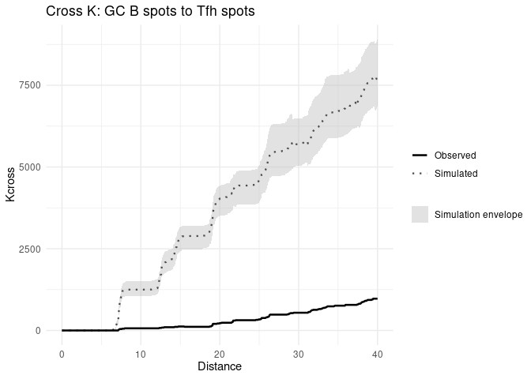

Test spatial patterns of genes, cells, and clones
================

<div markdown="1"
style="background: #F7E5BC; padding: 12px; margin-bottom: 24px; line-height: 24px;">

<p style="margin: -12px -12px 12px; padding: 6px 12px; background: #d6b676; color: #ffffff; font-weight: 700;">

<b>Note</b>
</p>

**Time:** ~15 minutes.<br> **Data:** a saved SIRUP object of the example
MG thymus data, with BCRs, TCRs, gene expression, and cell-type
estimates.<br> **Needs:** SIRUP with spdep, scoper, and
spatstat.explore, spatstat.geom, and spatstat.random.

</div>

Here, we will test whether genes, cell types, and clones form spatial
patterns in one myasthenia gravis (MG) thymus section.

A map can suggest that a gene clusters or that a clone stays in one
place, and a spatial statistic tests whether the pattern is stronger
than chance. We will run five tests, plus one description of how far
clones spread:

| Question | Function | Statistic |
|----|----|----|
| Is a variable spatially autocorrelated? | `spatialMoran()` | Global Moran’s I |
| Where is a variable spatially autocorrelated? | `spatialLocalMoran()` | Local Moran’s I |
| Do two variables co-vary in space? | `spatialLee()` | Lee’s L |
| Do two spot types sit near each other? | `spatialRipleyCrossK()` | Ripley’s cross K |
| Is a clone spatially autocorrelated? | `spatialCloneJoinCount()` | Join count |
| How far does a clone spread? | `spatialCloneSpread()` | Pairwise distances |

<div markdown="1"
style="background: #F7E5BC; padding: 12px; margin-bottom: 24px; line-height: 24px;">

<p style="margin: -12px -12px 12px; padding: 6px 12px; background: #d6b676; color: #ffffff; font-weight: 700;">

<b>Note</b>
</p>

This page starts with a saved SIRUP object, which is loaded below. To
learn how the object is built, see
[Get started with SIRUP](get-started.md). To decide which test to
use, see [Choose a spatial statistic](choose-spatial-statistic.md).

</div>

## Load the example object

This code downloads a saved SIRUP object for one MG thymus section,
which is not part of the SIRUP package, and reads it. The object has a
BCR slot and a TCR slot, the cell-type proportions in the Seurat
metadata (estimated with cell2location), and BCR clones. Change `dest`
to a folder you want to keep. The function skips files that are already
there. Each function on this page accepts a SIRUP object and reads the
spot coordinates and the image settings from it. To see how the object
was built, see [Get started with SIRUP](get-started.md).

``` r
extdata <- SIRUP::downloadSIRUPExample(
  dest = file.path(tempdir(), "SIRUP_example"),
  files = "mg_thymus_slice2.sirup.rds"
)
#> ℹ 'mg_thymus_slice2.sirup.rds' is already in '/scratch/f007p0j/Rtmpyr7Vhs/SIRUP_example'.
```

``` r
library(SIRUP)
library(dplyr)
library(ggplot2)

sirup <- readSIRUP(file.path(extdata, "mg_thymus_slice2.sirup.rds"))
sirup
#> <SIRUP object>
#> Spatial data:    Seurat, 3,203 spatial IDs, 449 genes, 1 image
#> Receptor data:   2 slots
#>   BCR: 2,105 receptor sequences x 57 columns; 797/868 receptor IDs in spatial data (91.8%)
#>   TCR: 3,610 receptor sequences x 56 columns; 1,414/1,571 receptor IDs in spatial data (90.0%)
#> Spatial ID field: barcode_10x
#> Clone ID field:  clone_id
#> Analyses:        0
```

## Choose the neighbors

Most of these statistics compare each spot with its neighbors. The
neighbors are chosen in one of two ways:

- `k` sets the `k` nearest spots as neighbors. Use `k = 6` for standard
  Visium, where each spot has six neighbors on a hexagonal grid. Use
  `k = 8` for Visium HD, where each bin has eight neighbors on a square
  grid. A larger `k` measures patterns over larger distances.
- `radius` sets all spots within a distance as neighbors. SIRUP measures
  distances in image pixels at the stored `image_scale`, so the same
  distance in micrometers needs a different number at `"lowres"` and at
  `"hires"`.

<div markdown="1"
style="background: #F7E5BC; padding: 12px; margin-bottom: 24px; line-height: 24px;">

<p style="margin: -12px -12px 12px; padding: 6px 12px; background: #d6b676; color: #ffffff; font-weight: 700;">

<b>Tip</b>
</p>

`k` does not depend on the image scale, so it is a good default.

</div>

## Test whether a variable is spatially autocorrelated

Use `spatialMoran()` to determine if a continuous variable is spatially
autocorrelated, i.e., if neighboring spots have similar values. This
function computes [Moran’s
I](https://en.wikipedia.org/wiki/Moran%27s_I#Global_Moran's_I). Moran’s
I is near 0 when the values show no spatial pattern, it is positive when
similar values are nearby, and it is negative when dissimilar values are
nearby.

`variable_type` tells the function what type of variable it is:

- `"feature"` is a gene, from the assay and layer that are given.
- `"metadata"` is a numeric spot metadata column. For a text column,
  give `value` to test the spots that have that value.
- `"receptor"` is 1 for spots with any receptor and 0 for other spots.
  `variable` is a label only.
- `"clone"` is 1 for spots with the clone that `variable` names.

This chunk tests *AICDA*, a marker of germinal center B cells:

``` r
aicda <- spatialMoran(
  sirup,
  variable = "AICDA",
  variable_type = "feature",
  assay = "Spatial",
  layer = "data",
  k = 6
)
aicda$test
#> 
#>  Moran I test under randomisation
#> 
#> data:  dat$value  
#> weights: listw    
#> 
#> Moran I statistic standard deviate = 6.0618, p-value = 6.731e-10
#> alternative hypothesis: greater
#> sample estimates:
#> Moran I statistic       Expectation          Variance 
#>      5.944121e-02     -3.123048e-04      9.716874e-05
```

The result is a list, and `test` is the `spdep::moran.test()` result. It
holds the statistic, its expected value under no spatial pattern, the
variance, and the p value. For *AICDA*, $I$ is small, about 0.06, and
the p value is below $10^{-9}$. The assay detects *AICDA* in few spots,
and most spots have a count of zero. The clustering is weak, but chance
is a poor explanation for it. $I$ gives the size of the pattern and the
p value gives the evidence for it.

The same function tests cell-type proportions and receptor presence:

``` r
moran_table <- bind_rows(
  tibble(variable = "AICDA expression", I = aicda$test$estimate[[1]], p = aicda$test$p.value),
  {
    res <- spatialMoran(sirup, variable = "GC B", variable_type = "metadata", k = 6)
    tibble(variable = "GC B cell proportion", I = res$test$estimate[[1]], p = res$test$p.value)
  },
  {
    res <- spatialMoran(sirup, slot = "BCR", variable = "BCR", variable_type = "receptor", k = 6)
    tibble(variable = "BCR present", I = res$test$estimate[[1]], p = res$test$p.value)
  },
  {
    res <- spatialMoran(sirup, slot = "TCR", variable = "TCR", variable_type = "receptor", k = 6)
    tibble(variable = "TCR present", I = res$test$estimate[[1]], p = res$test$p.value)
  }
)
moran_table
#> # A tibble: 4 × 3
#>   variable                  I         p
#>   <chr>                 <dbl>     <dbl>
#> 1 AICDA expression     0.0594 6.73e- 10
#> 2 GC B cell proportion 0.623  0        
#> 3 BCR present          0.417  0        
#> 4 TCR present          0.332  1.31e-238
```

The GC B cell proportion has a stronger cluster, with $I$ near 0.62. The
cell2location estimate is smooth and has no zeros from sampling. A p
value of 0 means a value below the smallest number that R can store.

## Find where a variable is spatially autocorrelated

Global Moran’s I gives one number for the whole section. Use
`spatialLocalMoran()` to find where a variable is spatially
autocorrelated, i.e., which spots sit in a cluster of similar values.
This function computes local Moran’s I (also called LISA) for each spot.
Local Moran’s I is positive when a spot has neighbors with similar
values and negative when a spot differs from its neighbors.

``` r
gc_b_local <- spatialLocalMoran(
  sirup,
  variable = "GC B",
  variable_type = "metadata",
  k = 6
)
head(gc_b_local[, c("cell", "value", "local_i", "z_i", "p_value")])
#>                 cell  value    local_i       z_i     p_value
#> 1 AAACAAGTATCTCCCA-1 0.0556 0.42119564 1.8775350 0.060444809
#> 2 AAACACCAATAACTGC-1 0.0492 0.02554433 0.1780355 0.858695126
#> 3 AAACAGCTTTCAGAAG-1 0.0128 0.67548360 2.1434191 0.032079462
#> 4 AAACAGGGTCTATATT-1 0.0149 0.44557822 1.5436247 0.122679267
#> 5 AAACAGTGTTCCTGGG-1 0.0251 0.10316582 0.6444111 0.519308914
#> 6 AAACATGGTGAGAGGA-1 0.0915 2.05891309 3.0435870 0.002337758
```

`plotSpatialLocalMoran()` draws the z-scores on the tissue. Red spots
sit in clusters of similar values, and blue spots differ from their
neighbors.

``` r
plotSpatialLocalMoran(
  sirup,
  gc_b_local,
  point_size = 1,
  title = "GC B cell proportion, local Moran's I (z-score)"
) +
  guides(color = guide_colorbar(title = "z"))
```


The clusters of high GC B cell proportion sit at the ectopic germinal
centers (eGCs). Each spot has its own p value, so correct for multiple
testing before calling a spot significant, e.g., with
`p.adjust(method = "BH")`.

## Test whether two variables co-vary in space

Use `spatialLee()` to determine if two continuous variables share a
spatial pattern, i.e., if a high value of one variable tends to sit near
high values of the other. This function computes [Lee’s
L](https://en.wikipedia.org/wiki/Lee%27s_L). Lee’s L combines Pearson
correlation with spatial smoothing. The variables do not need to peak in
the same spots.

In MG, patients make antibodies against the acetylcholine receptor
(AChR). *CHRNA1* codes for the AChR alpha subunit, and thymic myoid
cells express it. This test asks whether *CHRNA1* and the germinal
center marker *AICDA* share a spatial pattern. *MS4A1* (CD20) gives a
positive control, because GC B cells express both *MS4A1* and *AICDA*.

``` r
lee_control <- spatialLee(
  sirup,
  x = "AICDA", y = "MS4A1",
  assay = "Spatial", layer = "data", k = 6
)
lee_chrna1 <- spatialLee(
  sirup,
  x = "AICDA", y = "CHRNA1",
  assay = "Spatial", layer = "data", k = 6
)

tibble(
  pair = c("AICDA and MS4A1", "AICDA and CHRNA1"),
  L = c(lee_control$L, lee_chrna1$L),
  p = c(lee_control$test$p.value, lee_chrna1$test$p.value)
)
#> # A tibble: 2 × 3
#>   pair                    L        p
#>   <chr>               <dbl>    <dbl>
#> 1 AICDA and MS4A1   0.0975  2.17e-49
#> 2 AICDA and CHRNA1 -0.00171 5.66e- 1
```

The control pair shares a pattern, but *AICDA* and *CHRNA1* do not. In
this section, $L$ for that pair is near zero and the test is not
significant.

<div markdown="1"
style="background: #9e584a; padding: 12px; margin-bottom: 24px; line-height: 24px;">

<p style="margin: -12px -12px 12px; padding: 6px 12px; background: #8b3620; color: #ffffff; font-weight: 700;">

<b>Warning</b>
</p>

The analytical test (`method = "analytical"`) builds a dense matrix with
one entry for each pair of spots. This works for Visium. For Visium HD,
use `method = "mc"`, which uses permutations and sparse weights.

</div>

## Test whether two spot types sit near each other

Use `spatialRipleyCrossK()` to determine if two discrete variables
co-vary in space, i.e., if spots of type A lie near spots of type B.
This function computes Ripley’s cross K. It counts the spots of type B
within each distance of an average spot of type A, then compares that
curve with curves from random relabeling of the spots, which gives an
envelope. A curve above the envelope means that A and B sit closer than
chance.

T follicular helper (Tfh) cells give B cells the signals that keep a
germinal center going. This test asks whether spots with GC B cells sit
near spots with Tfh cells. First, label each spot from its cell2location
proportions. `updateSpatial()` runs a function on the Seurat object and
stores the result.

``` r
sirup <- updateSpatial(sirup, function(spatial) {
  gc_b <- spatial$`GC B` > 0.10
  tfh <- spatial$Tfh > 0.10
  spatial$gc_tfh_mark <- case_when(
    gc_b & !tfh ~ "GC B",
    tfh & !gc_b ~ "Tfh",
    TRUE ~ NA_character_
  )
  spatial
})

table(getSpatial(sirup)$gc_tfh_mark, useNA = "ifany")
#> 
#> GC B  Tfh <NA> 
#>   76  211 2916
```

Spots with neither cell type, or with both, get `NA`, and the test
leaves them out. Then run the test. `nsim` sets the number of random
relabelings, and 99 or more is best for a final analysis.

``` r
gc_tfh_k <- spatialRipleyCrossK(
  sirup,
  mark_col = "gc_tfh_mark",
  i = "GC B",
  j = "Tfh",
  nsim = 39,
  max_r = 40
)

plotRipleyCrossK(gc_tfh_k, title = "Cross K: GC B spots to Tfh spots")
```



In this section, the observed curve lies below the envelope at every
distance. Random relabeling keeps the marked spots in place and shuffles
the labels, so a curve below the envelope means that GC B spots sit next
to other GC B spots more often than next to Tfh spots. The same holds
for Tfh spots. The two cell types form separate groups at the 10%
threshold. The rule that drops spots with both cell types adds to the
separation, so change the thresholds or the marks to ask a different
question.

The distance $r$ is in image pixels at the stored `image_scale`. To
convert it to micrometers, use the Visium spot size. A spot is 55 µm
wide, and the image object stores the spot diameter in full-resolution
pixels:

``` r
scale_factors <- getSpatial(sirup)@images[[1]]@scale.factors
um_per_pixel <- 55 / (scale_factors$spot * scale_factors$lowres)
um_per_pixel
#> [1] 11.7135
max(gc_tfh_k$plot_data$r) * um_per_pixel
#> [1] 468.5401
```

The value `max_r = 40` lowres pixels is about 470 µm.

## Test whether a clone is spatially autocorrelated

Use `spatialCloneJoinCount()` to determine if the spots of one clone sit
next to each other. This function computes the [join count
statistic](https://en.wikipedia.org/wiki/Join_count_statistic). It marks
the spots that have the clone, counts the neighbor pairs in which both
spots have the clone (the joins), and compares that count with the count
expected by chance. If the clone stays in one place, the section has
more joins than random labeling gives.

The function tests each clone that occurs in at least `min_spatial_ids`
spots. If the object has stored polygons, it runs one test for each
polygon by default. Set `use_stored_polygons = FALSE` for one test over
the whole section.

``` r
big_clones <- getReceptors(sirup, slot = "BCR") %>%
  filter(!is.na(barcode_10x)) %>%
  distinct(clone_id, barcode_10x) %>%
  count(clone_id, sort = TRUE) %>%
  slice_head(n = 5) %>%
  pull(clone_id)

join_count <- spatialCloneJoinCount(
  sirup,
  slot = "BCR",
  clone_val = big_clones,
  use_stored_polygons = FALSE,
  k = 6,
  return_data = TRUE
)

join_count$summary
#>   clone_id         image polygon n_spatial_ids n_clone_spatial_ids
#> 1      598 thymus_slice2     all           797                  11
#> 2      288 thymus_slice2     all           797                  27
#> 3       34 thymus_slice2     all           797                  66
#> 4       64 thymus_slice2     all           797                  10
#> 5      196 thymus_slice2     all           797                  27
#>   observed_join_count expected_join_count   variance statistic      p_value
#> 1                12.5           0.4145729  0.3644266 20.019673 1.855757e-89
#> 2                30.0           2.6457286  2.2476408 18.245749 1.118248e-74
#> 3                67.5          16.1683417 12.6054484 14.457931 1.117067e-47
#> 4                 5.5           0.3391960  0.2987982  9.441226 1.842208e-21
#> 5                15.5           2.6457286  2.2476408  8.574011 4.997114e-18
#>                                   method radius k alternative
#> 1 Join count test under nonfree sampling     NA 6     greater
#> 2 Join count test under nonfree sampling     NA 6     greater
#> 3 Join count test under nonfree sampling     NA 6     greater
#> 4 Join count test under nonfree sampling     NA 6     greater
#> 5 Join count test under nonfree sampling     NA 6     greater
```

The summary has one row for each clone. `statistic` is the standardized
join count (a z-score) and `p_value` is the one-sided p value.
`plotSpatialCloneJoinCount()` shows the clone and its joins. The plot
needs `return_data = TRUE` in the test.

``` r
plotSpatialCloneJoinCount(
  join_count = join_count,
  object = sirup,
  clone_val = join_count$summary$clone_id[[1]],
  show_neighbors = TRUE
)
```


## Measure how far a clone spreads

Use `spatialCloneSpread()` to describe how far each clone reaches across
the section. This function is descriptive, so it does not report a test.
It uses the pairwise distances between the sequences of the clone.

``` r
spread <- spatialCloneSpread(sirup, slot = "BCR", min_spatial_ids = 3)
spread %>%
  arrange(desc(n_spatial_ids)) %>%
  head()
#> # A tibble: 6 × 5
#>   sample  clone_id n_spatial_ids mean_pairwise_distance max_pairwise_distance
#>   <chr>   <chr>            <int>                  <dbl>                 <dbl>
#> 1 spatial 34                  86                   66.2                 397. 
#> 2 spatial 288                 42                  123.                  304. 
#> 3 spatial 196                 38                  156.                  395. 
#> 4 spatial 739                 16                   21.5                  75.1
#> 5 spatial 810                 14                   80.0                 263. 
#> 6 spatial 907                 14                   54.2                 120.
```

The table gives the mean and the maximum pairwise distance for each
clone, in image pixels. By default, sequences in the same spot count as
separate points at distance 0. Set `collapse_within_spot = TRUE` to
count each spot once.

## Save the results in the object

Store the results in the object with `setAnalysis()`, so they travel
with the data.

``` r
sirup <- sirup %>%
  setAnalysis("moran_aicda", aicda) %>%
  setAnalysis("local_moran_gc_b", gc_b_local) %>%
  setAnalysis("lee_aicda_chrna1", lee_chrna1) %>%
  setAnalysis("clone_join_count", join_count) %>%
  setAnalysis("clone_spread", spread)
listAnalyses(sirup)
#> [1] "moran_aicda"      "local_moran_gc_b" "lee_aicda_chrna1" "clone_join_count"
#> [5] "clone_spread"
```

## Next steps

- To pick a test from your question, see
  [Choose a spatial statistic](choose-spatial-statistic.md).
- To draw regions and compare their repertoires, see
  [Draw tissue regions and measure clonal dominance and diversity](regions.md).
- To build lineage trees for the clones that you found, see
  [Call clones and build lineage trees on the tissue](clones-and-trees.md).
- To run the tests on several sections, see
  [Analyze multiple spatial sections bulk BCR-seq](multisample.md).
