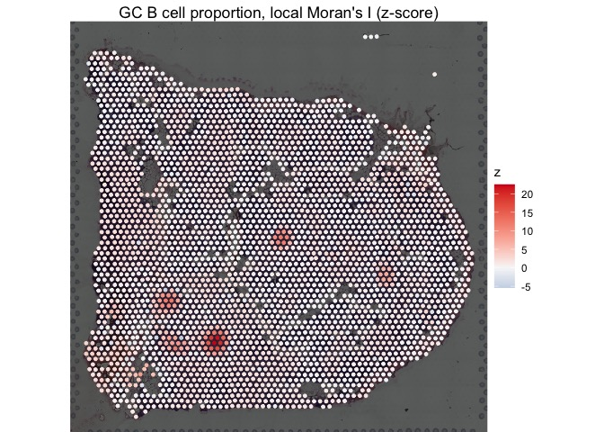
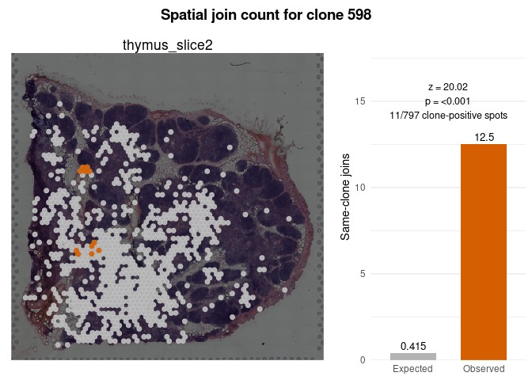

Test spatial patterns of genes, cells, and clones
================

> **Time:** about 15 minutes. **Data:** MG thymus section 2, with BCRs,
> TCRs, gene expression, and cell-type estimates, bundled with SIRUP.
> **Needs:** SIRUP with spdep, scoper, and spatstat.explore,
> spatstat.geom, and spatstat.random.

A map can suggest that a gene clusters or that a clone stays in one
place. A spatial statistic tests whether the pattern is stronger than
chance. In this page you run five such tests on one myasthenia gravis
(MG) thymus section. A *spot* is one capture location of the spatial
assay. A *clone* is a group of receptors that descend from one ancestor
cell.

| Question | Function | Statistic |
|----|----|----|
| Does one variable cluster in space? | `spatialMoran()` | Global Moran’s I |
| Where are the clusters? | `spatialLocalMoran()` | Local Moran’s I |
| Do two variables have the same spatial pattern? | `spatialLee()` | Lee’s L |
| Are spots of type A near spots of type B? | `spatialRipleyCrossK()` | Ripley’s cross K |
| Do the spots of one clone sit next to each other? | `spatialCloneJoinCount()` | Join count |

`spatialCloneSpread()` adds a sixth measure. It reports how far each
clone spreads across a section. For help with the choice of test, see
[Choose a spatial statistic](choose-spatial-statistic.md).

Each function accepts a SIRUP object. It reads the spot coordinates and
the image settings from the object.

## Set up the object

Load the packages, then build one BCR object and one TCR object from the
example data.

``` r
library(SIRUP)
library(dplyr)
library(ggplot2)
```

``` r
extdata <- system.file("extdata", package = "SIRUP")
read_receptors <- function(file, locus) {
  airr::read_rearrangement(file.path(extdata, file)) %>%
    extractSpatialIds(
      id = "sequence_id",
      spatial_id = "barcode_10x",
      regex = ",([ACGT]{16})$",
      suffix = "-1"
    ) %>%
    filterAirr(
      locus_val = locus,
      min_v_length = 250,
      min_j_length = 30,
      min_junction_length = 10,
      productive_only = TRUE,
      min_consensus_count = NULL,
      spatial_id = "barcode_10x"
    ) %>%
    filter(!grepl("[^ACGT]", junction))
}

thymus <- readRDS(file.path(extdata, "mg_thymus_slice2_spatial.rds"))

cell_types <- data.table::fread(
  file.path(extdata, "mg_thymus_cell_types.csv.gz"),
  data.table = FALSE
) %>%
  filter(sample == "mg_thymus_slice2")
rownames(cell_types) <- cell_types$barcode
thymus <- Seurat::AddMetaData(thymus, select(cell_types, -sample, -barcode))

bcr_sirup <- createSIRUP(
  spatial = thymus,
  receptors = read_receptors("mg_thymus_slice2_bcr.tsv.gz", "IGH"),
  spatial_id = "barcode_10x",
  image_scale = "lowres",
  swap_coords = FALSE,
  polygons_path = file.path(extdata, "mg_thymus_slice2_gc_polygons.csv")
)
#> filterAirr kept 2195 of 3801 rows (dropped 1606).
bcr_sirup <- updateReceptors(
  bcr_sirup,
  scoper::hierarchicalClones,
  threshold = 0.1,
  summarize_clones = FALSE,
  nproc = 1
)
#> Running defineClonesScoper in bulk mode and only keep heavy chains

tcr_sirup <- createSIRUP(
  spatial = thymus,
  receptors = read_receptors("mg_thymus_slice2_tcr.tsv.gz", "TRB"),
  spatial_id = "barcode_10x",
  image_scale = "lowres",
  swap_coords = FALSE
)
#> filterAirr kept 3718 of 7915 rows (dropped 4197).
tcr_sirup <- updateReceptors(
  tcr_sirup,
  scoper::identicalClones,
  summarize_clones = FALSE,
  nproc = 1
)
#> Running defineClonesScoper in bulk mode and only keep heavy chains
```

`read_receptors()` reads a consensus table. It takes the spot barcode
from `sequence_id`. It keeps the high-quality sequences of one locus
that have an unambiguous junction. BCR clones come from
`scoper::hierarchicalClones()`. TCRs do not mutate, so TCR clones come
from `scoper::identicalClones()`. The cell-type table holds the
estimated proportion of each cell type in each spot. The proportions
come from the cell2location method and join the Seurat metadata. The BCR
object also holds the polygons that mark the ectopic germinal centers
(eGCs). [Draw tissue regions and measure clonal dominance and diversity](regions.md) explains polygons.

## Choose the neighbors

Most of these statistics compare each spot with its neighbors. You
choose the neighbors in one of two ways:

- `k`: the `k` nearest spots. Use `k = 6` for standard Visium, where
  each spot has six neighbors on a hexagonal grid. Use `k = 8` for
  Visium HD, where each bin has eight neighbors on a square grid. A
  larger `k` measures patterns over larger distances.
- `radius`: all spots within a distance. SIRUP measures distances in
  image pixels at the stored `image_scale`. The same distance in
  micrometers needs a different number at `"lowres"` and at `"hires"`.

> **Tip.** `k` does not depend on the image scale. Use it as the
> default.

## Test one variable with global Moran’s I

*Moran’s I* measures spatial autocorrelation. It asks whether
neighboring spots have similar values.

$$I = \frac{N}{W} \frac{\sum_i \sum_j w_{ij}(x_i - \bar{x})(x_j - \bar{x})}{\sum_i (x_i - \bar{x})^2}$$

Here $x_i$ is the value at spot $i$. $w_{ij}$ is 1 if spot $j$ is a
neighbor of spot $i$, and 0 if not. $N$ is the number of spots. $W$ is
the sum of all $w_{ij}$. $I$ near 0 means no spatial pattern. Positive
$I$ means that similar values cluster. Negative $I$ means that values
alternate, as on a chessboard.

`variable_type` tells SIRUP what `variable` is:

- `"feature"`: a gene, from the assay and layer you give.
- `"metadata"`: a numeric spot metadata column. For a text column, give
  `value` to test the spots that have that value.
- `"receptor"`: 1 for spots with any receptor and 0 for other spots.
  `variable` is a label only.
- `"clone"`: 1 for spots with the clone that `variable` names.

``` r
aicda <- spatialMoran(
  bcr_sirup,
  variable = "AICDA",
  variable_type = "feature",
  assay = "Spatial",
  layer = "data",
  k = 6
)
aicda$test
#> 
#>  Moran I test under randomisation
#> 
#> data:  dat$value  
#> weights: listw    
#> 
#> Moran I statistic standard deviate = 6.0618, p-value = 6.731e-10
#> alternative hypothesis: greater
#> sample estimates:
#> Moran I statistic       Expectation          Variance 
#>      5.944121e-02     -3.123048e-04      9.716874e-05
```

The result is a list. `test` is the `spdep::moran.test()` result. It
holds the statistic, its expected value under no spatial pattern, the
variance, and the p value. For *AICDA* (a marker of germinal center B
cells), $I$ is small, about 0.06. The p value is below $10^{-9}$. The
assay detects *AICDA* in few spots, and most spots have a count of zero.
The clustering is weak, but chance is a poor explanation for it. Read
$I$ for the size of the pattern and the p value for the evidence.

The same function tests cell-type proportions and receptor presence:

``` r
moran_table <- bind_rows(
  tibble(variable = "AICDA expression", I = aicda$test$estimate[[1]], p = aicda$test$p.value),
  {
    res <- spatialMoran(bcr_sirup, variable = "GC B", variable_type = "metadata", k = 6)
    tibble(variable = "GC B cell proportion", I = res$test$estimate[[1]], p = res$test$p.value)
  },
  {
    res <- spatialMoran(bcr_sirup, variable = "BCR", variable_type = "receptor", k = 6)
    tibble(variable = "BCR present", I = res$test$estimate[[1]], p = res$test$p.value)
  },
  {
    res <- spatialMoran(tcr_sirup, variable = "TCR", variable_type = "receptor", k = 6)
    tibble(variable = "TCR present", I = res$test$estimate[[1]], p = res$test$p.value)
  }
)
moran_table
#> # A tibble: 4 × 3
#>   variable                  I         p
#>   <chr>                 <dbl>     <dbl>
#> 1 AICDA expression     0.0594 6.73e- 10
#> 2 GC B cell proportion 0.623  0        
#> 3 BCR present          0.417  0        
#> 4 TCR present          0.332  1.31e-238
```

The GC B cell proportion has a stronger cluster, with $I$ near 0.62. The
cell2location estimate is smooth and has no zeros from sampling. A p
value of 0 means a value below the smallest number that R can store.

Moran’s I accepts binary variables, such as receptor presence. The
join-count test below suits clones better.

## Find clusters with local Moran’s I

Global Moran’s I gives one number for the whole section. *Local Moran’s
I* (also called LISA) gives one value for each spot. A spot has a high
positive value when it and its neighbors have similar values. The
z-score shows how far the value is from the value expected by chance.

``` r
gc_b_local <- spatialLocalMoran(
  bcr_sirup,
  variable = "GC B",
  variable_type = "metadata",
  k = 6
)
head(gc_b_local[, c("cell", "value", "local_i", "z_i", "p_value")])
#>                 cell  value    local_i       z_i     p_value
#> 1 AAACAAGTATCTCCCA-1 0.0556 0.42119564 1.8775350 0.060444809
#> 2 AAACACCAATAACTGC-1 0.0492 0.02554433 0.1780355 0.858695126
#> 3 AAACAGCTTTCAGAAG-1 0.0128 0.67548360 2.1434191 0.032079462
#> 4 AAACAGGGTCTATATT-1 0.0149 0.44557822 1.5436247 0.122679267
#> 5 AAACAGTGTTCCTGGG-1 0.0251 0.10316582 0.6444111 0.519308914
#> 6 AAACATGGTGAGAGGA-1 0.0915 2.05891309 3.0435870 0.002337758
```

`plotSpatialLocalMoran()` draws the z-scores on the tissue. Red spots
sit in clusters of similar values. Blue spots differ from their
neighbors:

``` r
plotSpatialLocalMoran(
  bcr_sirup,
  gc_b_local,
  point_size = 1,
  title = "GC B cell proportion, local Moran's I (z-score)"
) +
  labs(color = "z")
```



The clusters of high GC B cell proportion sit at the eGC polygons. Each
spot has its own p value. Correct for multiple testing before you call a
spot significant. For example, use `p.adjust(method = "BH")`.

## Compare two variables with Lee’s L

*Lee’s L* combines Pearson correlation with spatial smoothing. It is
high when two variables are high in the same neighborhoods. The
variables need not peak in the same spots.

In MG, patients make antibodies against the acetylcholine receptor
(AChR). *CHRNA1* codes for the AChR alpha subunit, and thymic myoid
cells express it. This test asks whether *CHRNA1* and the germinal
center marker *AICDA* share a spatial pattern. *MS4A1* (CD20) gives a
positive control, because GC B cells express both *MS4A1* and *AICDA*:

``` r
lee_control <- spatialLee(
  bcr_sirup,
  x = "AICDA", y = "MS4A1",
  assay = "Spatial", layer = "data", k = 6
)
lee_chrna1 <- spatialLee(
  bcr_sirup,
  x = "AICDA", y = "CHRNA1",
  assay = "Spatial", layer = "data", k = 6
)

tibble(
  pair = c("AICDA and MS4A1", "AICDA and CHRNA1"),
  L = c(lee_control$L, lee_chrna1$L),
  p = c(lee_control$test$p.value, lee_chrna1$test$p.value)
)
#> # A tibble: 2 × 3
#>   pair                    L        p
#>   <chr>               <dbl>    <dbl>
#> 1 AICDA and MS4A1   0.0975  2.17e-49
#> 2 AICDA and CHRNA1 -0.00171 5.66e- 1
```

The control pair shares a pattern. *AICDA* and *CHRNA1* do not. In this
section, $L$ for that pair is near zero and the test is not significant.

> **Note.** The analytical test (`method = "analytical"`) builds a dense
> matrix with one entry for each pair of spots. This works for Visium.
> For Visium HD, use `method = "mc"`. It uses permutations and sparse
> weights.

## Test two spot types with Ripley’s cross K

*Ripley’s cross K* counts, for each distance $r$, how many type B points
lie within $r$ of an average type A point:

$$K_{AB}(r) = \frac{|W|}{N_A N_B} \sum_{i \in A} \sum_{j \in B} \mathbf{1}(d_{ij} \le r)$$

$|W|$ is the area of the tissue window. $d_{ij}$ is the distance between
points $i$ and $j$. SIRUP compares the observed curve with curves from
random relabeling of the points. If the observed curve is above the
envelope of the random curves, A and B sit closer than chance.

T follicular helper (Tfh) cells give B cells the signals that keep a
germinal center going. This test asks whether spots with GC B cells sit
near spots with Tfh cells. First, label each spot from its cell2location
proportions. `updateSpatial()` runs a function on the Seurat object and
stores the result:

``` r
bcr_sirup <- updateSpatial(bcr_sirup, function(spatial) {
  gc_b <- spatial$`GC B` > 0.10
  tfh <- spatial$Tfh > 0.10
  spatial$gc_tfh_mark <- case_when(
    gc_b & !tfh ~ "GC B",
    tfh & !gc_b ~ "Tfh",
    TRUE ~ NA_character_
  )
  spatial
})

table(getSpatial(bcr_sirup)$gc_tfh_mark, useNA = "ifany")
#> 
#> GC B  Tfh <NA> 
#>   76  211 2916
```

Spots with neither cell type, or with both, get `NA`. The test leaves
them out. Then run the test. `nsim` sets the number of random
relabelings. Use 99 or more for a final analysis:

``` r
gc_tfh_k <- spatialRipleyCrossK(
  bcr_sirup,
  mark_col = "gc_tfh_mark",
  i = "GC B",
  j = "Tfh",
  nsim = 39,
  max_r = 40
)

plotRipleyCrossK(gc_tfh_k, title = "Cross K: GC B spots to Tfh spots")
```


The distance $r$ is in image pixels at the stored `image_scale`. To
convert it to micrometers, use the Visium spot size. A spot is 55 µm
wide. The image object stores the spot diameter in full-resolution
pixels:

``` r
scale_factors <- getSpatial(bcr_sirup)@images[[1]]@scale.factors
um_per_pixel <- 55 / (scale_factors$spot * scale_factors$lowres)
um_per_pixel
#> [1] 11.7135
max(gc_tfh_k$plot_data$r) * um_per_pixel
#> [1] 468.5401
```

The value `max_r = 40` lowres pixels is about 470 µm.

In this section, the observed curve lies below the envelope at every
distance. Random relabeling keeps the marked spots in place and shuffles
the labels. A curve below the envelope means that GC B spots sit next to
other GC B spots more often than next to Tfh spots. The same holds for
Tfh spots. The two cell types form separate groups at the 10% threshold.
The rule that drops spots with both cell types adds to the separation.
Change the thresholds or the marks to ask a different question.

## Test whether a clone stays together with join counts

The join-count test suits a clone. Take every spot with a BCR. Mark the
spots that have the clone. Count the neighbor pairs in which both spots
have the clone. Each pair is a “join”. If the clone stays in one place,
the section has more joins than random labeling gives.

`spatialCloneJoinCount()` runs `spdep::joincount.test()` for each clone
that occurs in at least `min_spatial_ids` spots. If the object has
stored polygons, the function runs one test for each polygon by default.
Set `use_stored_polygons = FALSE` for one test over the whole section:

``` r
big_clones <- getReceptors(bcr_sirup) %>%
  filter(!is.na(barcode_10x)) %>%
  distinct(clone_id, barcode_10x) %>%
  count(clone_id, sort = TRUE) %>%
  slice_head(n = 5) %>%
  pull(clone_id)

join_count <- spatialCloneJoinCount(
  bcr_sirup,
  clone_val = big_clones,
  use_stored_polygons = FALSE,
  k = 6,
  return_data = TRUE
)

join_count$summary
#>   clone_id         image polygon n_spatial_ids n_clone_spatial_ids
#> 1      598 thymus_slice2     all           797                  11
#> 2      288 thymus_slice2     all           797                  27
#> 3       34 thymus_slice2     all           797                  66
#> 4       64 thymus_slice2     all           797                  10
#> 5      196 thymus_slice2     all           797                  27
#>   observed_join_count expected_join_count   variance statistic      p_value
#> 1                12.5           0.4145729  0.3644266 20.019673 1.855757e-89
#> 2                30.0           2.6457286  2.2476408 18.245749 1.118248e-74
#> 3                67.5          16.1683417 12.6054484 14.457931 1.117067e-47
#> 4                 5.5           0.3391960  0.2987982  9.441226 1.842208e-21
#> 5                15.5           2.6457286  2.2476408  8.574011 4.997114e-18
#>                                   method radius k alternative
#> 1 Join count test under nonfree sampling     NA 6     greater
#> 2 Join count test under nonfree sampling     NA 6     greater
#> 3 Join count test under nonfree sampling     NA 6     greater
#> 4 Join count test under nonfree sampling     NA 6     greater
#> 5 Join count test under nonfree sampling     NA 6     greater
```

The summary has one row for each clone. `statistic` is the standardized
join count (a z-score). `p_value` is the one-sided p value.
`plotSpatialCloneJoinCount()` shows the clone and its joins. The plot
needs `return_data = TRUE` in the test:

``` r
plotSpatialCloneJoinCount(
  join_count = join_count,
  object = bcr_sirup,
  clone_val = join_count$summary$clone_id[[1]],
  show_neighbors = TRUE
)
```



## Measure how far a clone spreads

`spatialCloneSpread()` describes how far each clone reaches across the
section. It uses the pairwise distances between the sequences of the
clone:

``` r
spread <- spatialCloneSpread(bcr_sirup, min_spatial_ids = 3)
spread %>%
  arrange(desc(n_spatial_ids)) %>%
  head()
#> # A tibble: 6 × 5
#>   sample  clone_id n_spatial_ids mean_pairwise_distance max_pairwise_distance
#>   <chr>   <chr>            <int>                  <dbl>                 <dbl>
#> 1 spatial 34                  86                   66.2                 397. 
#> 2 spatial 288                 42                  123.                  304. 
#> 3 spatial 196                 38                  156.                  395. 
#> 4 spatial 739                 16                   21.5                  75.1
#> 5 spatial 810                 14                   80.0                 263. 
#> 6 spatial 907                 14                   54.2                 120.
```

The table gives the mean and the maximum pairwise distance for each
clone, in image pixels. By default, sequences in the same spot count as
separate points at distance 0. Set `collapse_within_spot = TRUE` to
count each spot once.

## Keep the results

Store the results in the object, so they travel with the data:

``` r
bcr_sirup <- bcr_sirup %>%
  setAnalysis("moran_aicda", aicda) %>%
  setAnalysis("local_moran_gc_b", gc_b_local) %>%
  setAnalysis("lee_aicda_chrna1", lee_chrna1) %>%
  setAnalysis("clone_join_count", join_count) %>%
  setAnalysis("clone_spread", spread)
listAnalyses(bcr_sirup)
#> [1] "moran_aicda"      "local_moran_gc_b" "lee_aicda_chrna1" "clone_join_count"
#> [5] "clone_spread"
```

## Next steps

- Pick a test from your question:
  [Choose a spatial statistic](choose-spatial-statistic.md).
- Draw regions and compare their repertoires:
  [Draw tissue regions and measure clonal dominance and diversity](regions.md).
- Build lineage trees for the clones that you found:
  [Call clones and build lineage trees on the tissue](clones-and-trees.md).
- Run the tests on several sections:
  [Analyze several sections with bulk AIRR-seq and blood](multisample.md).
