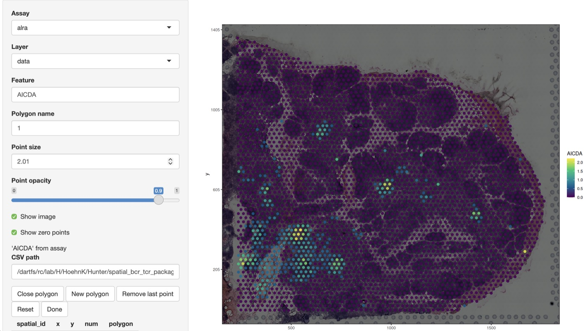

```{r, include = FALSE}
knitr::opts_chunk$set(
  collapse = TRUE,
  comment = "#>",
  fig.width = 7,
  fig.height = 5,
  dpi = 96,
  dev = "jpeg",
  dev.args = list(quality = 90),
  out.width = "100%"
)
```

SIRUP (Spatial Immune Receptor Utilities Package) is an R package for
spatial adaptive immune receptor repertoire sequencing (spAIRR-seq). It works
with B cell receptor (BCR) and T cell receptor (TCR) sequences that carry a
spatial barcode, together with spatial gene expression from the same tissue
section.

SIRUP covers three stages:

1. **Process.** Turn demultiplexed long reads into consensus receptor
   sequences in an AIRR table, with one spatial ID per sequence. See
   `vignette("processing", package = "SIRUP")`.
2. **Integrate.** Put the receptor table and the spatial Seurat object into
   one SIRUP object. This vignette starts here.
3. **Analyze and visualize.** Draw tissue regions, measure clonal dominance and
   diversity, test spatial association, and plot lineage trees on the tissue.

This vignette takes about 15 minutes. It shows the SIRUP object, the main
plots, and a first regional analysis. The other vignettes go deeper:

| Vignette | Topic |
|---|---|
| `vignette("processing", package = "SIRUP")` | Reads to AIRR tables with IgBLAST and pRESTO |
| `vignette("regions", package = "SIRUP")` | Tissue regions, clonal dominance, and diversity |
| `vignette("spatial-statistics", package = "SIRUP")` | Moran's I, Lee's L, Ripley's cross K, join counts |
| `vignette("clones-and-trees", package = "SIRUP")` | Clones, germlines, and lineage trees on the tissue |
| `vignette("multisample", package = "SIRUP")` | Several sections, bulk AIRR-seq, and blood |

## Installation

Install SIRUP from GitHub:

```{r install, eval = FALSE}
if (!requireNamespace("remotes", quietly = TRUE)) install.packages("remotes")
if (!requireNamespace("SIRUP", quietly = TRUE)) remotes::install_github("hoehnlab/SIRUP")
```

SIRUP uses Seurat objects for spatial expression. SIRUP installs the packages
that most analysis functions need. These include packages from the Immcantation
framework (such as dowser, scoper, and alakazam) and from the spatial
statistics community (such as spdep). A few packages are optional. The
vignettes use them. This code installs only the optional packages that you do
not have yet:

```{r install-suggests, eval = FALSE}
packages <- c("spatstat.explore", "spatstat.geom", "spatstat.random", "pals")
missing <- packages[!vapply(packages, requireNamespace, logical(1), quietly = TRUE)]
if (length(missing) > 0) install.packages(missing)
```

The processing step also needs command-line tools: IgBLAST, pRESTO, vsearch,
and MUSCLE. The airrblast R package, which SIRUP installs, runs IgBLAST. You need them only to process raw reads. The
processing vignette tells you how to set them up.

## The example data

SIRUP includes a small spAIRR-seq data set from the thymus of a patient with
myasthenia gravis (MG). The thymus in MG can contain ectopic germinal centers
(eGCs): germinal centers that form outside the lymph nodes and tonsils. The
data come from two 10x Visium sections of the same thymus. Each 55 µm spot
can hold several cells.

The files are in the package `extdata` folder:

```{r files}
extdata <- system.file("extdata", package = "SIRUP")
list.files(extdata)
```

| File | Contents |
|---|---|
| `mg_thymus_slice*_spatial.rds` | Seurat object for each section: every spot, a panel of genes, and a lowres H&E image |
| `mg_thymus_slice*_bcr.tsv.gz` | IGH consensus sequences of each section, as `processSpatialSample()` wrote them |
| `mg_thymus_slice2_tcr.tsv.gz` | TRB consensus sequences of section 2 |
| `mg_thymus_bulk_*.tsv.gz` | Bulk BCR-seq of the thymus, and of blood at the thymectomy and 12 months later (a subset) |
| `mg_thymus_slice*_gc_polygons.csv` | Hand-drawn outlines of the eGCs in each section |
| `mg_thymus_cell_types.csv.gz` | cell2location cell-type proportions for each spot |
| `mg_thymus_slice2_reads.tsv.gz` | A sample of read-level IgBLAST output for the processing vignette |

The receptor files are AIRR rearrangement tables from the SIRUP paper. To keep
the package small, the Seurat objects hold a few hundred genes and a reduced
H&E image.

This vignette uses section 2 only. The multi-sample vignette uses both
sections and the bulk data.

```{r libraries, message = FALSE, warning = FALSE}
library(SIRUP)
library(dplyr)
library(ggplot2)
```

```{r load-data}
thymus <- readRDS(file.path(extdata, "mg_thymus_slice2_spatial.rds"))
thymus

bcrs <- airr::read_rearrangement(file.path(extdata, "mg_thymus_slice2_bcr.tsv.gz"))
bcrs %>%
  select(sequence_id, v_call, j_call, c_call, consensus_count) %>%
  head()
```

Each row is one BCR sequence. The pipeline wrote the spot barcode into 
`sequence_id`, after the
comma. `extractSpatialIds()` copies it into its own column, and the `suffix`
argument adds `-1` so that it matches the spot names in the Seurat object:

```{r spatial-ids}
bcrs <- extractSpatialIds(
  bcrs,
  id = "sequence_id",
  spatial_id = "barcode_10x",
  regex = ",([ACGT]{16})$",
  suffix = "-1"
)

head(colnames(thymus))
mean(bcrs$barcode_10x %in% colnames(thymus))
```

A few sequences have a barcode that is not in the Seurat object. The spot was
off the tissue or failed the expression QC. SIRUP keeps these rows in the
table, but it cannot put them on the tissue.

Keep the high-quality sequences. These are the thresholds from the SIRUP
paper (see `vignette("processing", package = "SIRUP")`):

```{r filter}
bcrs <- filterAirr(
  bcrs,
  locus_val = "IGH",
  min_v_length = 250,
  min_j_length = 30,
  min_junction_length = 10,
  productive_only = TRUE,
  min_consensus_count = NULL,
  spatial_id = "barcode_10x"
)
bcrs <- filter(bcrs, !grepl("[^ACGT]", junction))
```

The last line removes the few sequences with an ambiguous base (such as `N`)
in the junction. scoper, which calls the clones below, needs junctions of
`A`, `C`, `G`, and `T` only.

## Create a SIRUP object

`createSIRUP()` joins the spatial data and the receptor table. You tell it
which receptor columns hold the spatial ID, the locus, and (when you have
them) the clone and a count or weight:

```{r create}
sirup <- createSIRUP(
  spatial = thymus,
  receptors = bcrs,
  spatial_id = "barcode_10x",
  locus = "locus",
  image_scale = "lowres",
  swap_coords = FALSE,
  metadata = list(tissue = "MG thymus", section = "slice 2")
)

sirup
```

A SIRUP object is a list with five parts:

| Part | Contents | Accessor |
|---|---|---|
| `spatial` | The Seurat object | `getSpatial()` |
| `receptors` | The AIRR table, as a tibble | `getReceptors()` |
| `metadata` | Field names, image settings | `x$metadata` |
| `polygons` | Tissue regions, one row per polygon | `getPolygons()` |
| `analyses` | Any results you choose to keep | `getAnalysis()` |

SIRUP records the field names once. After that, SIRUP functions find the
spatial ID, clone, and locus columns without more arguments. Your column names
do not need to match a convention.

`createSIRUP()` validates the object while building.

### Call clones

A clone is a group of B cells that descend from one ancestor cell. Many SIRUP
functions summarize receptors by clone. SIRUP does not call clones itself.
`updateReceptors()` runs a function on the receptor table and puts the result
back in the object. Here it runs `scoper::hierarchicalClones()`, with the
threshold from the SIRUP paper:

```{r call-clones}
sirup <- updateReceptors(
  sirup,
  scoper::hierarchicalClones,
  threshold = 0.1,
  summarize_clones = FALSE,
  nproc = 1
)
sirup
```

The receptor table now has a `clone_id` column, and SIRUP records it as the
clone field. If your clone column has another name, such as
`clone_family_id`, give `clone = "clone_family_id"` to `createSIRUP()`.

### Image settings

Two settings control how SIRUP puts spots on the H&E image:

* `image_scale` tells SIRUP which scale factor to use. Use `"lowres"` or
  `"hires"` to match the image stored in the Seurat object. `Load10X_Spatial()`
  stores the lowres image by default. The example objects store a lowres
  image.
* `swap_coords` swaps the x and y coordinates. Some older Seurat objects store
  the coordinates in the opposite order to the image. If your spots form the
  right shape but sit rotated or mirrored over the H&E, set
  `swap_coords = TRUE`.

The object stores both settings. Every plot and spatial statistic reads them
from the object, so you set them once.

## Look inside the object

`summary()` gives counts for each part:

```{r summary}
summary(sirup)
```

The accessors return ordinary objects. You can give them to any function from
another package:

```{r accessors}
getSpatial(sirup)

getReceptors(sirup) %>%
  count(c_call, sort = TRUE) %>%
  head()
```

`spatialReceptorSummary()` gives a short report of a receptor table:

```{r receptor-summary}
spatialReceptorSummary(getReceptors(sirup), spatial_id = "barcode_10x")
```

## Plot expression and receptors on the tissue

`spatialExpressionPlot()` draws gene expression over the H&E image. By default
it hides spots with zero expression, so the tissue stays visible.

*AICDA* marks germinal center B cells. The example objects have two assays:
`Spatial` (counts and log-normalized data) and `alra` (ALRA-imputed values for
a panel of marker genes). Imputed values give smoother maps. Use them for
display only, not for statistics.

```{r expression}
spatialExpressionPlot(
  sirup,
  features = "AICDA",
  assay = "alra",
  layer = "data",
  title = "AICDA",
  zero_tol = 0
) + labs(title = "Look it's a ggplot")
```

`plotReceptors()` draws receptor-positive spots. The `group` argument names
the receptor column that sets the color. Here every row has the locus `IGH`,
so all BCR-positive spots get one color:

```{r receptors}
plotReceptors(
  sirup,
  group = "locus",
  colors = "#0072B2",
  receptor_size = 1.2,
  title = "BCR-positive spots"
)
```

Use `group_val` to show only some values of the group column. This plot shows
the three largest clones in the section:

```{r clones}
top_clones <- getReceptors(sirup) %>%
  count(clone_id, sort = TRUE) %>%
  slice_head(n = 3) %>%
  pull(clone_id)
top_clones

plotReceptors(
  sirup,
  group = "clone_id",
  group_val = top_clones,
  receptor_size = 1.6,
  title = "Three largest BCR clones"
)
```

A Visium spot can hold BCRs from more than one clone. When two selected clones
share a spot, `plotReceptors()` gives the spot a combined label, with the
clone IDs joined by ` + `. The `overlap` argument controls this behavior.

`plotReceptorsExpression()` combines the two plots. Spots with expression are
filled points. Receptor-positive spots are hollow rings on top:

```{r receptors-expression}
plotReceptorsExpression(
  sirup,
  group = "locus",
  gene = "AICDA",
  assay = "alra",
  layer = "data",
  colors = "skyblue3",
  receptor_size = 1.2,
  feature_size = 2,
  title = "AICDA expression and BCR-positive spots"
)
```

## Add tissue regions

Most spatial questions are about regions: a germinal center, a tumor margin,
a lesion. In SIRUP a region is a polygon on the tissue image.

`selectSpatialPolygons()` opens an app in which you draw polygons over the
tissue. We drew the eGCs over imputed *AICDA* expression, which marks germinal
center B cells:

```{r select-polygons, eval = FALSE}
gc_vertices <- selectSpatialPolygons(
  sirup,
  feature = "AICDA",
  assay = "alra",
  layer = "data",
  plot_image = TRUE,
  save_path = "mg_thymus_slice2_gc_polygons.csv"
)
```

```{r polygon-app, eval = TRUE, echo = FALSE, out.width = "100%"}

```

Click around the edge of a region. Each click snaps to the nearest spot, and
**Close polygon** joins the last vertex to the first:

```{r polygon-clicks, eval = TRUE, echo = FALSE, out.width = "30%", fig.show = "hold"}
knitr::include_graphics(c(
  "figures/polygon-click-1.png",
  "figures/polygon-click-2.png",
  "figures/polygon-closed.png"
))
```

When you click **Done**, the app returns the vertices of every polygon and
writes them to the CSV file.

`addPolygons()` attaches polygons to the object. Give it the data frame from
the app (`polygons = gc_vertices`) or the CSV file (`polygons_path`). It then
annotates every spot and every receptor with the polygon that contains it. The
example data include the eGC polygons that we drew for the SIRUP paper:

```{r polygons}
sirup <- addPolygons(
  sirup,
  polygons_path = file.path(extdata, "mg_thymus_slice2_gc_polygons.csv")
)

getPolygons(sirup)

plotSpatialPolygons(sirup, polygon_alpha = 0.3, 
                    label_outside = TRUE, label_offset = 0.02,
                    label_color = "white", label_leader = FALSE)
```

The receptor table now has a `polygon_id` column. Receptors outside every
polygon get `NA`:

```{r polygon-column}
getReceptors(sirup) %>%
  count(polygon_id)
```

## A first regional analysis

`polygonReceptorSummary()` counts the receptors, spots, and clones in each
polygon. It stores the result in the object as an analysis:

```{r polygon-summary}
sirup <- polygonReceptorSummary(sirup, polygon_id = "polygon_id")
getAnalysis(sirup, "polygon_receptor_summary")
```

Clonal dominance asks how much of each region the largest clones take up.
`spatialCloneDominance()` computes the fraction of each polygon's receptors
that belongs to each clone. `plotSpatialPolygonPies()` draws one pie chart per
polygon next to the tissue:

```{r dominance, fig.width = 9, fig.height = 6}
dominance <- spatialCloneDominance(object = sirup)

dominance$dominance %>%
  group_by(polygon) %>%
  slice_max(proportion, n = 1, with_ties = FALSE) %>%
  select(polygon, clone_id, n_receptors, proportion)

pies <- plotSpatialPolygonPies(
  dominance = dominance,
  object = sirup,
  fill = "clone_id",
  top_n = 5
)
pies$page_1
```

The function returns one plot per page, with six pies on each page. The
`top_n` argument sets how many clones get their own color in each pie. The
other clones go into the grey `Other` slice.

The eGCs in this section are polyclonal. In the larger eGCs, the largest clone
holds 13% to 17% of the BCRs.

## Change the data with your own functions

SIRUP does not wrap every AIRR tool. Instead, three functions let you run any
function on one part of the object and put the result back:

* `updateReceptors(x, fun, ...)` calls `fun(getReceptors(x), ...)` and stores
  the returned table.
* `updateSpatial(x, fun, ...)` calls `fun(getSpatial(x), ...)` and stores the
  returned Seurat object.
* `updateAnalysis(x, name, fun, ...)` does the same for a stored analysis.

Each function validates the object again before it returns. For example,
`updateReceptors()` with `dplyr::filter()` keeps only the class-switched
IgG sequences:

```{r update-receptors}
igg <- updateReceptors(sirup, dplyr::filter, grepl("^IGHG", c_call))
nrow(getReceptors(igg))
```

The same pattern runs germline reconstruction (`dowser::createGermlines()`)
or mutation counting (`shazam::observedMutations()`) inside the object. The clones vignette shows
these steps.

`updateSpatial()` works the same way for the Seurat object. This call adds the
cell2location cell-type proportions as spot metadata:

```{r update-spatial}
cell_types <- data.table::fread(
  file.path(extdata, "mg_thymus_cell_types.csv.gz"),
  data.table = FALSE
)
cell_types <- filter(cell_types, sample == "mg_thymus_slice2")
rownames(cell_types) <- cell_types$barcode
cell_types <- select(cell_types, -sample, -barcode)

sirup <- updateSpatial(sirup, Seurat::AddMetaData, metadata = cell_types)

spatialExpressionPlot(
  sirup,
  features = "GC B",
  zero_tol = 0.05,
  title = "GC B cell proportion (cell2location)"
)
```

`spatialExpressionPlot()` accepts genes and numeric spot metadata columns.
`zero_tol` hides spots at or below a value. Here it hides spots with less
than 5% GC B cells.

## Keep results with the data

`setAnalysis()` stores any R object under a name. Stored results stay with the
data that produced them, so you do not need to track separate files:

```{r analyses}
sirup <- setAnalysis(sirup, "gc_dominance", dominance)
listAnalyses(sirup)
```

`saveSIRUP()` writes the object to one RDS file. `readSIRUP()` reads it back,
validates it, and upgrades objects that an older SIRUP version saved:

```{r save-read}
path <- file.path(tempdir(), "mg_thymus_slice2.sirup.rds")
saveSIRUP(sirup, path)
sirup <- readSIRUP(path)
sirup
```

## Next steps

* To process your own reads, read `vignette("processing", package = "SIRUP")`.
* To draw regions and compare their repertoires, read
  `vignette("regions", package = "SIRUP")`.
* To test spatial patterns, read
  `vignette("spatial-statistics", package = "SIRUP")`.
* To build lineage trees and show them on the tissue, read
  `vignette("clones-and-trees", package = "SIRUP")`.
* To combine sections, bulk BCR-seq, and blood, read
  `vignette("multisample", package = "SIRUP")`.
