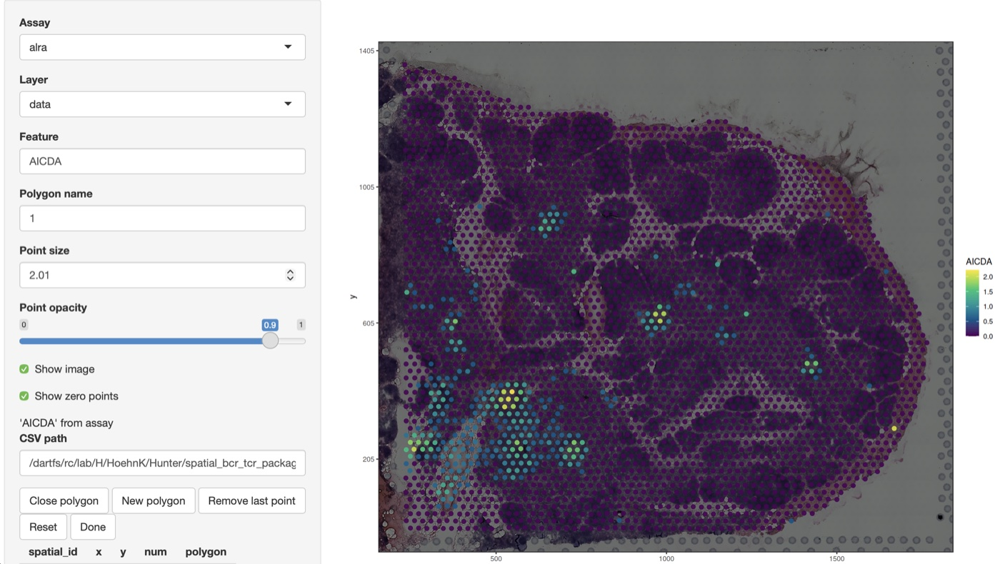

```{r, include = FALSE}
knitr::opts_chunk$set(
  collapse = TRUE,
  comment = "#>",
  fig.width = 7,
  fig.height = 5,
  dpi = 96,
  dev = "jpeg",
  dev.args = list(quality = 90),
  out.width = "100%"
)
```

<div markdown="1" style="background: #F7E5BC; padding: 12px; margin-bottom: 24px; line-height: 24px;">
  <b>Time</b>: ~15 minutes. 
  <b>Data</b>: example MG thymus data in SIRUP.
</div>

Here, we will build a SIRUP object from example data and run a few simple analyses.

<div markdown="1" style="background: #9e584a; padding: 12px; margin-bottom: 24px; line-height: 24px;">
  <p style="margin: -12px -12px 12px; padding: 6px 12px; background: #8b3620; color: #ffffff; font-weight: 700;"> <b>Note</b> </p>
  This page starts after read processing. If you have raw or demultiplexed reads, see `vignette("processing", package = "SIRUP")` first.
</div>

## Install SIRUP

Install SIRUP and its dependencies from GitHub with BiocManager:

```{r install, eval = FALSE}
if (!requireNamespace("BiocManager", quietly = TRUE)) install.packages("BiocManager")
BiocManager::install("hoehnlab/SIRUP")
```

This vignette uses a few of SIRUP's suggested packages as well. Run the code below to install any that are missing:

```{r install-suggests, eval = FALSE}
packages <- c("spatstat.explore", "spatstat.geom", "spatstat.random", "pals")
missing <- packages[!vapply(packages, requireNamespace, logical(1), quietly = TRUE)]
if (length(missing) > 0) install.packages(missing)
```

## Look at the example data

SIRUP includes an example spAIRR-seq data set from the thymus of a patient with
myasthenia gravis (MG). The thymus in MG can contain ectopic germinal centers
(eGCs) where B cells undergo affinity maturation. 
The data were generated with 10x Visium for spatial transcriptomics and barcodes, 
then RAGE-seq + long-read Oxford Nanopore sequencing to amplify BCRs/TCRs and
sequence them.

This vignette uses these files:

| File | Contents |
|---|---|
| `mg_thymus_slice2_spatial.rds` | A spatial Seurat object for MG thymus |
| `mg_thymus_slice2_bcr.tsv.gz` | AIRR rearrangement table of IGH sequences with spatial IDs |
| `mg_thymus_slice2_gc_polygons.csv` | Annotated polygons of the eGCs |
| `mg_thymus_cell_types.csv.gz` | Cell-type proportions for each spot |

The files are in the `extdata` folder of the package. This code finds the folder:

```{r extdata}
extdata <- system.file("extdata", package = "SIRUP")
```

The SIRUP paper describes how the authors made these files. To reduce file sizes,
each Seurat object holds a few hundred genes and a reduced image.

```{r libraries, message = FALSE, warning = FALSE}
library(SIRUP)
library(dplyr)
library(ggplot2)
```

## Load the spatial GEX data and the receptors

Read the Seurat object and the AIRR table:

```{r load-data}
thymus <- readRDS(file.path(extdata, "mg_thymus_slice2_spatial.rds"))
thymus

bcrs <- airr::read_rearrangement(file.path(extdata, "mg_thymus_slice2_bcr.tsv.gz"))
bcrs %>%
  select(sequence_id, v_call, j_call, c_call, sequence_alignment) %>%
  head()
```

Each row is one BCR sequence. The processing pipeline wrote the spatial ID at
the end of `sequence_id`, after a comma.

## Match each sequence to a spot

`extractSpatialIds()` is a convenience function to extract the spatial ID and put it 
into its own column. The `regex` argument finds the spatial ID. The `suffix` argument 
adds `-1`, so that each spatial ID matches a spot name in the Seurat object.

```{r spatial-ids}
bcrs <- extractSpatialIds(
  bcrs,
  id = "sequence_id",
  spatial_id = "barcode_10x",
  regex = ",([ACGT]{16})$",
  suffix = "-1"
)

head(colnames(thymus))
mean(bcrs$barcode_10x %in% colnames(thymus))
```

A few sequences have a spatial ID that is not in the Seurat object. The spot was likely
off the tissue or failed the expression quality control. SIRUP will maintain these receptor sequences
in the integrated SIRUP object, but it will not be able to place them in spatial plots.

## Filter the sequences

Keep only the high-quality sequences. The thresholds used are discussed in
`vignette("processing", package = "SIRUP")`.

```{r filter}
bcrs <- filterAirr(
  bcrs,
  locus_val = "IGH",
  min_v_length = 250,
  min_j_length = 30,
  min_junction_length = 10,
  productive_only = TRUE,
  min_consensus_count = NULL,
  spatial_id = "barcode_10x"
)
```

## Create a SIRUP object

`createSIRUP()` joins the Seurat object and the receptor table. Tell it which
receptor column holds the spatial ID and which holds the locus. You can also 
specify the image scale and coordinate settings when constructing the object, 
which are discussed further below.

```{r create}
sirup <- createSIRUP(
  spatial = thymus,
  receptors = bcrs,
  spatial_id = "barcode_10x",
  locus = "locus",
  image_scale = "lowres",
  swap_coords = FALSE,
  metadata = list(tissue = "MG thymus", section = "slice 2")
)

sirup

summary(sirup)
```

If a `spatial_id`, `locus`, and/or `clone` column are specified when constructing the SIRUP object,
later functions can find these columns without including them as arguments.

Two settings control how SIRUP constructs plots over the H&E image:

* `image_scale` is `"lowres"` or `"hires"`. Use the image that tge Seurat
  object stores. `Load10X_Spatial()` stores the low-resolution image by default, 
  though it can use the high-resolution image if specified in the `image.name` argument.
* `swap_coords` swaps the x and y coordinates. Set it to `TRUE` if the spots
  have the right shape but sit rotated or mirrored over the image. This is easiest to
  determine by plotting the spots as shown below.

```{r check-swapcoords}
coords <- SeuratObject::GetTissueCoordinates(thymus)
ggplot(coords, aes(x, y)) + geom_point() 
```

If both arguments are included when constructing the SIRUP object, they will be stored in the object, 
and plotting functions will automatically use them. If they are not specified when constructing the 
SIRUP object, both settings should be passed to any plotting functions.

<div markdown="1" style="background: #9e584a; padding: 12px; margin-bottom: 24px; line-height: 24px;">
  <p style="margin: -12px -12px 12px; padding: 6px 12px; background: #8b3620; color: #ffffff; font-weight: 700;"> <b>Note</b> </p>
  `vignette("sirup-object", package = "SIRUP")` discusses the SIRUP object in more detail.
</div>


## Building clones in the SIRUP object

A clone is a group of cells that descend from a common ancestor. Many SIRUP
functions work with clone-level data, but SIRUP does not itself build clones. 
The `updateReceptors()` function is a method that can runs any function on 
the receptor table and updates the receptor table in the object with the result. 
This call runs `hierarchicalClones()` from the `scoper` package.

```{r call-clones}
sirup <- updateReceptors(
  sirup,
  scoper::hierarchicalClones,
  threshold = 0.1,
  summarize_clones = FALSE,
  nproc = 1
)
sirup
```

The receptor table now has a `clone_id` column, and SIRUP records it as the
clone field in the object automatically. 

## Plot gene expression and receptors on the tissue

`spatialExpressionPlot()` plots gene expression over the H&E image. By default,
it hides spots with zero expression to help the tissue stay visible, though 
this can be turned off by setting `zero_tol = -Inf`.

The example object has two assays:
`Spatial` (counts and log-normalized data) and `alra` (ALRA-imputed values), which
can help improve visualization. *AICDA* is a marker for germinal center B cells, and
it is plotted below. 

```{r expression}
spatialExpressionPlot(
  sirup,
  features = "AICDA",
  assay = "alra",
  layer = "data",
  title = "AICDA",
  zero_tol = 0,
  point_alpha = 0.5
)
```

`plotReceptors()` plots all spots that have a receptor. The `group` argument
is the receptor column that determines the color. All BCRs here are IGH, so 
they all are colored the same.

```{r receptors}
plotReceptors(
  sirup,
  group = "locus",
  colors = "#0072B2",
  receptor_size = 1.2,
  title = "BCR-positive spots"
)
```

To restrict a receptors plot to a set with only a particular value of the `group` column,
use the `group_val` argument. This plot includes only the three largest IGH clones.

```{r clones}
top_clones <- getReceptors(sirup) %>%
  count(clone_id, sort = TRUE) %>%
  slice_head(n = 3) %>%
  pull(clone_id)
top_clones

plotReceptors(
  sirup,
  group = "clone_id",
  group_val = top_clones,
  overlap = "average",
  receptor_size = 1.6,
  title = "Three largest clones"
)
```

Because this data was generated with 10X Visium spatial sequencing, each spot
likely contains multiple cells. Resultingly, sequences from distinct groups may
share a spot. By default, `plotReceptors()` gives the spot a combined label and 
averages the colors of the two groups. The `overlap` argument controls this
behavior.

`plotReceptorsExpression()` combines the two plots. Spots with gene expression are
filled points. Spots with a receptor have a hollow ring on top:

```{r receptors-expression}
plotReceptorsExpression(
  sirup,
  group = "locus",
  gene = "AICDA",
  assay = "alra",
  layer = "data",
  colors = "#0072B2",
  receptor_size = 1.3,
  feature_size = 2,
  title = "AICDA expression and BCR-positive spots"
)
```

## *In silico* micro-dissection of ROIs

Many spatial questions concern a particular region, such as a germinal center, a tumor
margin, or a lesion. `selectSpatialPolygons()` opens an app where users can draw polygons
over regions of interest using the H&E image and gene expression (e.g., *AICDA*) or 
spatial object metadata.


```{r select-polygons, eval = FALSE}
gc_vertices <- selectSpatialPolygons(
  sirup,
  feature = "AICDA",
  assay = "alra",
  layer = "data",
  plot_image = TRUE,
  save_path = "mg_thymus_slice2_gc_polygons.csv"
)
```

```{r polygon-app, eval = TRUE, echo = FALSE, out.width = "100%"}

```

Click around the edge of a region. Each click snaps to the nearest spot.
**Close polygon** joins the last vertex to the first:

```{r polygon-clicks, eval = TRUE, echo = FALSE, out.width = "30%", fig.show = "hold"}
knitr::include_graphics(c(
  "figures/polygon-click-1.png",
  "figures/polygon-click-2.png",
  "figures/polygon-closed.png"
))
```

After you click **Done**, the app returns the vertices of every polygon. It
writes them to the CSV file at `save_path` (which can be changed using the CSV path in the app).

`addPolygons()` attaches polygons to the object. Give it the data frame from the
app (`polygons = gc_vertices`) or the CSV file (`polygons_path`). SIRUP then determines
which polygons, if any, contain each spot and each receptor. The example data
include the annotated eGC polygons from the SIRUP paper. 

```{r polygons}
sirup <- addPolygons(
  sirup,
  polygons_path = file.path(extdata, "mg_thymus_slice2_gc_polygons.csv")
)

getPolygons(sirup)

getPolygons(sirup)$vertices[[1]]
```

Plot the polygons over the H&E image with `plotSpatialPolygons()`.

```{r plot-spatial-polygons}
plotSpatialPolygons(
  sirup,
  polygon_alpha = 0.3,
  label_outside = TRUE,
  label_offset = 0.02,
  label_color = "white",
  label_leader = FALSE
)
```

The receptor table now has a `polygon_id` column. Receptors outside every
polygon get `NA`:

```{r polygon-column}
getReceptors(sirup) %>%
  count(polygon_id)
```

## Determine which clones dominate the polygons

`polygonReceptorSummary()` counts the receptors, spots, and clones in each
polygon. It stores the result in the object as an analysis.

```{r polygon-summary}
sirup <- polygonReceptorSummary(sirup, polygon_id = "polygon_id")
getAnalysis(sirup, "polygon_receptor_summary")
```

Clonal dominance measures how much of a region the largest clones fill.
`spatialCloneDominance()` computes the fraction of the receptors in each polygon
that belongs to each clone. `plotSpatialPolygonPies()` draws one pie chart (or stacked bar chart) for
each polygon next to the tissue.

```{r dominance, fig.width = 9, fig.height = 6}
dominance <- spatialCloneDominance(object = sirup)

dominance$dominance %>%
  group_by(polygon) %>%
  slice_max(proportion, n = 1, with_ties = FALSE) %>%
  select(polygon, clone_id, n_receptors, proportion)

pies <- plotSpatialPolygonPies(
  dominance = dominance,
  object = sirup,
  fill = "clone_id",
  top_n = 5
)
pies$page_1
```

The function returns one plot for each page, with six pies on a page. The
`top_n` argument sets how many clones get their own color in each pie. The grey
`Other` slice holds the remaining clones.

`vignette("regions", package = "SIRUP")` covers ROIs in more detail.

## Save an analysis in a SIRUP object

`setAnalysis()` stores analysis within the SIRUP object. Stored analyses can
be accessed with `getAnalysis()`.

```{r analyses}
sirup <- setAnalysis(sirup, "gc_dominance", dominance)
listAnalyses(sirup)

getAnalysis(sirup, "gc_dominance") %>% str(max.level = 1)
```

The stored result is a list. Its `dominance` item is the table of clone fractions.
The other items hold the spots, coordinates, receptors, and polygon vertices of each
region, and the field names that the function used.

## Save and read a SIRUP object

`saveSIRUP()` writes the object to one RDS file. `readSIRUP()` reads it back and validates it.

```{r save-read}
path <- file.path(tempdir(), "mg_thymus_slice2.sirup.rds")
saveSIRUP(sirup, path)
sirup <- readSIRUP(path)
sirup
```

## Next steps

* To learn more about the structure of the SIRUP object see
  `vignette("sirup-object", package = "SIRUP")`.
* To compare ROIs in the tissue, see `vignette("regions", package = "SIRUP")`.
* To build lineage trees and visualize them on the tissue, read
  `vignette("clones-and-trees", package = "SIRUP")`.
* To test spatial patterns, read
  `vignette("spatial-statistics", package = "SIRUP")`.
* To process your own reads, read `vignette("processing", package = "SIRUP")`.
