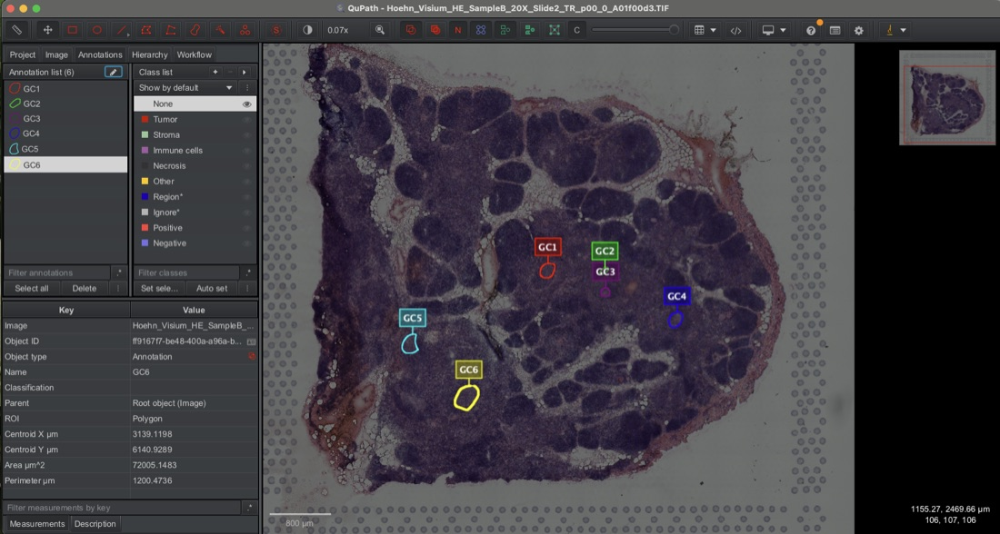
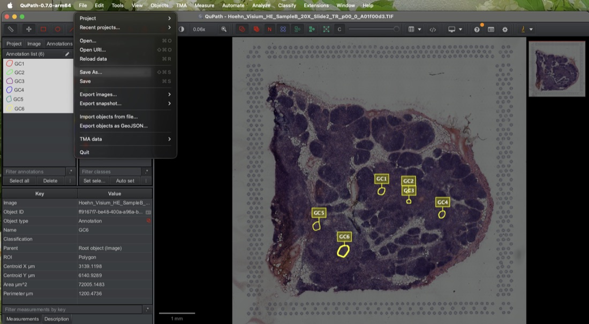

```{r, include = FALSE}
knitr::opts_chunk$set(
  collapse = TRUE,
  comment = "#>",
  fig.width = 7,
  fig.height = 5,
  dpi = 96,
  dev = "jpeg",
  dev.args = list(quality = 90),
  out.width = "100%"
)
```

<div markdown="1" style="background: #F7E5BC; padding: 12px; margin-bottom: 24px; line-height: 24px;">
  <p style="margin: -12px -12px 12px; padding: 6px 12px; background: #d6b676; color: #ffffff; font-weight: 700;"> <b>Note</b> </p>
  **Time:** ~5 minutes.<br>
  **Data:** consensus BCRs and spatial gene expression from one myasthenia gravis (MG) thymus section, downloaded with `downloadSIRUPExample()`. The download also holds six germinal center (GC) outlines that a user drew in QuPath.<br>
  **Needs:** SIRUP with its Suggests packages airr, jsonlite, and sf.
</div>

A *polygon* is a closed outline around spots on the H&E image. You can draw polygons in SIRUP with `selectSpatialPolygons()`. You can also draw them in [QuPath](https://qupath.github.io), a free program for tissue images. A pathologist can outline regions there at full resolution. This page shows how to export those outlines from QuPath and add them to a SIRUP object that has no polygons yet. For what to do with polygons afterward, see `vignette("regions", package = "SIRUP")`.

## Draw and export the annotations in QuPath

1. Open the full-resolution H&E image in QuPath. It must be the same image that the spots were registered to.
2. Draw one annotation for each region. Close every outline. SIRUP reads only closed polygons. Give each annotation a name, such as `GC1`. The name becomes the polygon ID in SIRUP. A classification, such as `GC`, also works.

```{r qupath-annotations, echo = FALSE}

```

3. Select the annotations. Choose `File > Export objects as GeoJSON...`. The menu name can differ a little between QuPath versions.

```{r qupath-menu, echo = FALSE}

```

4. In the dialog, export the selected objects. Keep `Export as FeatureCollection` checked. Click `OK` and save the file.

```{r qupath-dialog, echo = FALSE}
knitr::include_graphics("figures/qupath-export-dialog.jpg")
```

QuPath writes the coordinates in pixels of the full-resolution image. SIRUP converts them for you.

## Build an object without polygons

This page uses the example files of the MG thymus. This code downloads them. The default folder is temporary. The function skips files that are already there.

```{r download-data}
extdata <- SIRUP::downloadSIRUPExample(
  dest = file.path(tempdir(), "SIRUP_example"),
  files = c(
    "mg_thymus_slice2_spatial.rds",
    "mg_thymus_slice2_bcr.tsv.gz",
    "mg_thymus_slice2_qupath_gcs.geojson"
  )
)
```

The next chunk builds a SIRUP object from the spatial data and the BCRs. It gives no polygons. `vignette("get-started", package = "SIRUP")` explains each step.

```{r setup, message = FALSE, warning = FALSE}
library(SIRUP)
library(dplyr)

thymus <- readRDS(file.path(extdata, "mg_thymus_slice2_spatial.rds"))
bcrs <- airr::read_rearrangement(file.path(extdata, "mg_thymus_slice2_bcr.tsv.gz")) %>%
  extractSpatialIds(
    id = "sequence_id",
    spatial_id = "barcode_10x",
    regex = ",([ACGT]{16})$",
    suffix = "-1"
  ) %>%
  filterAirr(
    locus_val = "IGH",
    min_v_length = 250,
    min_j_length = 30,
    min_junction_length = 10,
    productive_only = TRUE,
    min_consensus_count = NULL,
    spatial_id = "barcode_10x"
  ) %>%
  filter(!grepl("[^ACGT]", junction))

sirup <- createSIRUP(
  spatial = thymus,
  receptors = bcrs,
  spatial_id = "barcode_10x",
  image_scale = "lowres",
  swap_coords = FALSE
)
nrow(getPolygons(sirup))
```

## Add the annotations

The download holds the GeoJSON file that the screenshots show. Give `addQuPathPolygons()` the object and the path of your own file.

```{r add-polygons}
geojson <- file.path(extdata, "mg_thymus_slice2_qupath_gcs.geojson")
sirup <- addQuPathPolygons(sirup, geojson)
getPolygons(sirup)
```

The function takes `image_scale` (`"lowres"` here) from the object. It stores one polygon for each annotation, named after the annotation. Each spot and each receptor record now has a `polygon_id`.

```{r count-spots}
table(getSpatial(sirup)$polygon_id, useNA = "ifany")
```

`plotSpatialPolygons()` draws the polygons over the tissue. Always make this plot. It shows at once if the annotations and the spots do not line up.

```{r plot-polygons}
plotSpatialPolygons(sirup, polygon_alpha = 0.3)
```

## What the function does

- **Scale.** QuPath pixels are full-resolution pixels. The function finds the factor that converts them to the coordinates of the object, for the `image_scale` of the object. If the object has no `image_scale`, you must give it.
- **Buffer.** A spot is a circle. By default, the function grows each polygon by the spot radius. A spot whose circle touches the outline then counts as inside. Use `buffer = 0` to count only spots with the centre inside the outline.
- **Names and classes.** The polygon ID is the annotation name. If an annotation has no name, the ID is its class and a number, such as `GC_01`. Use `class = "GC"` to keep only one class.
- **Holes.** A SIRUP polygon has one ring and cannot have holes. The function drops holes and gives a warning. A shape with several parts becomes one polygon for each part.
- **Existing polygons.** The function adds to the polygons that the object already holds. Use `replace = TRUE` to replace them. A multi-sample object needs `sample_id`, and only the polygons of that sample change.

To read the annotations without changing an object, use `readQuPathPolygons()`.
