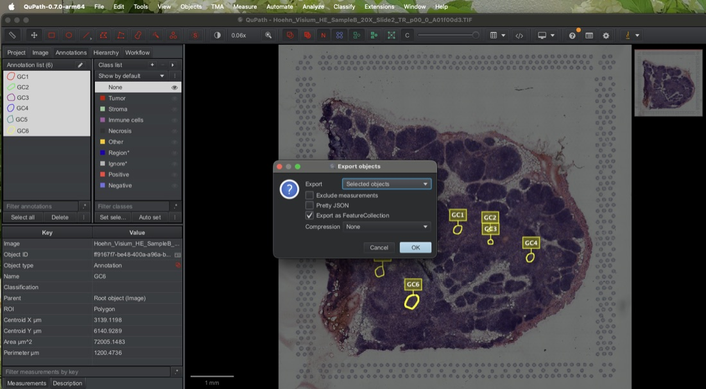

```{r, include = FALSE}
knitr::opts_chunk$set(
  collapse = TRUE,
  comment = "#>",
  fig.width = 7,
  fig.height = 5,
  dpi = 96,
  dev = "jpeg",
  dev.args = list(quality = 90),
  out.width = "100%"
)
```

<div markdown="1" style="background: #F7E5BC; padding: 12px; margin-bottom: 24px; line-height: 24px;">
  <p style="margin: -12px -12px 12px; padding: 6px 12px; background: #d6b676; color: #ffffff; font-weight: 700;"> <b>Note</b> </p>
  **Time:** ~5 minutes.<br>
  **Data:** The example SIRUP object and the QuPath exported GeoJSON polygons file.
</div>

Here, we will add polygons that were drawn in [QuPath](https://qupath.github.io) to a SIRUP object.

Regions of interest (ROIs), or polygons, can be drawn in SIRUP with `selectSpatialPolygons()` (see `vignette("regions", package = "SIRUP")`).
Pathologists often draw ROIs in QuPath, a free program for working with tissue images. SIRUP can read exported QuPath
polygon annotations (if exported as a GeoJSON) and add them to a SIRUP object.

## Load the example object

This code downloads a saved SIRUP object for MG thymus section 2, which is slightly too big to come directly with the package,
and the QuPath exported polygons. Change `dest` to a whatever folder you wish to save the example data in.
To see how the object was built, see `vignette("get-started", package = "SIRUP")`.

```{r download-data}
extdata <- SIRUP::downloadSIRUPExample(
  dest = file.path(tempdir(), "SIRUP_example"),
  files = c(
    "mg_thymus_slice2_brighter.sirup.rds",
    "mg_thymus_slice2_qupath_gcs.geojson"
  )
)
```

```{r setup, message = FALSE, warning = FALSE}
library(SIRUP)

sirup <- readSIRUP(file.path(extdata, "mg_thymus_slice2_brighter.sirup.rds"))
```

## Draw and export the annotations in QuPath

If you would like to draw the annotations in QuPath yourself, follow these steps. We do not recommend choosing this route
rather than using `selectSpatialPolygons()` in SIRUP in general, as QuPath does not natively incorporate gene expression data,
and we have found that going from continuous outlines in QuPath to polygon vertices in SIRUP does not always work perfectly.
Nevertheless, if you have a very large region that is easy to outline solely with H&E, or if you have a pathologist who
is more comfortable drawing in QuPath, this can be a good option.

1. Open the full-resolution H&E image in QuPath. It must be the same image that the spatial data were registered to.
  Look for a full-resolution TIFF image.
2. Draw one annotation for each region, and be sure to close every outline. Give each annotation a name, such as `GC1`.
  The name becomes the polygon ID in SIRUP. A classification, such as `GC`, would also work.

```{r qupath-annotations, echo = FALSE}
knitr::include_graphics("figures/qupath-annotations.jpg")
```

3. Select the annotations and choose `File > Export objects as GeoJSON...`. The menu name can differ a little between QuPath versions.

```{r qupath-menu, echo = FALSE}
knitr::include_graphics("figures/qupath-export-menu.jpg")
```

4. In the dialog, export the selected objects and keep `Export as FeatureCollection` checked. Click `OK` and save the file.

```{r qupath-dialog, echo = FALSE}

```

QuPath writes the coordinates in pixels of the full-resolution image. SIRUP will automatically convert them to the 
coordinates of the object, which are set as `image_scale` in the object.

## Add the annotations to the object

Use `addQuPathPolygons()` to add the exported annotations to the SIRUP object, just as you would add polygons drawn
using SIRUP with `addPolygons()`. The function reads the GeoJSON file, converts the coordinates to the scale of the object,
stores the polygons in the SIRUP object, and adds a `polygon_id` to the `spatial` metadata and `receptors` table(s).

```{r add-polygons, message = FALSE}
geojson <- file.path(extdata, "mg_thymus_slice2_qupath_gcs.geojson")
sirup <- addQuPathPolygons(sirup, geojson)
getPolygons(sirup)
table(getSpatial(sirup)$polygon_id)
```


## Plot the polygons on the tissue

`plotSpatialPolygons()` draws the polygons over the H&E image. It is worth making this plot every time, because it shows right away if the annotations and the
spots do not line up.

```{r plot-polygons}
plotSpatialPolygons(sirup, polygon_alpha = 0.3, label_color = "black")
```

## Check how the function converts the annotations

`addQuPathPolygons()` has several options and subtleties, which are worth checking if the polygons you add to the object 
do not line up correctly.

* **Scale.** QuPath pixels are full-resolution pixels. The function finds the factor that converts them to the coordinates
  of the object, for the `image_scale` of the object. If the object has no `image_scale`, it must be given.
* **Buffer.** A spot is a 2D circle, so by default the function expands each polygon by the spot radius. A spot whose circle
 touches the outline then counts as inside. Use `buffer = 0` to count only spots with center inside the outline (this is
 not recommended).
* **Names and classes.** The polygon ID is the annotation name. If an annotation has no name, the ID is its class and a number, such as `GC_01`.
  Use `class = "GC"` to keep only the GC class.
* **Holes and multipart polygons.** A SIRUP polygon has one ring and cannot have holes, so the function drops holes in QuPath polygons
 and gives a warning. A multipart polygon becomes one polygon for each part. 
* **Existing polygons.** By default, the function adds to the polygons that the object already holds. Use `replace = TRUE`
  to replace them. A multi-sample object needs you to pass `sample_id`, and only the polygons of that sample change.

To read the annotations without attaching them to an object, use `readQuPathPolygons()`.

## Next steps

* To compare ROIs in the tissue, see `vignette("regions", package = "SIRUP")`.
* To build lineage trees and visualize them on the tissue, read `vignette("clones-and-trees", package = "SIRUP")`.
* To add more sections or bulk AIRR-seq, see `vignette("multisample", package = "SIRUP")`.
* To test spatial patterns, read `vignette("choose-spatial-statistic", package = "SIRUP")`.
