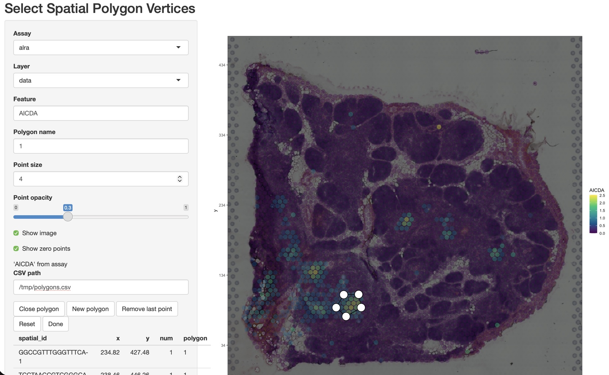

```{r, include = FALSE}
knitr::opts_chunk$set(
  collapse = TRUE,
  comment = "#>",
  fig.width = 7,
  fig.height = 5,
  dpi = 96,
  dev = "jpeg",
  dev.args = list(quality = 90),
  out.width = "100%"
)
has_rgl <- requireNamespace("rgl", quietly = TRUE)
# The rgl widget needs HTML output. Markdown copies show the code only.
show_rgl <- has_rgl && knitr::is_html_output(
  excludes = c("gfm", "markdown", "markdown_github", "commonmark")
)
```

<div markdown="1" style="background: #F7E5BC; padding: 12px; margin-bottom: 24px; line-height: 24px;">
  <p style="margin: -12px -12px 12px; padding: 6px 12px; background: #d6b676; color: #ffffff; font-weight: 700;"> <b>Note</b> </p>
  **Time:** ~15 minutes.<br>
  **Data:** The example SIRUP object, plus its polygon file.<br>
</div>

Here, we will select regions of interest (ROIs) on a tissue section, attach them to a SIRUP object, and examine the 
BCR repertoire in each region. 

## Load the example object

This code downloads a saved SIRUP object for MG thymus section 2, which is slightly too big to come directly with the package,
and the polygon file for the section. Change `dest` to a whatever folder you wish to save the example data in.
To see how the object was built, see `vignette("get-started", package = "SIRUP")`.

```{r download-data, message = FALSE}
extdata <- SIRUP::downloadSIRUPExample(
  dest = file.path(tempdir(), "SIRUP_example"),
  files = c(
    "mg_thymus_slice2_brighter.sirup.rds",
    "mg_thymus_slice2_gc_polygons.csv"
  )
)
```

```{r setup, message = FALSE, warning = FALSE}
library(SIRUP)
library(dplyr)
library(ggplot2)

sirup <- readSIRUP(file.path(extdata, "mg_thymus_slice2_brighter.sirup.rds"))
sirup
```

## Draw regions

In SIRUP, select ROIs using the `selectSpatialPolygons()` function, which opens a Shiny app in the web browser.
The app shows spots over the H&E image, colored by a gene or a metadata column in the spatial gex data. 
Click to select the vertices of a region, then click 
**Close polygon** to join the last vertex to the first. Click **New polygon** to start the next region. When finished,
click **Done**. The app returns a table of the vertices, and it writes them to the CSV file at `save_path`.

```{r polygon-app, echo = FALSE, out.width = "100%"}

```

The panel on the left sets the assay, layer, and feature (from the spatial GEX data) that color the spots, the size
and opacity of the points, and whether to show the H&E image and the spots with zero expression. The screenshot 
shows one selected polygon.

```{r select-polygons, eval = FALSE}
gc_vertices <- selectSpatialPolygons(
  sirup,
  feature = "AICDA",
  assay = "alra",
  layer = "data",
  plot_image = TRUE,
  save_path = "mg_thymus_slice2_gc_polygons.csv"
)
```

If you're working with very large or dense data, like Visium HD these arguments can help the app respond faster:
* `show_zeros = FALSE` hides spots with zero expression, which keeps 0 spots from overwhelming the visualization.
* `downsample_n` draws fewer spots, so the app responds faster. Each click still snaps to the full set of spots.

<div markdown="1" style="background: #F7E5BC; padding: 12px; margin-bottom: 24px; line-height: 24px;">
  <p style="margin: -12px -12px 12px; padding: 6px 12px; background: #d6b676; color: #ffffff; font-weight: 700;"> <b>Tip</b> </p>
  Give a `save_path`. The CSV file is the record of the annotation, so other people can repeat the analysis without a second round of drawing.
</div>

### Draw regions on a remote server

If you are running R on a remote server, like an HPC cluster, the app cannot open a browser on your computer.
Instead, start the app on the server, then connect to it from your computer through an SSH tunnel.

1. Start R on the server. On a cluster, use an interactive session on a compute node (e.g., with `srun --pty`).
2. Run `selectSpatialPolygons()` with `launch_browser = FALSE` and a `port`. Pick a port above 1024 that nobody
   else on the server uses, e.g., 4321.
3. On your computer, open a second terminal and start the tunnel. The tunnel sends your local port to the port of 
   the app. Leave the terminal open while you draw.
4. In the browser on your computer, go to `http://127.0.0.1:4321` (or whatever port you chose).

The app runs on the server, but you see it on your computer. When you finish drawing, click **Done**. The app writes the
CSV file on the server, so provide a `save_path` that is valid there. An example call to selectSpatialPolygons() is below.
The SSH command is also shown. Change `user` and `server.example.edu` to your username and server.

```{r select-polygons-remote, eval = FALSE}
# On the server
gc_vertices <- selectSpatialPolygons(
  sirup,
  feature = "AICDA",
  assay = "alra",
  layer = "data",
  plot_image = TRUE,
  save_path = "mg_thymus_slice2_gc_polygons.csv",
  launch_browser = FALSE,
  port = 4321
)
```

```bash
# On your computer
ssh -L 4321:127.0.0.1:4321 user@server.example.edu
```

If you run R on a compute node behind a login node, the tunnel must reach the compute node. Add `host = "0.0.0.0"`
to `selectSpatialPolygons()`, so that the login node can connect to the app, and give the name of the compute node
to the tunnel:

```bash
# On your computer
ssh -L 4321:compute-node-name:4321 user@login.server.example.edu
```

<div markdown="1" style="background: #F7E5BC; padding: 12px; margin-bottom: 24px; line-height: 24px;">
  <p style="margin: -12px -12px 12px; padding: 6px 12px; background: #d6b676; color: #ffffff; font-weight: 700;"> <b>Note</b> </p>
  `host = "0.0.0.0"` lets other computers on the server network reach the app while it runs. Draw the regions, click 
  **Done**, and let the function end, so the app does not stay open. Give a `save_path` on the server, so that the CSV
  file holds the vertices after the session ends.
</div>

### Read the example polygons

The example data include the polygon file for this section. Read it in as you would any .csv file.

```{r polygon-file}
vertices <- read.csv(
  file.path(extdata, "mg_thymus_slice2_gc_polygons.csv"),
  colClasses = c(polygon = "character")
)
head(vertices)
```

Each row is one vertex. `polygon` names the region, `spatial_id` is the closest spot to where you clicked, and `x` and `y` are its
coordinates. 

Regions drawn by a pathologist in QuPath (or by you) can be added too, as shown in `vignette("qupath-annotations", package = "SIRUP")`.

## Attach ROIs to the SIRUP object

Use `addPolygons()` to attach the polygons to the SIRUP object. This function also automatically annotates the spots
and the receptors with which polygons they live in.

```{r add-polygons}
sirup <- addPolygons(
  sirup,
  polygons_path = file.path(extdata, "mg_thymus_slice2_gc_polygons.csv")
)
sirup
```

The receptor table and the Seurat metadata now have a `polygon_id` column. They also have one `TRUE`/`FALSE` column for
each polygon, such as `polygon_5`. This ensures that if you have any overlapping polygons, you can still identify which
polygon each spot or receptor belongs to.

`plotSpatialPolygons()` draws the stored polygons over the tissue.

```{r plot-polygons}
plotSpatialPolygons(sirup, polygon_alpha = 0.3)
```

Set `zoom = TRUE` to crop the image to the polygons.

```{r plot-polygons-zoom}
plotSpatialPolygons(sirup, zoom = TRUE)
```

Small polygons can crowd their labels, so set `label_outside = TRUE` to move the labels outside, each joined to its
polygon by a line. 

Most SIRUP spatial plots accept `polygons = TRUE`, which draws the stored polygons on top, as in the next plot of
BCR-positive spots.

```{r receptors-polygons}
plotReceptors(
  sirup,
  slot = "BCR",
  group = "locus",
  colors = "green",
  receptor_size = 1.2,
  receptor_alpha = 0.8,
  polygons = TRUE,
  polygon_alpha = 0.2,
  polygon_color = "white",
  polygon_linewidth = 1,
  zoom = TRUE,
  title = "BCRs and ROI outlines"
)
```

## Overlapping ROIs

ROIs can overlap, e.g., a germinal center can be drawn inside a larger follicle. To account for this, SIRUP records
 polygon membership in two ways

* `polygon_id` holds one region for each spot. If a spot is in more than one polygon, it is assigned to the polygon with the smallest area.
* `polygon_<ID>` columns hold the full membership. Each polygon has one `TRUE`/`FALSE` column.

SIRUP analyses use `polygon_id` by default for polygon membership. To use a different rule, build your own column
from the `polygon_<ID>` columns and pass your new column to the analysis functions.

To demonstrate, we will make another polygon around polygon 5. `expandPolygons()` moves each vertex away from the polygon center by
`delta`, in image pixels.

```{r nested}
expanded_5 <- vertices %>%
  filter(polygon == "5") %>%
  expandPolygons(delta = 12) %>%
  mutate(polygon = "5_expanded")

nested <- addPolygons(sirup, polygons = bind_rows(vertices, expanded_5))

getReceptors(nested, slot = "BCR") %>%
  filter(polygon_5_expanded == TRUE) %>%
  count(polygon_id, polygon_5, polygon_5_expanded)

plotSpatialPolygons(nested, polygon_val = c("5", "5_expanded"), zoom = TRUE, label = FALSE)
```

The inner polygon is polygon 5 and the outer polygon is the expanded version. Receptors in polygon 5 keep `polygon_id = "5"`,
because polygon 5 is smaller by area. Receptors in the ring around it get `polygon_id = "5_expanded"`. The `polygon_5_expanded`
column is `TRUE` for both groups.

## Count receptors in each ROI

Use `polygonReceptorSummary()` to count the receptors in each polygon. It gives one row for each polygon and also stores
the table in the object as an analysis.

```{r receptor-summary}
sirup <- polygonReceptorSummary(
  sirup,
  slot = "BCR",
  polygon_id = "polygon_id",
  include_total_spots = TRUE,
  summary_columns = c("c_call", "junction_length"),
  summary_operations = c("cat", "mean")
)

getAnalysis(sirup, "polygon_receptor_summary_BCR")
```

The default output table includes columns that count the receptors, the spots with receptors, and the clones.
The table also gives the fraction of receptors in the largest clone. `include_total_spots = TRUE` adds the
total number of spots in the polygon.

`summary_columns` and `summary_operations` can add custom summaries. Pass `summary_columns` a vector of column names in
that you want to summarize from the receptor table, and `summary_operations` a vector of operations to run on each column.
Allowed operations are `count`, `sum`, `mean`, `median`, `var`, `sd`, `min`, `max`, `any`, `all`, and `cat`.
In the table above, `mean_junction_length` is the mean junction length in each ROI.

`withPolygons()` runs any function on the receptors of each polygon. It returns a list with one result for each polygon.

```{r with-polygons}
isotypes <- withPolygons(
  sirup,
  slot = "BCR",
  function(receptors) {
    receptors %>%
      mutate(isotype = substr(c_call, 1, 4)) %>%
      count(isotype)
  }
)
isotypes[["5"]]
```

With `mode = "all_polygons"`, `withPolygons()` runs the function once on the receptors of all polygons together.

## Determine which clones dominate the ROIs

*Clonal dominance* is the fraction of the receptors in an ROI that belong to each clone.
Use `spatialCloneDominance()` to compute this for every polygon.

```{r dominance}
dominance <- spatialCloneDominance(object = sirup, slot = "BCR", locus_val = "IGH")
names(dominance)

dominance$dominance %>%
  arrange(polygon, desc(proportion)) %>%
  select(polygon, clone_id, n_receptors, proportion, v_gene_superfamily) %>%
  head(10)
```

The result is a list, and `dominance` is the main table, with one row for each clone and polygon. The other items hold
the spots, coordinates, receptors, and polygon outlines that the plot functions need. Store the result in the SIRUP object.

```{r store-dominance}
sirup <- setAnalysis(sirup, "gc_dominance", dominance)
```

By default, each receptor row counts once. Give a numeric column to `count` to weight the rows, e.g., by `consensus_count`.
Set `exclude_singletons = TRUE` to drop clones with one receptor.

### Plot clonal dominance

`plotSpatialRegionReceptors()` draws the receptors in each polygon, colored by a column. `top_n` gives a color to each
of the most common values, and the function groups the rest as `Other`.

```{r region-receptors}
plotSpatialRegionReceptors(
  dominance = dominance,
  object = sirup,
  color = "clone_id",
  top_n = 12,
  point_size = 2,
  zoom = TRUE
)
```

`plotSpatialPolygonPies()` shows each polygon as a pie chart. It has four modes.

* `"side_by_side"` (default) is a numbered map with the pie charts next to it.
* `"spatial_clipped"` fills each pie into its own polygon on the tissue. This mode needs the sf package.
* `"dominance_only"` shows the pie charts without a map.
* `"stacked_bar"` shows one stacked bar for each polygon to the right of the numbered map.

```{r pies, fig.width = 9, fig.height = 6}
pies <- plotSpatialPolygonPies(
  dominance = dominance,
  object = sirup,
  fill = "clone_id",
  top_n = 5,
  label_top_n = 1
)
pies$page_1
```

The fill column can be any column, not only the clone. `v_gene_superfamily` shows which IGHV families each region uses.
The `stacked_bar` mode plots a stacked bar chart summarizing the proportions of each value in each polygon. 

```{r bars}
plotSpatialPolygonPies(
  dominance = dominance,
  object = sirup,
  fill = "v_gene_superfamily",
  mode = "stacked_bar",
  top_n = 7
)
```

The `spatial_clipped` mode draws each pie inside its polygon, which is not recommended for small polygons as it can be
tough to see.

```{r clipped}
plotSpatialPolygonPies(
  dominance = dominance,
  object = sirup,
  fill = "clone_id",
  mode = "spatial_clipped",
  top_n = 5,
  zoom = TRUE
)
```

## Measure clonal diversity in ROIs

*Clonal diversity* describes the variety and abundance of clones in the repertoire, see
\url{https://alakazam.readthedocs.io/en/stable/vignettes/Diversity-Vignette/} for more details. We are interested in the
diversity of the clones in each ROI.

`polygonDiversity()` calls `alakazam::alphaDiversity()` with polygon as the grouping variable. `alakazam::alphaDiversity()`
resamples every polygon to the same number of receptors (to ensure comparability, since diversity is sensitive to sample size),
the size of the smallest polygon that has at least `min_n` receptors, and adds bootstrap confidence intervals. The
function excludes any ROIs with fewer than `min_n` receptors (default 10). A larger `min_n` gives less noisy
estimates but keeps fewer polygons.

```{r diversity, warning = FALSE}
sirup <- polygonDiversity(sirup, slot = "BCR", polygon_id = "polygon_id", min_n = 10, nboot = 200)
diversity <- getAnalysis(sirup, "polygon_diversity_BCR")
```

The stored analysis is one `alakazam` `DiversityCurve` object, with one curve for each polygon. Plot it with
`alakazam::plotDiversityCurve()`, which shows the 95% confidence band of each polygon.

```{r diversity-plot, fig.height = 3.5}
alakazam::plotDiversityCurve(diversity, legend_title = "ROI")
```

`summarizePolygonDiversity()` picks one `q` and stores a table with one row for each polygon. `plotSpatialPolygons()` 
can then fill each polygon by a column of any stored analysis.

```{r diversity-map}
sirup <- summarizePolygonDiversity(sirup, slot = "BCR", q = 1, analysis_name = "shannon")

plotSpatialPolygons(
  sirup,
  fill_analysis = "shannon",
  fill_column = "d",
  analysis_fill = c("#08306B", "#FFFF00"),
  polygon_alpha = 1,
  label = FALSE
) +
  labs(fill = "Hill number\n(q = 1)")
```

`analysis_fill` sets the colors for the lowest and the highest value. Polygons with too few receptors for the estimate 
are grey. 

`polygonAbundance()` works the same way for clonal rank-abundance curves. It calls `alakazam::estimateAbundance()` 
once on all polygons and stores one `AbundanceCurve`. Plot it with `alakazam::plotAbundanceCurve()`.

## Extract and compare GEX in ROIs

`seuratSubsetPolygon()` keeps the spots inside polygons and records the polygon of each spot in the Seurat metadata
under the specified column (e.g., with `metadata = "gc"`). Use it to extract the spots in each polygon and then
make comparisons. Here, we aggregate the expression of each gene in each polygon to make pseudobulk profiles.

```{r subset, message = FALSE}
gc_spots <- seuratSubsetPolygon(sirup, metadata = "gc")
gc_spots
table(gc_spots$gc)

pseudobulk <- Seurat::AggregateExpression(
  gc_spots,
  assays = "Spatial",
  group.by = "gc"
)$Spatial
pseudobulk[c("AICDA", "MS4A1", "CXCL13", "CD3E"), ]
```

<div markdown="1" style="background: #F7E5BC; padding: 12px; margin-bottom: 24px; line-height: 24px;">
  <p style="margin: -12px -12px 12px; padding: 6px 12px; background: #d6b676; color: #ffffff; font-weight: 700;"> <b>Note</b> </p>
  Seurat adds a `g` to group names that start with a number. The column for eGC 1 is `g1`.
</div>

These profiles can be given to a differential expression tool, such as limma or DESeq2.

## Measure distances between regions

`polygonCentroids()` calculates and returns the centroid of each polygon. `polygonPairwiseDistance()` returns the distance
between every pair of centroid, in image pixels (`distance`). It also divides each distance by the diagonal
of the section (`normalized_distance`), which can be used to compare sections of different sizes.

```{r distances}
polygonCentroids(sirup)
polygonPairwiseDistance(sirup) %>%
  arrange(distance) %>%
  head()
```

## Next steps

* To build lineage trees and visualize them on the tissue, read `vignette("clones-and-trees", package = "SIRUP")`.
* To add more sections or bulk AIRR-seq, see `vignette("multisample", package = "SIRUP")`.
* To test spatial patterns, read `vignette("choose-spatial-statistic", package = "SIRUP")`.
* To use QuPath annotations to define ROIs, see `vignette("qupath-annotations", package = "SIRUP")`.
